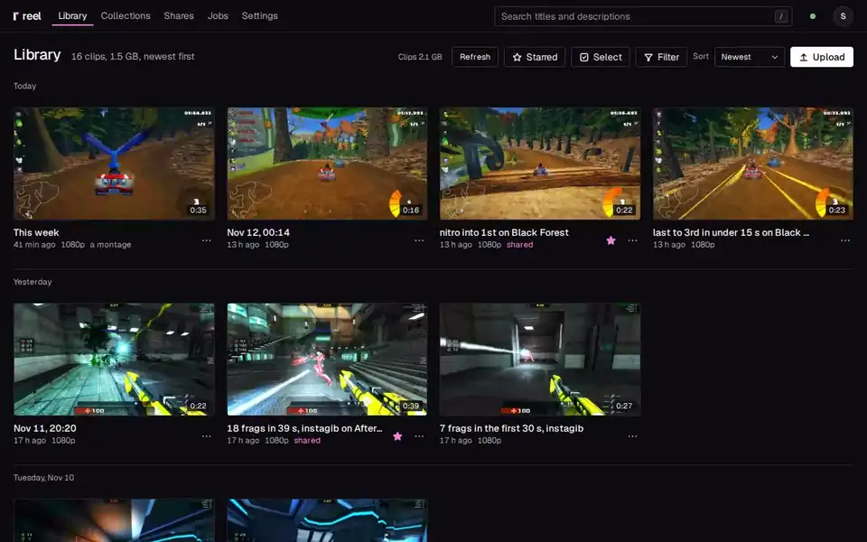
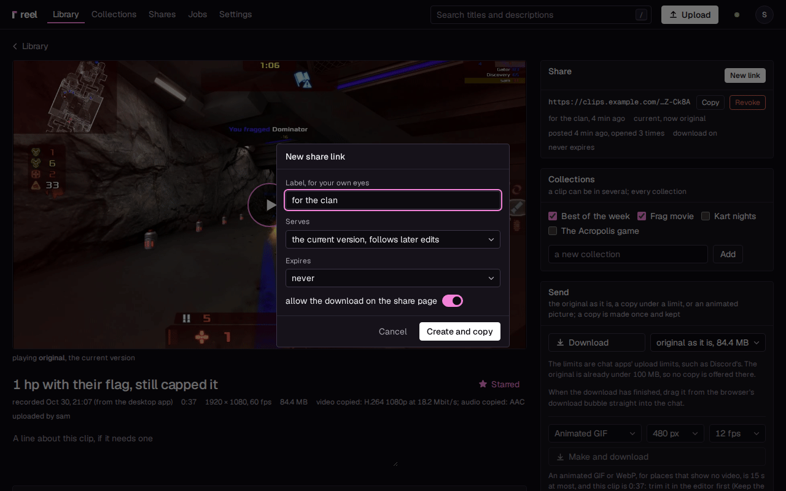

<picture>
  <source media="(prefers-color-scheme: dark)" srcset="docs/assets/wordmark.svg">
  
</picture>

**Game clips that stay yours.**

One key saves the replay and copies a link that plays right in the chat. On your own PC or
server, in full quality, with an editor that keeps every version. No account, no cloud.

reel keeps the clips OBS records in a library of your own and puts **Save and share** on a
hotkey you press in the game. Cut a clip, mix its audio tracks, make a montage or a GIF. The
app waits in the tray at 13 MB while you play.



Read the **[documentation](https://locko2901.github.io/reel/)**, start with
**[Getting started](https://locko2901.github.io/reel/getting-started/)**, or
**[download the app](https://github.com/Locko2901/reel/releases/latest)**.

## Why reel

### From game to chat in one key

- **Save and share.** One hotkey has OBS save the replay, uploads it, waits until its
  preview is ready and copies the link. A sound tells you it is on the clipboard. No window,
  no alt-tab.
- **Links that play where you paste them.** Each link is a page with the video and the tags
  chat apps read, so the chat plays it inline. reel sizes the preview so it arrives in time,
  and can serve it from your own S3 storage (Cloudflare R2's free tier covers it).
- **A first embed that works.** The link is copied only once its preview is ready, so the
  chat never caches a broken one. Old messages keep playing after you edit the clip.
- **Copies under a size** for chats that take files: 10, 20, 50, 100 or 500 MB, made once at
  the best quality that fits.

### Full quality, and an editor that keeps everything

- **The original stays as recorded.** A clip OBS saved in H.264 is never encoded again. No
  watermark, no size cap, and the download is the full file.
- **Versions, not overwrites.** Every cut is a new version beside the original, and any
  version can be made current again. A link can follow the clip's current version or stay
  pinned to one.
- **Fast, lossless cuts.** The start snaps to a keyframe, so most cuts take a second. Keep the
  last 15, 30 or 60 seconds in one click.
- **Every audio track.** Game, microphone and voice chat each get a mute and a volume, with
  loudness normalisation and a limiter.
- **Montages, fades, tall cuts and GIFs.** Join clips with crossfades, frame a cut tall (9:16)
  or square for a phone, fade in and out, or make a GIF or WebP of the best second.

### Light on your gaming PC

- **13 MB in the tray.** Closed to the tray, the app is one small process with no browser
  engine running ([measured](https://locko2901.github.io/reel/light/)).
- **OBS included and set up.** The Windows installer can bring OBS, unmodified, and set it
  up in a few steps: quality, encoder, audio tracks, noise suppression. Or the app connects
  to the OBS you already have.
- **Gentle on the game.** Uploads can pause while a game is fullscreen and keep under a
  bandwidth limit, and a dropped upload goes on where it stopped.
- **Windows and Linux.** An installer for Windows; an AppImage or a .deb for Linux.

### Yours

- **On your PC, or on your server.** The app keeps the library on your PC out of the box, no
  server needed. Add a server (one Docker container, Rust and SQLite, idling at around 20 MiB)
  when you want share links and a library your friends can use.
- **No account, no telemetry.** There is no reel service that clips or links pass through.
- **Friends and phones.** Accounts for friends, collections with one link for all their
  clips, and a web app that installs to the phone's home screen; on Android a video goes to
  reel from the gallery's share button.
- **Open source**, under the MIT licence.



## Get started

**Just the app.** Install it on your gaming PC and you have a library right there: clips
come in as OBS saves them, and you can cut them, make copies under a size and send the file.

- Windows: **reel** brings OBS and sets it up ([All in one](https://locko2901.github.io/reel/setup/all-in-one/)),
  **reel light** uses the OBS you have ([Your own OBS](https://locko2901.github.io/reel/setup/own-obs/)).
- Linux: the AppImage or the .deb ([Linux](https://locko2901.github.io/reel/setup/linux/)).

The installers are on the [releases page](https://github.com/Locko2901/reel/releases/latest).

**Add a server for links.** On a Linux machine with Docker, take
[`deploy/docker-compose.yml`](deploy/docker-compose.yml), set `REEL_PUBLIC_URL` to the
address your links will carry, and start it:

```
docker compose up -d
docker compose logs reel
```

The log prints a setup code. Put a reverse proxy with HTTPS in front, open the address, make
the first admin with the code and follow the first run. Then pair the app from the server's
Settings, Devices, **Pair a device**, and press **Save and share** (Ctrl+Alt+Shift+S) in a game.
[The server](https://locko2901.github.io/reel/setup/server/) has every step.

The image is `ghcr.io/locko2901/reel`; `latest` follows the releases.

## What it does not do

- **No feed.** No likes, no followers, no discovery. A link is seen by whoever you send it to.
- **No watermark.** Nothing is added to a frame.
- **No one else's cloud.** reel runs on your PC or your server. Link previews go to a storage
  of yours only when you turn that on.
- **No recorder of its own.** OBS records; reel takes what OBS saves.
- **No Mac app.** On a Mac, reel's pages work in the browser.

## Documentation

- [Getting started](https://locko2901.github.io/reel/getting-started/), and the
  [setup guides](https://locko2901.github.io/reel/setup/) for the app, the server, the phone
  and a library without the app
- [Sharing and links](https://locko2901.github.io/reel/sharing/),
  [the editor](https://locko2901.github.io/reel/editor/),
  [the desktop app](https://locko2901.github.io/reel/desktop-app/)
- [Updating](https://locko2901.github.io/reel/updating/),
  [backing up](https://locko2901.github.io/reel/backup/),
  [configuration](https://locko2901.github.io/reel/configuration/) (every setting and
  `REEL_` variable)
- [Troubleshooting](https://locko2901.github.io/reel/troubleshooting/) and the
  [FAQ](https://locko2901.github.io/reel/faq/)

## Contributing

Bug reports, ideas and pull requests are welcome: [CONTRIBUTING.md](CONTRIBUTING.md) says how
to build and test (`make check` needs only Docker). Please report security problems privately
([SECURITY.md](SECURITY.md)).

reel is under the [MIT licence](LICENSE), copyright Lockoo. It ships others' work under their
own licences, OBS Studio and ffmpeg among them: [THIRD_PARTY.md](THIRD_PARTY.md).
