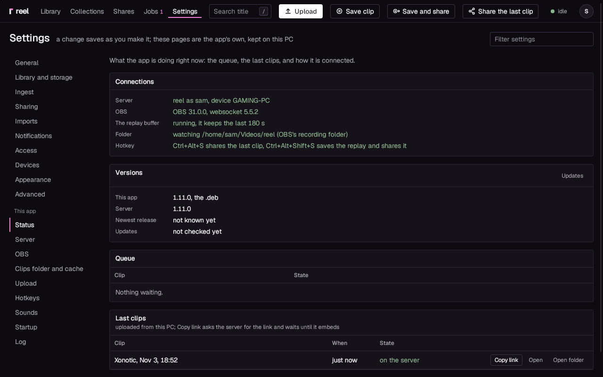
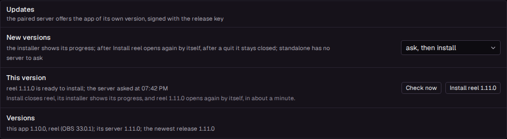
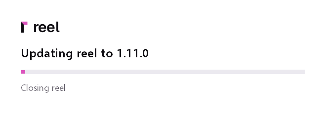

# The desktop app

The app runs on your gaming PC and lives in the tray. Every clip OBS saves goes into your library,
and the app's window shows that library with the editor, montages and everything else. Paired with
a server of your own, one key also puts a share link on your clipboard.

This page covers the app once it runs. To install it, pick a guide in
[Setting up reel](setup/index.md).

## Which download

Every installer is on [reel's releases](https://github.com/Locko2901/reel/releases), each with its
`.sha256`. A server you run offers the installers of its own version under Settings, Devices, each
with a line saying who it is for.

| Download | File | For |
|---|---|---|
| **reel, for Windows** | `reel_<version>_x64-setup.exe`, about 200 MB | a PC without OBS, or one where reel should run its own: OBS comes with the app, unmodified, and the app sets it up |
| **reel light, for Windows** | `reel-light_<version>_x64-setup.exe`, about 70 MB | a PC with OBS set up already: the app connects to that OBS |
| **reel for Linux, the AppImage** | `reel_<version>_amd64.AppImage` | any distribution, one file: make it executable and run it |
| **reel for Debian and Ubuntu, the .deb** | `reel_<version>_amd64.deb` | the same app as a package, installed with apt |

What each needs:

- **Windows**: Windows 10 or 11, 64 bit. Both installers install the same app for your Windows
  user, called reel in the Start menu and in Apps, and bring Microsoft's WebView2 along when
  Windows lacks it; reel light asks for no administrator rights, reel asks once, for its firewall
  rule. They are not code signed yet, so SmartScreen warns the first time
  ([Windows protected your PC](troubleshooting.md#windows-protected-your-pc)). One installed over
  the other keeps your settings, your library and the pairing, and its page says **Switch to reel**
  or **Switch to reel light**. reel light over reel removes the OBS that came with it, and its
  installer asks before it does ([All in one](setup/all-in-one.md#afterwards)). Settings, Startup
  names the package under **Versions**, and **About** next to the version.
- **Linux** keeps one name for both files: reel, the AppImage or the `.deb`, with the OBS you
  install yourself.
- **Linux**: a 64 bit PC with glibc 2.36 or later: Arch, Fedora, Debian 12, Ubuntu 24.04 and
  later. Ubuntu 22.04 is too old. There is no OBS inside the AppImage or the `.deb`: reel runs the
  OBS you installed from your distribution or Flathub a second time, with settings of its own, or
  connects to yours, as you choose ([Linux](setup/linux.md)). The AppImage carries what its window
  plays video and sound with (GStreamer and its plugins, its GL plugin among them, so the video
  goes to the screen without a copy); the `.deb` installs your system's (`gstreamer1.0-plugins-good`,
  `gstreamer1.0-libav` and `gstreamer1.0-gl` among them).

## Standalone or connected

The app runs in one of two modes, set under Settings, **Server**, **Mode**:

| | **standalone** | **connected** |
|---|---|---|
| The library | on this PC, inside the app | on your server |
| Sending a clip | download it, or a copy under a size, and drag the file into the chat | paste a share link, copied with one key |
| What you need | the app alone | a reel server, paired with the app |
| Hotkeys | **Save a clip** | **Save a clip**, **Save and share**, **Share the last clip**, **Upload the last clip** |

A new install starts standalone. An app that was set up before keeps its mode through an update.

In standalone, the window shows the library on this PC with the same pages a server has, minus
what only a server needs: share links (the clip page's Share, a collection's link, Copy link in a
clip's menu and in the Select bar, the Shares page), members and sign-in, the Devices page, the
public address, notifications to ntfy or a webhook, external storage, the incoming folder, the
first run and the restart. Their addresses answer "Not in standalone" with what to do instead.
Settings keeps its groups, with the pages a library on one PC has: **Recording** (the app's
five), **Library** (**Library and storage**, **Library folder**, **Ingest**, **Encoder**, **Copies
under a size**, **Imports**), **Server** (the app's **Server** page alone, for a server later) and
**System** (**General**, **Appearance**, **Startup**, **Status**, **Log**, **Advanced**).

A server can be paired while the app stays standalone: **Upload to the server** on Settings,
**Status** then sends a clip to it. [Standalone](setup/standalone.md) has the whole picture, and
how to add a server later.

## What runs, and when

- **At sign-in.** The app starts with your Windows or desktop session, hidden in the tray, without
  a window (Settings, Startup, **Start at logon**, on by default). On Windows that is a Run entry
  for your user; on Linux an entry in your desktop's autostart.
- **In the tray.** Double-click reel's icon to open the library. Its menu has the app's state,
  **Last clips** (each with **Open** and **Copy link**), **Save clip**, **Save and share**,
  **Pause recording**, **Share the last clip**, **Pause uploads**, **Open library**, **Open
  settings**, on Windows with the OBS that came with reel **Open OBS** or **Hide OBS**, and
  **Quit**. When an update is ready, **Install reel** with the new version is there too. In
  standalone the menu keeps what makes sense on one PC: the state, **Last clips** (each with
  **Open**), **Save clip**, **Pause recording**, **Open library**, **Open settings**, OBS's entry
  and **Quit**, with **Pause uploads** once a server is paired. For a tray whose icons are all one
  colour, Settings, Startup, **Tray icon** shows reel's mark alone in white or in black. On Linux,
  reel's own OBS has a tray icon of its own, which opens its window.
- **Pause recording**, in the tray and in the status chip of the window, stops OBS's replay
  buffer: OBS no longer encodes, and the buffer gives back its memory. OBS stays open, so **Resume
  recording** starts the buffer again at once. While paused, the tray, its icon's tooltip and the
  chip say **recording paused**, **Save clip** and **Save and share** are off and say why, and the
  Save hotkey saves nothing but says so. The pause lasts until you resume, or until the app starts
  again: a new start always records.
- **The window.** Closing it (the X) ends the window and the WebView that draws it; the app goes
  on in the tray, and opening the window again builds a new one in about a second. Started at
  sign-in, the app makes no window at all until you ask for one. [How light it is](light.md) has
  the numbers.
- **When a clip is in**, a notification says so. Connected, it is "Clip uploaded", with **Copy
  link** (it makes a link if the clip has none) and **Open**, which opens the clip's page in the
  window. In standalone it is "Clip in the library", with **Open**. The buttons work from Windows'
  notification centre later too, even after the app was closed: the app starts and does it. On
  Linux the buttons show where the desktop's notifications have buttons (GNOME, KDE and most
  others); elsewhere the tray has both.
- **A second start** (from the Start menu, the desktop's launcher, or the AppImage again) opens the
  window of the app that is already running. There is never a second app.
- **Quit** from the tray ends the app, and reel's own OBS with it when it runs one. The window and
  the tray icon go at once; the app stops OBS behind them within a few seconds.

## The window

The window shows reel's pages (Library, Collections, Shares, Jobs, Settings): your server's,
signed in as you, or in standalone the library on this PC, without Shares. The app adds its own
parts to the header:

- **Save clip** and **Save and share**, next to **Upload**, do what the two hotkeys do. **Save
  clip** has OBS save the replay, which goes into the library, or up to the server like any clip.
  **Save and share** (connected) also copies the clip's link once it is up. Both are off while
  OBS's replay buffer is not running, and say why: in their tooltip, or in a narrow window (600 px
  and less) in the avatar's menu, where they move to. Settings, OBS and the tray have them too.
- **Share the last clip** (connected), next to them, copies the link of the newest clip, as the
  hotkey does.
- **The status chip** is a dot and a word for what the app is doing: **idle**, **uploading**,
  **paused**, **recording paused**, **preparing the link**, **not paired**, **cannot reach the server**, **no replay
  saved**, **error**, or the step of the work on a clip. Click it for a line each about the
  **App**, **OBS** and the **Server**, the **Versions**, the **Pause recording** and **Pause
  uploads** switches, **Status page** and **Updates**. In standalone the third line is the **Library**: on this PC, where it
  lives, and whether reel on this PC runs. Its dot turns red only for a check of the PC's own (its
  room, ffmpeg, the database), and **Pause uploads** shows once a server is paired.
- **Settings** holds the app's own pages and the server's in one nav, grouped by what you do:
  **Recording**, **Library**, **Server** and **System**. Ctrl+, opens Settings from anywhere in the
  window.

The window has no address bar. A clip's page has its own back button above the player, and the
mouse's back and forward buttons, Alt+Left and Alt+Right walk back and forth through the pages,
the app's own included.

A download in the window (a clip's or a version's **Download**, a copy under a size, an animated
picture, **Download** on a link's page, the zip of picked clips) goes to your Downloads folder. A
note at the bottom of the page shows its name, size and progress, then where it was saved, with
**Show in folder** and **Open**, or why it failed.

When the server cannot be reached, the window shows the app's own page instead: what went wrong
in words (for example "No answer from the server" or "The connection is not trusted"), **Retry**,
and the app's settings. The app tries again by itself and keeps the clips it finds meanwhile.

## The app's pages

Settings groups its pages by what you do, the app's own beside the server's (in standalone,
the library's): **Recording** has OBS and the clips, **Library** the library, **Server** the
connection to a server and, from the server, Sharing, Devices, Access and Notifications, and
**System** the rest. Beside a server, a page's line says where it is kept: the app's pages on
this PC, each PC with its own, the server's on the server, the same for every PC and browser.
The app's own pages:

| Page | Group | What it holds |
|---|---|---|
| **Status** | System | the connections (the server, OBS, the clips folder, the hotkeys, on Linux the tray), the versions, the queue with **Upload now** and **Retry**, and the last clips with **Copy link** and **Open**. In standalone: the library on this PC in place of the server, a **Standalone** panel (where the library lives, the encoder, ffmpeg), **Add now** and **Retry** to take a clip into the library, and the last clips with **Open**, and **Upload to the server** once a server is paired |
| **Server** | Server | **Mode** (connected or standalone), the **Server URL**, the **Device name** and the pairing; in standalone under **A server, later** |
| **Library folder** (standalone) | Library | where the library is on this PC, with **Move** and **Make a copy**, the **Library cap** and **The cap spares unsent clips** |
| **Encoder** (standalone) | Library | the **GPU encoder** and the one in use, and **Copies on the GPU** |
| **OBS** | Recording | with reel's own OBS (the one that came with reel on Windows, the installed one run a second time on Linux): which OBS and how it runs, **Open OBS** on Windows, and **Its setup** (clip length, quality, encoder, capture, audio, format), where a change made in OBS shows once OBS is hidden again. With your own OBS: **What reel needs from OBS**, the obs-websocket connection, **What OBS is set to** and **Change in OBS** |
| **Clips folder and cache** (in standalone **Clips folder**) | Recording | the folder watched for clips (it follows OBS's recording folder unless you turn **Follow OBS** off) and, connected, how long a clip stays on the PC after the server has it |
| **Upload** (in standalone **New clips**) | Recording | connected: every clip automatically, the last clip on a hotkey, or by hand; a bandwidth limit; on Windows the pause while a game is fullscreen (never for a Save and share, whose upload goes at once, ahead of the others); **Keep the last**. In standalone: **Keep the last**, on Windows **Wait while a game is fullscreen**, and the loudness of new clips |
| **Hotkeys** | Recording | the four keys, and a line saying how keys reach the app on this desktop; in standalone **Save a clip** alone |
| **Sounds** | Recording | the cues, each on or off, with a volume, a WAV file of your own and **Preview**: clip captured, clip uploaded and link copied; in standalone clip captured and clip in the library |
| **Startup** | System | **Start at logon**, **Tray icon**, the app's **Updates**, and **About** (the version, the folders the app keeps its settings and data in, and on Windows **Uninstall reel...**) |
| **Log** | System | what the app did, newest at the bottom, the **Log level**, **Open the log folder** |

Every change saves as you make it. The pairing's token never goes into a file the app shows or
into the log: on Windows it lives in the Windows Credential Manager, on Linux in a file only your
user can read, in the app's settings folder.

## Hotkeys

The four hotkeys, under Settings, **Hotkeys**:

| Hotkey | Default | What it does |
|---|---|---|
| **Share the last clip** | Ctrl+Alt+S | asks the server for the newest clip's link, waits until its link preview is ready, copies it and plays the cue |
| **Save and share** | Ctrl+Alt+Shift+S | OBS saves the replay, the app uploads it, waits until its link preview is ready and copies the link |
| **Save a clip** | none (Alt+F10 after the OBS setup) | OBS saves the replay; the clip goes into the library, or up to the server like any clip, without a link |
| **Upload the last clip** | Ctrl+Alt+U | for the upload mode **the last clip, on the hotkey**; harmless otherwise |

In standalone only **Save a clip** is taken. The other three make or copy a link, or upload, and
need a server; from a desktop's own shortcut or the command line they are refused with a
notification saying so.

The "clip captured" sound plays the moment OBS takes the save, before it has written the replay,
which for a long replay takes a few seconds. Press Save and share again while one is under way,
and it saves another clip with the same sound; only the newest clip's link is copied, with one
"link copied" sound (three presses: three "clip captured", one "link copied"). A press within a
second of the last save counts as a double tap and does nothing. A save made with OBS's own
hotkey sounds once OBS has written the replay.

To set a key, click its field and press the keys. A combination that Windows, the desktop or
another app holds is refused ("Ctrl+Alt+S is held by Windows or another app; ..."), and the field
keeps what it had.

On Windows the app takes the keys for the whole desktop, so they work while a game has the focus.
One exception: a game that runs as administrator does not pass its keys to the app (see
[Troubleshooting](troubleshooting.md#games-that-run-as-administrator)).

**On Linux** global hotkeys depend on your desktop: they may not work, or may need to be set up in
the desktop's own keyboard settings. There you can bind a key to `reel-desktop --save-and-share`
(or `--save`, `--share-last`, `--pause-recording`, `--resume-recording`). With the AppImage the command is the AppImage's path, which the
Hotkeys page shows.

## Updates

The app keeps itself up to date from the server it is paired with, or in standalone from reel's
releases, and you see each step:

- **From your server, or from the release.** Paired, the server offers the app of its own version,
  so updating the server brings the new app to every paired PC. Standalone, the app takes the
  newest release from GitHub. Each app gets its own kind: reel stays reel, with its OBS, reel light
  stays reel light, the AppImage gets the next AppImage.
- **Signed.** Every installer is signed with reel's release key, and the app checks the signature
  against the key built into it before it runs anything. The signature names the installer's
  version, and the app takes it only as that version and only when it is newer than its own.
- **When.** Paired, the app asks its server 45 seconds after it starts, then every six hours.
  Standalone, it asks GitHub only when you ask: **Check now**, or once a day when Settings,
  **Advanced**, **Check for updates** is on ([What leaves your PC](privacy.md#what-leaves-your-pc)).
  **Check now** under Settings, Startup, **Updates** asks at once. **New versions** there decides
  what happens with a version found without it: **ask, then install** (the default) tells you in a
  notification, in the tray menu and on the Updates panel, with the release notes; **install when
  the app quits** downloads it and installs it when you quit from the tray; **off** offers it only
  on **Check now**.
- **Before you press Install**, the panel says what happens next and about how long it takes.
  On Windows: reel closes, its installer shows its progress in a small window, and reel opens
  again by itself, in about a minute with reel and half a minute with reel light. A
  notification says the same as it starts.

    

- **While it installs**, a small window shows "Updating reel to" the new version ("Updating reel
  light to" with reel light), with a bar and
  one line of what it is doing. It has no buttons and closes by itself. reel waits for a clip on
  its way to the server before it starts, and, in standalone, for a
  [move or a copy of the library](setup/standalone.md#the-library-on-another-drive) for as long
  as it goes on: the Updates panel and the tray say "reel 1.12.1 installs once the library has
  moved". **Stop** on the move or the copy lets the update go on at once.

    

- **Afterwards** reel is back in the tray at once and says "reel is updated to" the new version,
  with the first line of what is new. If its window was open, it opens again on the page it
  showed. Your settings and the pairing stay as they were. When you update from 1.9, the small
  window shows too, and the notification names the version you came from.
- **Install when the app quits** shows the small window as reel quits, and reel stays closed until
  you open it. It tells you it is updated at its next start. A quit while the library moves or a
  copy is made does not install it: the next start fetches the update again, and the quit after
  that installs it.
- **If an update does not install**, for example because another program holds one of reel's
  files and you pressed **Cancel** at its question, the reel you had starts again and says why
  ("reel 1.10.1 did not install: ..."). **Install** under Settings, Startup tries again.
- **The AppImage** puts the new version in place of its own file and opens again by itself, in a
  few seconds.
- **The .deb** does not update itself: install the next version's `.deb` the same way as the first.
- **Standalone** asks nothing by itself. A standalone app of 1.11 or earlier cannot install an
  update: it says the new version is out, and **Open the releases** opens the page with its
  installers. Install that one by hand, once; from then on the app installs its updates itself.

The **Versions** panel on Settings, Status names this app's version and kind, the server's, and
the newest release. The status chip's **Versions** row shows the version, or both while the app
and its server differ ("app 1.4.1, server 1.4.0"). On the server, Settings, Devices,
**App updates** has [Offer app updates](configuration.md#offer-app-updates), on by default, and a
[Release token](configuration.md#release-token) for a private fork.

## Uninstalling

=== "Windows"

    Open Windows Settings, **Apps**, **reel**, **Uninstall**, or in the app Settings, Startup,
    About, **Uninstall reel...**, which starts the same uninstaller and quits. Its page says what
    goes: the app, the OBS that came with it and OBS's settings, the desktop shortcut and the start
    at sign-in. Two boxes, both off, decide what else goes:

    - **Also remove reel's settings, logs and pairing**: the app's settings in `%APPDATA%\reel`,
      its log, the pairing with your server and the window's web data. Without it they stay for a
      later install, which then starts paired and set up as before.
    - **Also delete the clips folder** (its path and size on the box): the folder and every clip in
      it, for good; reel asks once more when you tick it. Clips already on your server stay there.
      A whole drive, a folder of Windows' own or of your profile (Videos, Documents, Program Files),
      a folder that holds one of them or reel, a link and a network folder are never offered: the
      page says the folder is kept, and why.

    The last page says **reel is removed**, and whether your clips folder went with it.

    The library on this PC, in `%LOCALAPPDATA%\reel\library`, stays either way. Delete that
    folder yourself if you want it gone. [Uninstalling](uninstalling.md) has every case.

    If **Capture games that run as administrator** was on, Windows asks once more, to remove the
    copy in Program Files and its task. An uninstall without its page (`uninstall.exe /S`) keeps
    the settings and the clips folder.

=== "AppImage"

    Turn **Start at logon** off (Settings, Startup), quit the app from the tray, and delete the
    AppImage. The settings live in `~/.config/reel`, and the app's data (the log, the list of clips
    sent, the library on this PC) in `~/.local/share/reel`; delete both if you want nothing left.
    Your clips folder stays.

=== ".deb"

    Quit the app from the tray, then run `sudo apt remove reel`. The settings in `~/.config/reel`
    and the data in `~/.local/share/reel` stay for a later install; delete them if you want nothing
    left.

On the server, Settings, Devices, **Revoke** signs the PC out for good, whether the app is still
installed or not.
