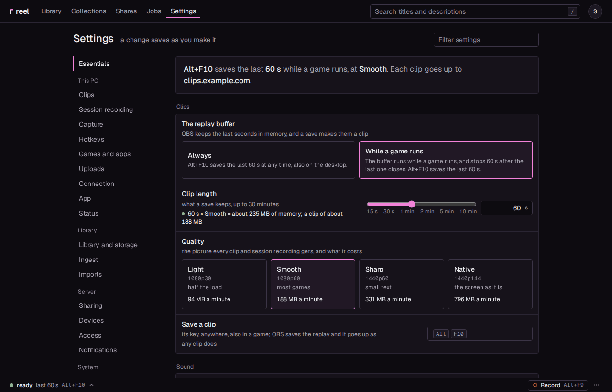
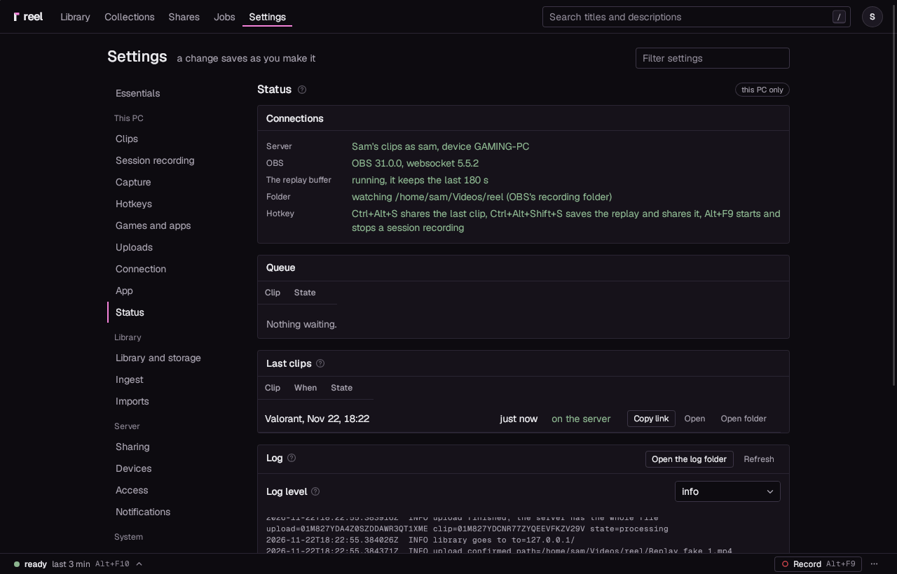
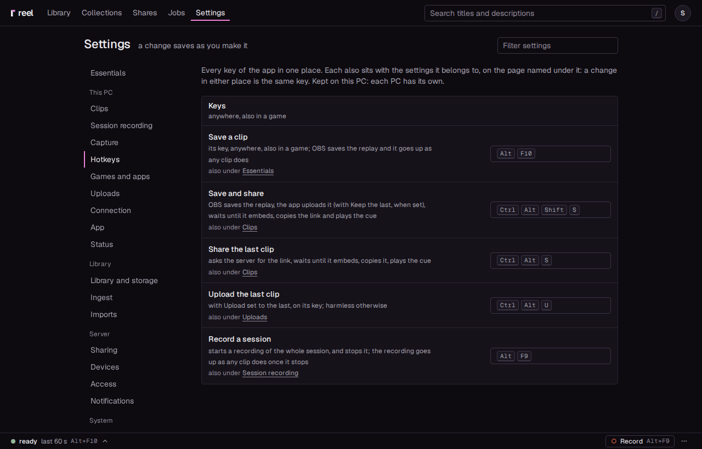
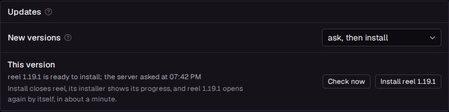
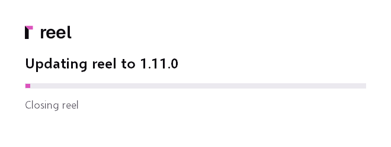

# The desktop app

The app runs on your gaming PC and lives in the tray. Every clip OBS saves goes into your library,
and the app's window shows that library with the editor, montages and everything else. Paired with
a server of your own, one key also puts a share link on your clipboard.

This page covers the app once it runs. To install it, pick a guide in
[Setting up reel](setup/index.md).

## Which download

Every installer is on [reel's releases](https://github.com/Locko2901/reel/releases), each with its
`.sha256`. A server you run offers the installers of its own version under Settings, Devices, each
with a line saying who it is for.

| Download | File | For |
|---|---|---|
| **reel, for Windows** | `reel_<version>_x64-setup.exe`, about 200 MB | a PC without OBS, or one where reel should run its own: OBS comes with the app, unmodified, and the app sets it up |
| **reel light, for Windows** | `reel-light_<version>_x64-setup.exe`, about 70 MB | a PC with OBS set up already: the app connects to that OBS |
| **reel for Linux, the AppImage** | `reel_<version>_amd64.AppImage` | any distribution, one file: make it executable and run it |
| **reel for Debian and Ubuntu, the .deb** | `reel_<version>_amd64.deb` | the same app as a package, installed with apt |

What each needs:

- **Windows**: Windows 10 or 11, 64 bit. Both installers install the same app for your Windows
  user, called reel in the Start menu and in Apps, and bring Microsoft's WebView2 along when
  Windows lacks it; reel light asks for no administrator rights, reel asks once, for its firewall
  rule. They are not code signed yet, so SmartScreen warns the first time
  ([Windows protected your PC](troubleshooting.md#windows-protected-your-pc)). One installed over
  the other keeps your settings, your library and the pairing, and its page says **Switch to reel**
  or **Switch to reel light**. reel light over reel removes the OBS that came with it, and its
  installer asks before it does ([All in one](setup/all-in-one.md#afterwards)). Settings, App
  names the package under **Versions**, and **About** next to the version.
- **Linux** keeps one name for both files: reel, the AppImage or the `.deb`, with the OBS you
  install yourself.
- **Linux**: a 64 bit PC with glibc 2.36 or later: Arch, Fedora, Debian 12, Ubuntu 24.04 and
  later. Ubuntu 22.04 is too old. There is no OBS inside the AppImage or the `.deb`: reel runs the
  OBS you installed from your distribution or Flathub a second time, with settings of its own, or
  connects to yours, as you choose ([Linux](setup/linux.md)). The AppImage carries what its window
  plays video and sound with (GStreamer and its plugins, its GL plugin among them, so the video
  goes to the screen without a copy); the `.deb` installs your system's (`gstreamer1.0-plugins-good`,
  `gstreamer1.0-libav` and `gstreamer1.0-gl` among them).

## Standalone or connected

The app runs in one of two modes, set under Settings, **Connection**, **Mode**:

| | **standalone** | **connected** |
|---|---|---|
| The library | on this PC, inside the app | on your server |
| Sending a clip | **Show in folder**, or download a copy under a size, and drag the file into the chat | paste a share link, copied with one key |
| What you need | the app alone | a reel server, paired with the app |
| Hotkeys | **Save a clip** | **Save a clip**, **Save and share**, **Share the last clip**, **Upload the last clip** |

A new install starts standalone. An app that was set up before keeps its mode through an update.

In standalone, the window shows the library on this PC with the same pages a server has, minus
what only a server needs: share links (the clip page's Share, a collection's link, Copy link in a
clip's menu and in the Select bar, the Shares page), members and sign-in, the Devices page, the
public address, notifications to ntfy or a webhook, external storage, the incoming folder, the
first run and the restart. Their addresses answer "Not in standalone" with what to do instead.
Settings is the same, with the pages a library on one PC has: its nav lists **Essentials**, this
PC's pages without **Uploads**, then the library's, reel on this PC: **Library and storage**,
**Library folder**, **Ingest**, **Encoding**, **Copies under a size**, **Imports**, **General**,
**Appearance** and **Advanced**.

A server can be paired while the app stays standalone: **Upload to the server** on Settings,
**Status** then sends a clip to it. [Standalone](setup/standalone.md) has the whole picture, and
how to add a server later.

## What runs, and when

- **At sign-in.** The app starts with your Windows or desktop session, hidden in the tray, without
  a window (Settings, **Start with Windows**, on Linux **Start at logon**, on by default). On Windows that is a Run entry
  for your user; on Linux an entry in your desktop's autostart.
- **In the tray.** Double-click reel's icon to open the library. Its menu's first line says what
  the app does in the words of the window's bar (**ready, last 60 s**, **recording, 12 min**,
  **clips paused**, **OBS not connected**, **uploading, 64%**), as does the icon's tooltip. Then
  **Last clips** (each with **Open** and **Copy link**), **Save clip**, **Save and share**,
  **Record a session**, **Pause clips**, **Share the last clip**, **Pause uploads**, **Open library**, **Open
  settings**, on Windows with the OBS that came with reel **Open OBS** or **Hide OBS**, and
  **Quit**. When an update is ready, **Install reel** with the new version is there too. In
  standalone the menu keeps what makes sense on one PC: that line, **Last clips** (each with
  **Open**), **Save clip**, **Record a session**, **Pause clips**, **Open library**, **Open settings**, OBS's entry
  and **Quit**, with **Pause uploads** once a server is paired. For a tray whose icons are all one
  colour, Settings, App, **Tray icon** shows reel's mark alone in white or in black. On Linux,
  reel's own OBS has a tray icon of its own, which opens its window.
- **Pause clips**, in the tray and in the menu of the window's bar, stops OBS's replay
  buffer: OBS no longer encodes, and the buffer gives back its memory. OBS stays open, so **Resume
  clips** starts the buffer again at once. While paused, the bar, the tray and its icon's tooltip
  say **clips paused**, the bar with **Resume** beside it, **Save clip** and **Save and share** are
  off and say why, and the Save hotkey saves nothing but says so. The pause lasts until you resume, or until the app starts
  again: a new start always records.
- **The window.** Closing it (the X) ends the window and the WebView that draws it; the app goes
  on in the tray, and opening the window again builds a new one in about a second. Started at
  sign-in, the app makes no window at all until you ask for one. [How light it is](light.md) has
  the numbers.
- **When a clip is in**, a notification says so. Connected, it is "Clip uploaded", with **Copy
  link** (it makes a link if the clip has none) and **Open**, which opens the clip's page in the
  window. In standalone it is "Clip in the library", with **Open**. The buttons work from Windows'
  notification centre later too, even after the app was closed: the app starts and does it. On
  Linux the buttons show where the desktop's notifications have buttons (GNOME, KDE and most
  others); elsewhere the tray has both.
- **A second start** (from the Start menu, the desktop's launcher, or the AppImage again) opens the
  window of the app that is already running. There is never a second app.
- **Quit** from the tray ends the app, and reel's own OBS with it when it runs one. The window and
  the tray icon go at once; the app stops OBS behind them within a few seconds.

## The window

The window shows reel's pages (Library, Collections, Shares, Jobs, Settings): your server's,
signed in as you, or in standalone the library on this PC, without Shares. Its header is the one
a browser shows: the pages, the search, and the menu under your initial, which has **Upload a
file** (**u** on any page; the library has **Upload** at the end of its own row). What this PC
does is in a bar along the window's foot:

- **On the left, the state in a word or two**: **ready** with how much OBS keeps (**last 60 s**)
  and the save hotkey beside it, **recording**, **clips paused**, **OBS not connected**,
  **connecting to OBS**, **replay buffer off**, **uploading** and how far, **uploads paused**,
  **not paired**, **server unreachable**, **OBS stopped**, **no clip saved**, **error**, or the step
  of the work on a clip. Its dot, and a line along the bar's top, are red while a session records
  and amber while clips are paused or OBS is not there. When nothing on this PC wants a word
  first and the server has something to look at (its disk, ffmpeg, the database), the bar says
  **server warning** or **server error**; in standalone, **library warning** or **library error**.
- **A button after the words** ends the state or shows why, where one can: **Resume** (clips, or
  uploads), **Start OBS** (reel's own OBS, after reel stopped starting it), **Settings** (the page
  with the answer), **Status**, **Retry**, **Pair** and **Log**.
- **On the right, Record** starts a [session recording](#recording-a-whole-session) and stops it,
  with its hotkey beside it in a window 1280 px wide or more; while one runs it shows a red square,
  the time and **Stop**.
- **The bar's menu** opens from its words or from **...** at its right, above the one you
  pressed. Its first line says the state in a sentence. Then **Save clip**, **Save and share** and
  **Share the last clip** (connected), each with its hotkey: they do what the hotkeys do, and
  while one cannot run it is off and the menu says why. **Save clip** has OBS save the replay,
  which goes into the library, or up to the server like any clip; **Save and share** also copies
  the clip's link once it is up. Then the **Pause clips** and **Pause uploads** switches, a line
  each about **OBS**, the **Server** and the **Versions**, **Status page** and **Updates**. In
  standalone the server's line is the **Library**: on this PC, where it lives, and whether reel
  on this PC runs; its dot turns red only for a check of the PC's own (its room, ffmpeg, the
  database), and **Pause uploads** shows once a server is paired. Esc closes the menu, and the
  keyboard reaches all of it.
- **Settings** opens on **Essentials**: what is set and the few settings most people change, each
  with what it costs. Its nav lists every other page, this PC's and then the server's (in
  standalone, the library's). Ctrl+, opens Settings from anywhere in the window.

The window has no address bar. A clip's page has its own back button above the player, and the
mouse's back and forward buttons, Alt+Left and Alt+Right walk back and forth through the pages,
the app's own included.

A download in the window (a clip's or a version's **Download**, a copy under a size, an animated
picture, **Download** on a link's page, the zip of picked clips) goes to your Downloads folder. A
note above the bar shows its name, size and progress, then where it was saved, with
**Show in folder** and **Open**, or why it failed. In standalone, a file already in the library is
not downloaded: **Open** and **Show in folder** take it where it is
([The files are on this PC](setup/standalone.md#the-files-are-on-this-pc)).

When the server cannot be reached, the window shows the app's own page instead: what went wrong
in words (for example "No answer from the server" or "The connection is not trusted"), **Retry**,
and the app's settings. The app tries again by itself and keeps the clips it finds meanwhile.

## Recording a whole session

The replay buffer keeps the last minutes; a session recording keeps all of it, from when you
start it until you stop it. Start and stop it with **Record** in the window's bar, **Record a
session** in the tray, or its hotkey (Alt+F9 by default). The recording goes into the library like
a clip, named after its game and when it started, and marked **session recording** on its card
next to its length. Connected, it goes up to the server once it has stopped, as any clip does,
and its upload waits while a game has the screen when uploads do.

- **While it runs**, **Record** shows a red square, the time and **Stop**, and the bar says
  **recording** with a red line along its top; the tray's icon has a red dot, and its first line
  and tooltip say **recording** and for how long (**recording, 12 min**). **Save clip** still saves
  replays meanwhile.
- **Reminders**, so a recording is not forgotten for hours: every 30 minutes a short sound and a
  notification, "Still recording a session". The sound is what reaches you in a game in full
  screen, where Windows holds notifications back. Settings, **Session recording** has **Remind
  every** (in minutes, 0 for none) and the reminder's sound (on or off, its volume, a WAV of your
  own), which also plays when a recording starts. A PC that slept through several reminders gives
  one when it wakes.
- **What it costs**: OBS records with the encoder the replay buffer already runs, so a recording
  costs room on the disk, not a second encode. At Smooth (25 Mbit/s) an hour is about 11 GB, at
  Light (12.5 Mbit/s) about 5.6 GB.
- **It stops by itself** before the disk is full: when the disk OBS records to has less than 5 GB
  left, or in standalone when the library would have no room left to take the recording in. A
  notification says so, and the recording so far goes into the library.
- **If OBS stops** mid recording (a crash, your own OBS closed, or a change under Settings or
  Settings, Capture that starts reel's OBS again), what it wrote is kept and goes into the library, and a
  notification says so.
- **Quit** stops the recording first, so its file is whole; it does not ask. A recording you
  started in your own OBS goes on there. An update waits to install until the recording has
  stopped.
- A recording started in OBS itself counts as a session recording too: the window and the tray
  show it, and its file goes into the library as one.
- **Keep the last** never cuts a recording, and **Share the last clip** and **Upload the last
  clip** mean the last replay, not a recording.
- From a desktop's shortcut or the command line: `--record-session` starts one, or stops the one
  that runs; `--start-session` and `--stop-session` do one of the two.

With a server, an upload over the server's **Upload size limit** (Settings, Imports; 8 GB unless
changed) is refused: the app says so and keeps the recording on this PC. Raise the limit for long
recordings. The server makes no preview video of a session recording by itself; a link to one
plays the recording.

## The app's pages

Settings opens on **Essentials**: a sentence of what is set (the key that saves a clip, how long
a clip is, when the replay buffer runs, the quality, and where a clip goes), then the settings
most people change, each with what it costs:

- **The replay buffer**: **Always**, or **While a game runs** ([Games and apps](games-and-apps.md)),
- **Clip length**, with the memory the replay buffer takes and the size of a clip,
- **Quality**, four presets, each with the size of a minute of clip,
- **Save a clip**, its key,
- **Microphone**,
- connected, **Upload**: every clip, the last one on its key, or by hand,
- **Start with Windows** (**Start at logon** on Linux).

With your own OBS, **Clip length** is OBS's replay length, and the picture and the microphone are
OBS's own: Essentials says so, and points to **Capture**.

The nav on the left lists every page of Settings: **Essentials**, then **This PC**, the app's own
pages, kept on this PC, each PC with its own; then the server's pages under **Library**,
**Server** and **System**, kept on the server, the same for every PC and browser. In standalone
the library's pages follow under **Library**, with **Library folder** and **Encoding** among them.
A server's page opens in the window with the same nav and the same head, so going from one page
to another changes the page and nothing around it. In a narrow window the nav is a list at the top
of the page. Back and Forward come back to where you were on a page; a page opened from the nav
starts at its top.

| Page | Where | What it holds |
|---|---|---|
| **Clips** | This PC | **Save a clip now**; with your own OBS **Start it in OBS**, which starts its replay buffer; **Keep the last**; connected, the keys **Save and share** and **Share the last clip**; the **Sounds** (clip captured, no clip, clip uploaded or in standalone clip in the library, and link copied), each on or off, with a volume, a WAV file of your own and **Preview**; and **On this PC**: the **Clips folder** and, connected, how long a clip stays on the PC after the server has it |
| **Session recording** | This PC | **Record a session**, its key; **With a game**: every game records by itself, and the recording stops when its game closes; the reminders while a [session recording](#recording-a-whole-session) runs: **Remind every** and their sound, on or off, with a volume, a WAV file of your own and **Preview**; the sound also plays when a recording starts |
| **Capture** | This PC | **Picture** (the encoder and the format; with your own OBS, the format and the bitrate), **What it captures** (the game in front, games that run as administrator), **Sound** (desktop audio, the game alone, Discord alone, the microphone's noise suppression and gate, a track for each source, the levels), and **The OBS behind it**: with reel's own OBS (the one that came with reel on Windows, the installed one run a second time on Linux) which OBS and how it runs, **Open OBS** on Windows and **Run the setup again**; with your own OBS the obs-websocket connection with **Run the setup**. Folded under it: **What reel needs from OBS**, **What OBS is set to** (its profile among it) and how reel finds a new clip (**Follow OBS**, the file endings, **Still for**) |
| **Hotkeys** | This PC | every hotkey of the app, each set there or with the settings it belongs to: **Save a clip** (also under Essentials), **Save and share** and **Share the last clip** (also under Clips), **Upload the last clip** (also under Uploads) and **Record a session** (also under Session recording); on Linux, how a hotkey reaches the app. See [Hotkeys](#hotkeys) |
| **Games and apps** | This PC | the programs reel has seen: which ones are games, and the name each gives its clips; Steam's installed games come in by themselves; **Show on Discord**; and **When a game closes**, its grace period. The count beside it is of those not sorted yet. See [Games and apps](games-and-apps.md) |
| **Uploads** | This PC, connected | **Upload the last clip**, its key; on Windows **Uploads wait while a game has the screen**, off unless you turn it on (never for a Save and share, whose upload goes at once, ahead of the others); a bandwidth limit and the chunk size. See [The waits](games-and-apps.md#the-waits) |
| **Connection** | This PC | **Mode** (connected or standalone), the **Server URL**, the **Device name** and the pairing; in standalone under **A server, later**, and with a server paired **Sending to it**, its bandwidth limit and chunk size |
| **App** | This PC | the **Tray icon**, the app's **Updates**, its **Versions**, and **About** (the version, the folders the app keeps its settings and data in, and on Windows **Uninstall reel...**); in standalone **Look for new versions on GitHub** |
| **Status** | This PC | the connections (the server, OBS, the clips folder, the hotkeys, on Linux the tray), the queue with **Upload now** and **Retry**, the last clips with **Copy link** and **Open**, and the **Log**: what the app did, newest at the bottom, the **Log level** and **Open the log folder**. In standalone: the library on this PC in place of the server, a **Standalone** panel (where the library lives, the encoder, ffmpeg), **Add now** and **Retry** to take a clip into the library, the last clips with **Open**, and **Upload to the server** once a server is paired |
| **Library folder** (standalone) | Library | where the library is on this PC, with **Move** and **Make a copy**, the **Library cap** and **The cap spares unsent clips** |
| **Encoding** (standalone) | Library | the **GPU encoder** and the one in use, **Copies on the GPU**, and on Windows **Encoding waits while a game has the screen**, off unless you turn it on. See [The waits](games-and-apps.md#the-waits) |

Every change saves as you make it. The pairing's token never goes into a file the app shows or
into the log: on Windows it lives in the Windows Credential Manager, on Linux in a file only your
user can read, in the app's settings folder.

## Hotkeys

The five hotkeys are all on Settings, **Hotkeys**, and each also sits with the settings it belongs
to: **Save a clip** under **Essentials**, **Save and share** and **Share the last clip** under
**Clips**, **Upload the last clip** under **Uploads** and **Record a session** under **Session
recording**. A key set in one place is the same key in the other.

| Hotkey | Default | What it does |
|---|---|---|
| **Share the last clip** | Ctrl+Alt+S | asks the server for the newest clip's link, waits until its link preview is ready, copies it and plays the cue |
| **Save and share** | Ctrl+Alt+Shift+S | OBS saves the replay, the app uploads it, waits until its link preview is ready and copies the link |
| **Save a clip** | none (Alt+F10 after the setup) | OBS saves the replay; the clip goes into the library, or up to the server like any clip, without a link |
| **Upload the last clip** | Ctrl+Alt+U | for the upload mode **the last clip, on the hotkey**; harmless otherwise |
| **Record a session** | Alt+F9 | starts a [session recording](#recording-a-whole-session), and stops the one that runs |

In standalone only **Save a clip** and **Record a session** are taken. The other three make or
copy a link, or upload, and need a server; from a desktop's own shortcut or the command line they
are refused with a notification saying so.

The "clip captured" sound plays the moment OBS takes the save, before it has written the replay,
which for a long replay takes a few seconds. Press Save and share again while one is under way,
and it saves another clip with the same sound; only the newest clip's link is copied, with one
"link copied" sound (three presses: three "clip captured", one "link copied"). A press within a
second of the last save counts as a double tap and does nothing. A save made with OBS's own
hotkey sounds once OBS has written the replay.

To set a key, click its field and press the keys. A combination that Windows, the desktop or
another app holds is refused ("Ctrl+Alt+S is held by Windows or another app; ..."), and the field
keeps what it had.

On Windows the app takes the keys for the whole desktop, so they work while a game has the focus.
One exception: a game that runs as administrator does not pass its keys to the app (see
[Troubleshooting](troubleshooting.md#games-that-run-as-administrator)).

**On Linux** global hotkeys depend on your desktop: they may not work, or may need to be set up in
the desktop's own keyboard settings. There you can bind a key to `reel-desktop --save-and-share`
(or `--save`, `--share-last`, `--pause-recording`, `--resume-recording`, `--record-session`). With the AppImage the command is the AppImage's path, which
Settings shows under **Hotkeys** (and under **Save a clip** on **Essentials**).

## Updates

The app keeps itself up to date from the server it is paired with, or in standalone from reel's
releases, and you see each step:

- **From your server, or from the release.** Paired, the server offers the app of its own version,
  so updating the server brings the new app to every paired PC. Standalone, the app takes the
  newest release from GitHub. Each app gets its own kind: reel stays reel, with its OBS, reel light
  stays reel light, the AppImage gets the next AppImage.
- **Signed.** Every installer is signed with reel's release key, and the app checks the signature
  against the key built into it before it runs anything. The signature names the installer's
  version, and the app takes it only as that version and only when it is newer than its own.
- **When.** Paired, the app asks its server 45 seconds after it starts, then every six hours.
  Standalone, it asks GitHub only when you ask: **Check now**, or by itself when Settings, App,
  **Look for new versions on GitHub** is on (the setup leaves it on unless you switch it off
  there): a minute after the start, then every six hours by the
  clock, once a day with **New versions** off ([What leaves your PC](privacy.md#what-leaves-your-pc)).
  **Check now** under Settings, App, **Updates** asks at once. **New versions** there decides
  what happens with a version found without it: **ask, then install** (the default) asks in a
  notification with **Install now** and **Later**, and at the top of the window's pages while it is
  open (the library too, on this PC or on your server), and offers it in the tray menu and on the
  Updates panel, with the release notes. **Later** asks again a day later, or at the next start;
  **install when the app quits** downloads it and installs it when you quit from the tray; **off**
  offers it only on **Check now**.
- **Before you press Install**, the panel says what happens next and about how long it takes.
  On Windows: reel closes, its installer shows its progress in a small window, and reel opens
  again by itself, in about a minute with reel and half a minute with reel light. A
  notification says the same as it starts.

    

- **While it installs**, a small window shows "Updating reel to" the new version ("Updating reel
  light to" with reel light), with a bar and
  one line of what it is doing. It has no buttons and closes by itself. reel waits for a clip on
  its way to the server before it starts, and, in standalone, for a
  [move or a copy of the library](setup/standalone.md#the-library-on-another-drive) for as long
  as it goes on: the Updates panel and the tray say "reel 1.12.1 installs once the library has
  moved". **Stop** on the move or the copy lets the update go on at once.
  While a [session recording](#recording-a-whole-session) runs, the question and the panel say
  that Install waits for it to stop, and once pressed the panel and the tray say "reel 1.15.1
  installs once the session recording stops".

    

- **Afterwards** reel is back in the tray at once and says "reel is updated to" the new version,
  with the first line of what is new. If its window was open, it opens again on the page it
  showed. Your settings and the pairing stay as they were. When you update from 1.9, the small
  window shows too, and the notification names the version you came from.
- **Install when the app quits** shows the small window as reel quits, and reel stays closed until
  you open it. It tells you it is updated at its next start. A quit while the library moves or a
  copy is made does not install it: the next start fetches the update again, and the quit after
  that installs it.
- **If an update does not install**, for example because another program holds one of reel's
  files and you pressed **Cancel** at its question, the reel you had starts again and says why
  ("reel 1.10.1 did not install: ..."). **Install** under Settings, App tries again.
- **The AppImage** puts the new version in place of its own file and opens again by itself, in a
  few seconds.
- **The .deb** does not update itself: install the next version's `.deb` the same way as the first.
- **Standalone** asks nothing by itself. A standalone app of 1.11 or earlier cannot install an
  update: it says the new version is out, and **Open the releases** opens the page with its
  installers. Install that one by hand, once; from then on the app installs its updates itself.

The **Versions** panel on Settings, App names this app's version and kind, the server's, and
the newest release. The **Versions** line of the bar's menu shows the version, or both while the app
and its server differ ("app 1.4.1, server 1.4.0"). On the server, Settings, Devices,
**App updates** has [Offer app updates](configuration.md#offer-app-updates), on by default, and a
[Release token](configuration.md#release-token) for a private fork.

## Uninstalling

=== "Windows"

    Open Windows Settings, **Apps**, **reel**, **Uninstall**, or in the app Settings, App,
    About, **Uninstall reel...**, which starts the same uninstaller and quits. Its page says what
    goes: the app, the OBS that came with it and OBS's settings, the desktop shortcut and the start
    at sign-in. Two boxes, both off, decide what else goes:

    - **Also remove reel's settings, logs and pairing**: the app's settings in `%APPDATA%\reel`,
      its log, the pairing with your server and the window's web data. Without it they stay for a
      later install, which then starts paired and set up as before.
    - **Also delete the clips folder** (its path and size on the box): the folder and every clip in
      it, for good; reel asks once more when you tick it. Clips already on your server stay there.
      A whole drive, a folder of Windows' own or of your profile (Videos, Documents, Program Files),
      a folder that holds one of them or reel, a link and a network folder are never offered: the
      page says the folder is kept, and why.

    The last page says **reel is removed**, and whether your clips folder went with it.

    The library on this PC, in `%LOCALAPPDATA%\reel\library`, stays either way. Delete that
    folder yourself if you want it gone. [Uninstalling](uninstalling.md) has every case.

    If **Capture games that run as administrator** was on, Windows asks once more, to remove the
    copy in Program Files and its task. An uninstall without its page (`uninstall.exe /S`) keeps
    the settings and the clips folder.

=== "AppImage"

    Turn **Start at logon** off (Settings), quit the app from the tray, and delete the
    AppImage. The settings live in `~/.config/reel`, and the app's data (the log, the list of clips
    sent, the library on this PC) in `~/.local/share/reel`; delete both if you want nothing left.
    Your clips folder stays.

=== ".deb"

    Quit the app from the tray, then run `sudo apt remove reel`. The settings in `~/.config/reel`
    and the data in `~/.local/share/reel` stay for a later install; delete them if you want nothing
    left.

On the server, Settings, Devices, **Revoke** signs the PC out for good, whether the app is still
installed or not.
