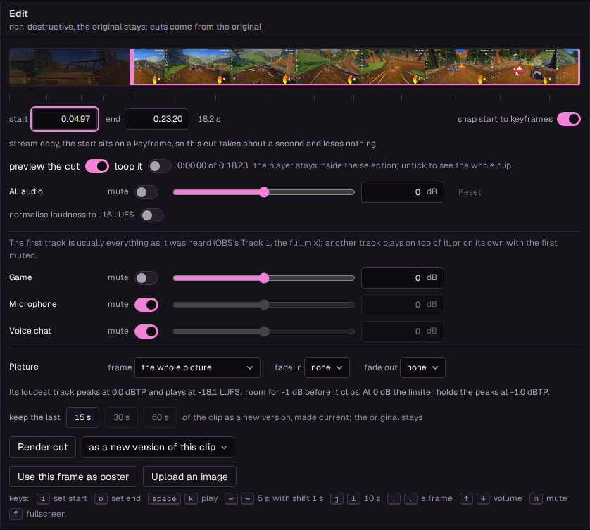
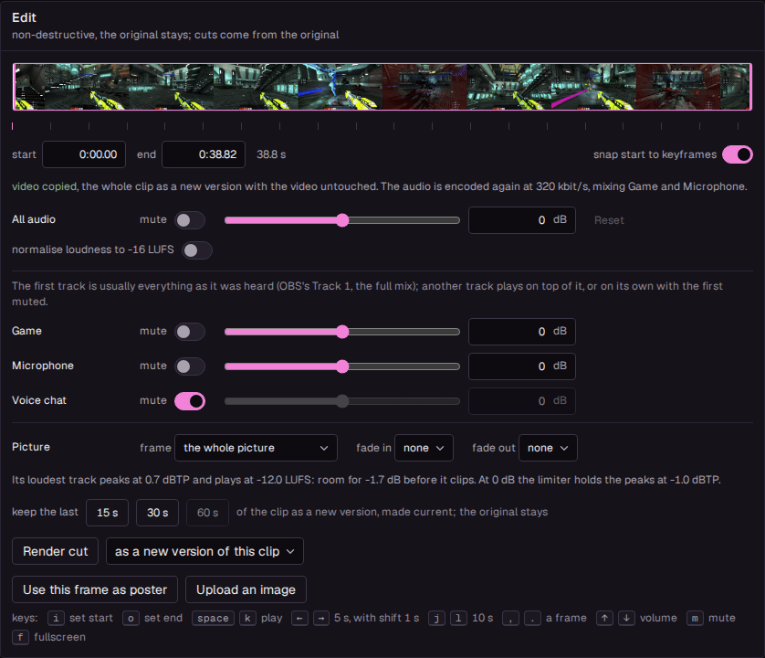
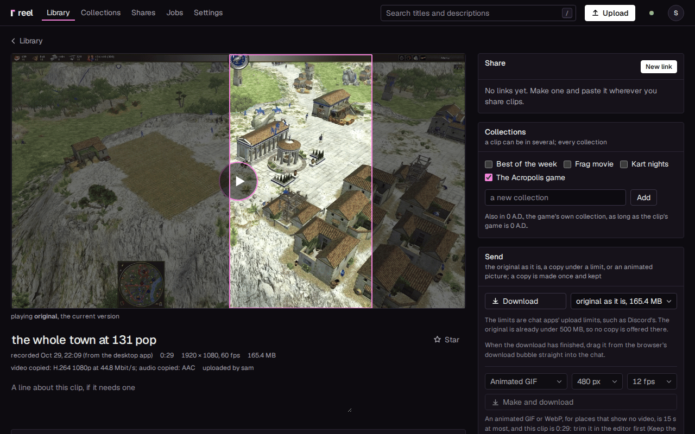
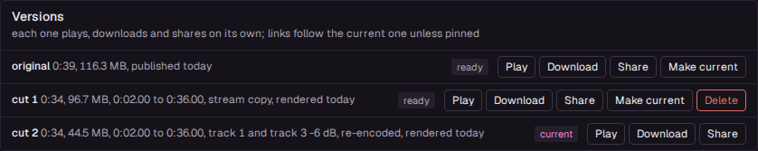
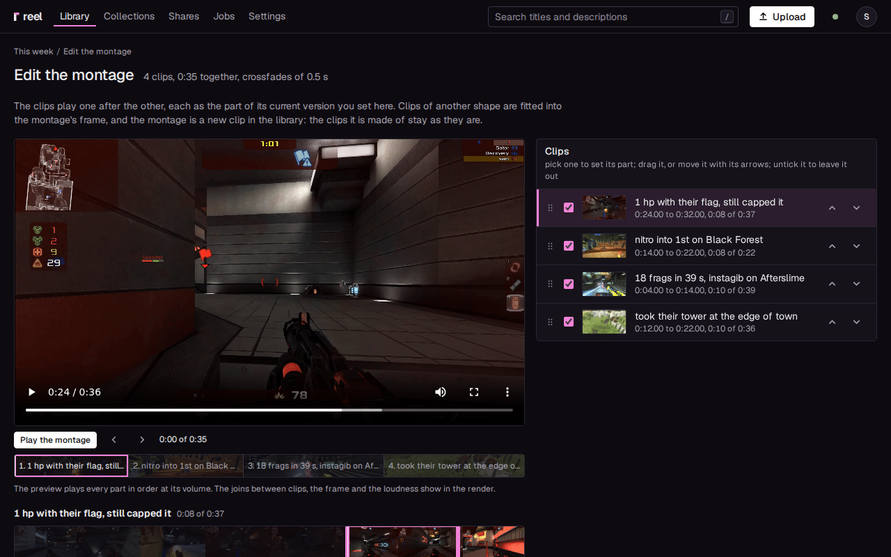

# The editor

Trim a clip to the moment that matters, fix its sound, frame it for a phone, or join several
clips into a montage. Every edit is a new **version** of the clip: the original is never
touched, and you can go back to it, or to any version, at any time.

The editor works the same in the desktop app on its own and on your server.

## Open a clip

Click a clip in the library. Its page has the player, the title and a line about the file, then
**Edit** and **Versions**; beside them, **Share** (on a server), **Collections**, **Send** and
**Details**.

- The title and the description under it ("A line about this clip, if it needs one") save as
  soon as you leave the field.
- **Edit** is there for whoever uploaded the clip, and for admins. Anyone else sees no **Edit**,
  and the line under the title says who uploaded the clip and edits it.
- The button above the player goes back to where you came from and says where, such as
  **Library** (with your search, filters and scroll as you left them), a collection's name, or
  another clip's title. A clip opened from its address, or in a new tab, goes back to the
  library, or to the page its link was on.

## Trim a clip {#trim}

Cut a clip down to the part worth watching.

<video src="../img/editor.mp4" poster="../img/editor.png" autoplay muted loop playsinline width="1280" height="800" aria-label="A trim typed into the editor and rendered as a new version of the clip"></video>

1. Drag the two handles on the filmstrip under **Edit**, or play the clip and press `i` where it
   should start and `o` where it should end. The **start** and **end** fields show the times,
   and take a typed time too (`0:07.50`).
2. Check it: **preview the cut** (on) keeps the player inside your selection, and **loop it**
   plays it over and over.
3. Press **Render cut**.

The button counts up ("Rendering cut 2, 45%"), then "Cut rendered." shows. The new version plays,
and it is the clip's current version. A cut that failed says why, and one cancelled under
**Jobs** says so.

Every cut is made from the original, never from another cut, so cutting again loses nothing.
That is why the filmstrip is always the original's. When a cut is current, the editor opens on
it: the handles at its range, its sound and picture as they were set, so a small drag nudges it.
**Whole original** starts over from the whole clip.

A link that follows the current version plays the new cut at once. A chat that already shows
the link keeps its old preview; [Show an edit in a chat](sharing.md#show-an-edit-in-a-chat) says
how to refresh it.

### Fast cuts on keyframes {#stream-copy-or-re-encode}

The line under the times tells you what a cut will cost before you render it. The small ticks
under the filmstrip are the original's keyframes.

- **stream copy**: the start sits on a keyframe, so the cut is taken out of the original as it
  is. It takes about a second and loses nothing.
- **re-encode**: the start is between keyframes. The whole cut is encoded again (at the
  [Re-encode at](configuration.md#re-encode-at) bitrate, on the graphics card when there is
  one), which takes a while but starts exactly where you put it. The line names the nearest
  keyframe.

**snap start to keyframes** (on) pulls the start onto a keyframe when you drag it, type it or
press `i` within 10 pixels of one, so most cuts are stream copies. Turn it off to cut at an
exact frame. The end never needs a keyframe.

## Keep the last seconds {#keep-the-last}

A replay often holds more than the play. The **keep the last** buttons, **15 s**, **30 s** and
**60 s**, keep the end of the clip in one click: the cut is rendered at once as a new version
and made current. With **snap start to keyframes** on, the start moves back to a keyframe up to
2.5 s earlier when there is one, so the cut is a stream copy. A button longer than the clip is
greyed out. The seconds are the [Quick trims](configuration.md#quick-trims) setting, under
Settings, General.

## Save a cut as its own clip {#a-new-clip-instead-of-a-version}

Turn one long recording into several clips. The list next to **Render cut** says where the cut
goes:

- **as a new version of this clip** (the default): the clip gets another version, and it
  becomes current.
- **as a new clip in the library**: the cut becomes a clip of its own, with the title you give
  it (this clip's title with "cut" after it, until you change it). The new clip says "cut from"
  this one, this clip's **Versions** lists it under "saved as its own clip", and this clip does
  not change.

## Fix the sound {#audio}

Make a quiet clip louder, a loud one gentler, or bring it to the level phones and streaming
use. The row **All audio** under **Edit** changes the sound of the cut:

- **mute**: the cut has no audio. Mute alone, with no trim, is a stream copy that drops the
  audio track.
- the volume, from -20 to +20 dB in half decibels, with the slider or the number; **Reset** goes
  back to 0.
- **normalise loudness to -16 LUFS**: brings the clip to the
  [Loudness target](configuration.md#loudness-target), -16 LUFS by default, the usual level for
  phones and streaming. While it is on, it sets the volume.

The line under the rows says how loud the original is and how much room it has: "The original
peaks at -6.2 dBTP and plays at -18.0 LUFS: room for +5.2 dB before it clips." A boost past that
room is held under -1 dBTP by a limiter when the cut is rendered, and the line says so. The page
plays your change live on the original (cuts are made from it, so the player moves to the
original when you trim or change the sound), but without the limiter, so a big boost may crackle
in the browser and not in the cut.

A change of the sound alone never encodes the video again: without a trim, or with the start on
a keyframe, the line says **video copied**, and only the audio is encoded again.

## Mix the audio tracks {#audio-tracks}

If you record the game, your microphone and voice chat on tracks of their own (OBS can), you
choose the mix for each cut: lift a friend's call, drop your own voice, or keep the game alone.
A clip with several audio tracks shows a row per track, named as the recording named them, each
with its own **mute** and volume.

- At the start the first track plays and the others are muted: the first is usually everything
  as it was heard (OBS's Track 1, the full mix), and adding the others to it would play them
  twice.
- Turn on another track to lift a voice or the game over the mix, or mute the first and keep one
  track alone.
- The page plays the mix live as you change it.

The rendered version plays the tracks you chose, mixed into one. Its share links, its preview
video and its copies under a size carry that mix. The original keeps every track, so another
mix is always possible.

## Frame it tall or square, fade in and out {#the-picture}

Make a clip fit a phone's short, or give it a clean start and end. The row **Picture** under
**Edit** changes what the cut shows:

- **frame**: **the whole picture** as it is, **tall, 9:16 (a phone's short)** or **square,
  1:1**. The window shows on the player, the rest dimmed; **window** slides it from the left edge
  to the right (top to bottom, for a picture taller than the window's shape). The cut keeps the
  window's own pixels: tall from a 1080p clip is 606 by 1080.
- **fade in** and **fade out**: from black and silence at the cut's start, and to them at its
  end, for 0.5, 1 or 2 seconds. Together they cannot be longer than the cut. A clip without
  sound fades its picture alone.

A frame or a fade means the whole cut is encoded again, never copied, which the line under the
handles says. Opened on a cut with a frame or fades, the editor shows them as they were, so
nudging one is one change.

## Pick the poster {#the-poster}

The poster is the picture a clip is known by: in the library, on the link's page and in a chat's
preview before the video plays.

- **Use this frame as poster** makes the frame the player is on the poster.
- **Upload an image** makes a picture of your own the poster: a JPEG, PNG or WebP (on a phone,
  one from the photo picker), up to 25 MB and 50 megapixels. Before it is saved, it shows as it
  will be, cropped to fill the video's frame as the library and a link's preview show it; press
  **Use as poster**. reel saves it as a new picture of its own, so nothing else of the file
  (where and when a photo was taken, the camera) is kept or served.
- **Use a frame again** goes back to the frame the clip had.

An uploaded image stays the poster of every version of the clip, a new cut too; a cut saved as
its own clip starts with a frame of its own. A frame you picked stays the poster as well when a
cut or another version becomes current, as long as that version still has the moment; one
trimmed without it gets a frame of its own.

## Versions

Every edit is kept, so you can always go back. **Versions** lists the original and every cut,
each with its length, size and how it was made ("0:07.00 to 0:12.00, stream copy"). The one the
clip shows is **current**.

- **Play** plays that version in the player above.
- **Download** gives its file as it is.
- **Share** makes a link pinned to it, on a server (see
  [Follow edits or pin a version](sharing.md#which-version-a-link-plays)).
- **Make current** makes it what the clip shows, and what every link that follows the current
  version plays from then on.
- **Delete** (press it twice) removes a cut and its files. The original cannot be deleted on its
  own, and a cut cannot be deleted while it is current or while an active link is pinned to it.

Each version gets its own poster, hover loop and filmstrip, and a preview video when it needs
one.

## Join clips into a montage {#a-montage}

Put your best plays one after the other in one new clip: hard cuts, crossfades or fades through
black between them, in a wide, tall or square frame. The clips it is made of stay as they are.

Open the montage editor one of two ways:

- On a collection's page, press **Make a montage**: it opens with the collection's ready clips,
  in its order.
- In the library, press **Select**, pick two clips or more, and press **Make a montage** in the
  bar: it opens with those, in the order you picked them.

### Set each clip's part

The editor has a player with the montage's timeline under it, the part of the clip you picked
under that, and the list of clips beside it (under it on a phone).

- Drag a clip in the list to move it, or use its up and down arrows. Untick a clip to leave it
  out. The line at the top counts the clips and how long they run together.
- Pick a clip (its name in the list, or its block on the timeline) to set the part the montage
  uses: drag the handles over its filmstrip, type the **Start** and **End**, or play it and press
  **Start here** and **End here** (`i` and `o`). **The whole clip** takes it all again. A part is
  half a second at least.
- **snap start to keyframes** (on) pulls the start onto a keyframe of the clip's current version
  when it comes within 10 pixels of one; the ticks under the filmstrip show where they are. It
  feels the same as on the clip page, but here it changes nothing else: a montage encodes every
  part again, so a start on a keyframe makes it neither faster nor better. Turn it off to start
  anywhere.
- **Volume** sets that clip's sound: **Silent**, or 50% to 200%.
- **Play the montage** plays every part in order, at its volume; the arrows go to the clip
  before and the next one, and a click on the timeline goes to that moment. The joins, the frame
  and the loudness are not in the preview: the render makes them.

### Choose how it looks and sounds

Under **The montage**:

- **Between clips**: **A hard cut**, **A crossfade** or **A fade through black**, lasting 0.25 to
  2 seconds. A fade overlaps the two clips, so the montage is that much shorter for each join,
  and a clip has to be longer than its fades.
- **Frame**: **Wide, 16:9**, **Tall, 9:16 (a phone's short)** or **Square, 1:1**.
- **Fill the frame**: a clip of another shape fills the frame and what is over is cut off,
  instead of black bars around it.
- **Every clip at one loudness** (on): every clip's sound is brought to the same loudness, the
  [Loudness target](configuration.md#loudness-target); off, each keeps its own.

### Render it

Give it a title ("Montage, Nov 2, 21:40" until you change it) and press **Render the
montage**. Its page opens, and the progress shows there. It renders as a cut does: on the graphics card when
there is one, as a job you can cancel under **Jobs**, and in the desktop app's own library it
waits while a game has the screen.

Each clip plays as its current version, so a clip you trimmed plays as its cut, and the part
you set is a part of that. Clips of other sizes or frame rates are fitted into one frame: its
short side as sharp as the sharpest clip's (360 to 1080 pixels), at the highest frame rate among
them (24 to 60 fps). A clip without sound is silent for its length.

The montage is a clip like any other: its game is the one all its clips share (none when they
differ), and its page lists the clips it was made of. It counts towards the
[library cap](sharing.md#the-library-cap) like any clip, and a montage that would be bigger than
the cap by itself is refused. The upload limit does not apply, as nothing is uploaded. Up to 100
clips go in one montage, running for up to 30 minutes in all (the parts, less the fades'
overlaps).

### Change a montage {#editing-a-montage-again}

A montage's page has **Edit the montage**: the editor opens with its clips in its order, each
with its part and volume, and its joins, frame and sound. A clip that has had another current
version since comes back whole (its old part was of the other version), and a clip that is gone
is left out; the page says so. Rendering makes a new montage. If you made the montage (or are an
admin), the box that starts **Replace** sends the old one to the trash once the new one is made:
its links stop, and **Restore** in the trash brings it back.

## Keys

On the clip's page, outside a text field (`i`, `o`, `e`, `c` and `d` where you can edit the
clip):

| Key | Does |
|---|---|
| `i` | set the start where the player is |
| `o` | set the end where the player is |
| `space` or `k` | play and pause |
| left and right arrows | 5 s back or on (1 s with `Shift`) |
| `j` and `l` | 10 s back or on |
| `,` and `.` | pause, then one frame back or on |
| up and down arrows | louder and quieter |
| `m` | mute |
| `f` | fullscreen |
| `e` | edit the title |
| `c` | copy the newest live link under **Share**, or open **New link** when there is none |
| `d` | download the current version |
| `s` | star the clip, or unstar it |

With a handle focused (click it or tab to it), the left and right arrows move it by a frame, and
by a second with `Shift`.

## Deleting a clip

**Delete clip** at the bottom of the page (press it twice) moves the clip with all its versions
to the trash, and its links stop at once. **Undo** in the message that appears brings it back;
see [Delete and restore](sharing.md#deleting-a-clip). A clip that failed to process has
**Discard** instead, which throws its file and the clip away for good.
