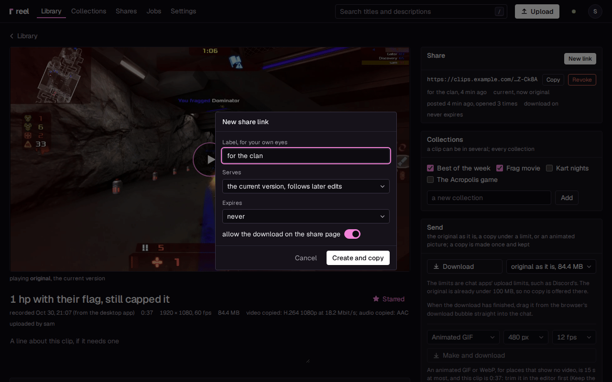

# reel

**Game clips that stay yours.**

One key saves the replay and copies a link that plays right in the chat. On your own PC or
server, in full quality, with an editor that keeps every version. No account, no cloud.

reel keeps the clips OBS records in a library of your own and puts **Save and share** on a
hotkey you press in the game. Cut a clip, mix its audio tracks, make a montage or a GIF. The app
waits in the tray at 13 MB while you play.

<video src="img/save.mp4" poster="img/save.png" autoplay muted loop playsinline width="1280" height="800" aria-label="A clip saved in a game lands in reel's library by itself, and its preview plays under the pointer"></video>

## What you get

- **One key from game to link.** **Save and share** has OBS save the replay, uploads it, and
  copies the link the moment its preview is ready, so the first embed in the chat works. A
  sound tells you it is on the clipboard.
- **Links that play where you paste them.** Chat apps play the video inline. Each link can
  follow the clip's current version or stay pinned to one, expire, offer the download or not,
  and be revoked. See [Sharing and links](sharing.md).
- **Full quality.** A clip OBS saved in H.264 is kept exactly as recorded, never encoded
  again. For chats that take files, reel makes a copy under a size (10, 20, 50, 100 or
  500 MB) once, at the best quality that fits.
- **An editor that keeps everything.** Trim with keyframe snapping, keep the last 15, 30 or 60
  seconds, mix the game, microphone and voice chat tracks, fade in and out, frame a cut tall
  or square for a phone, join clips into a montage, or make a GIF of the best second. See
  [The editor](editor.md).
- **Light on the gaming PC.** Closed to the tray, the app is one process of 13 MB on Windows,
  and uploads can wait while a game has the screen, when you want them to. See
  [How light it is](light.md) and [Games and apps](games-and-apps.md).
- **Yours.** The library lives on your PC out of the box; add a server of your own, one
  Docker container, when you want share links, accounts for friends and a library on the
  phone.

## Two ways to run it

| | You get | You need |
|---|---|---|
| **Just the app** | the library on your gaming PC, the editor, copies under a size to send as files | Windows or Linux, and OBS (the Windows installer can bring it) |
| **The app and your server** | everything above, plus share links that play in chats, accounts for friends, the phone, a library that is there when the PC is off | a Linux machine with Docker and an address the internet can reach |

You can start with the app alone and add a server any time; the clips you have can go up to
it then. [Getting started](getting-started.md) walks you through both.

## What it does not do

- **No feed.** No likes, no followers, no discovery, no comments: a link is seen by whoever you
  send it to, and nobody else finds your clips.
- **No watermark.** reel adds nothing to a frame.
- **No one else's cloud.** There is no reel account, no telemetry, and no service of reel's that
  clips or links pass through. See [Privacy and security](privacy.md).
- **No recorder of its own.** OBS records; reel takes what OBS saves.
- **No Mac app.** On a Mac, reel's pages work in the browser.

reel is open source under the MIT licence, on
[GitHub](https://github.com/Locko2901/reel).
