# All in one: reel

One installer, **reel**, brings the app and OBS, sets OBS up for you and keeps it running out of sight. Press
a key in a game, and a moment later the clip is in your library on this PC. Add a server of your
own, and one press can put a share link on your clipboard instead.

What you need:

- Windows 10 or 11, 64 bit.
- Nothing else to start with. A reel server is optional: it adds share links
  ([Add a server for links](#add-a-server-for-links)).
- OBS installed already and set up the way you like it? **reel light**, the smaller installer that
  uses your OBS, may suit you better: [Your own OBS](own-obs.md).

## 1. Download

Download reel, `reel_<version>_x64-setup.exe` (about 200 MB), from
[reel's releases](https://github.com/Locko2901/reel/releases). Its `.sha256` sits beside it, to
check the file if you want to. A reel server you run offers the same installer under Settings,
Devices, **reel, for Windows**.

## 2. Install

!!! note "Windows protected your PC"
    The installer is not code signed yet, so Windows SmartScreen warns about it. Click
    **More info**, then **Run anyway**.
    [Troubleshooting](../troubleshooting.md#windows-protected-your-pc) has the details.

1. Run the installer. Its one page, **Install reel**, tells you what you get (reel and OBS
   Studio, and which versions), who it is for, and where it goes: your own folder,
   `%LOCALAPPDATA%\reel`. Press **Install**.

    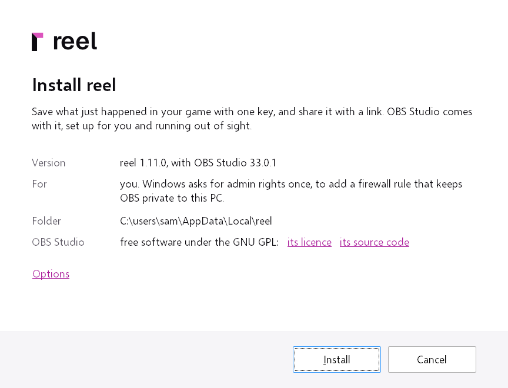

    OBS Studio's line links its licence and its source code. OBS comes with reel as its makers
    publish it, so there is nothing to accept. **Options** has one choice, **Add a shortcut to the
    desktop**, on unless you untick it.
2. Windows asks once for administrator rights, so the installer can add a firewall rule that keeps
   other machines from reaching the OBS that comes with reel. Click **Yes**. A later install or
   update does not ask again. The page shows the install's progress meanwhile.

    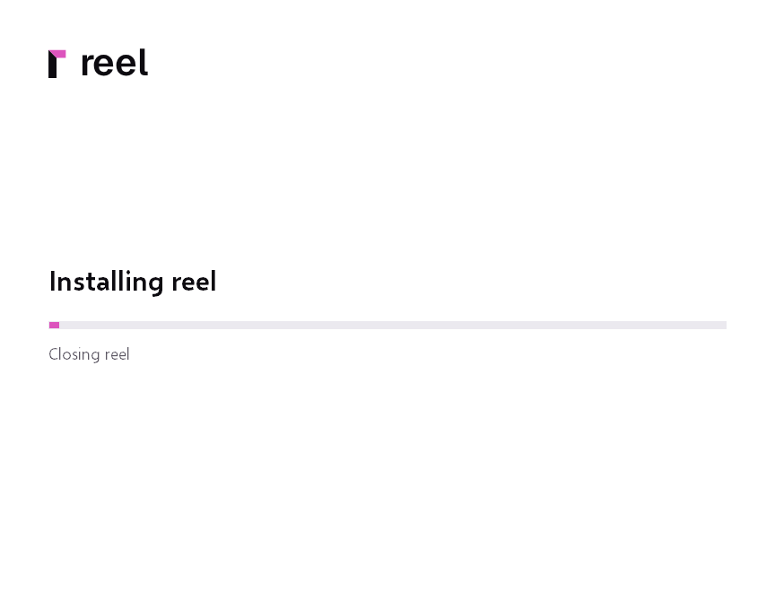

3. At the end, press **Open reel**. reel's icon appears in the tray (the corner by the clock), and
   the window opens on **reel's own OBS**. **Close** leaves it for later: reel is in the Start
   menu.

    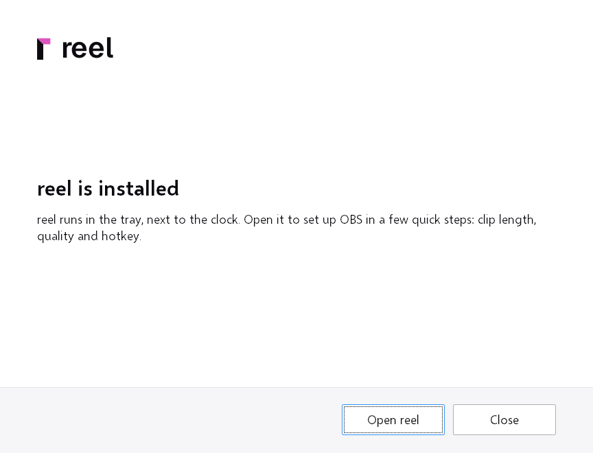

## 3. The setup

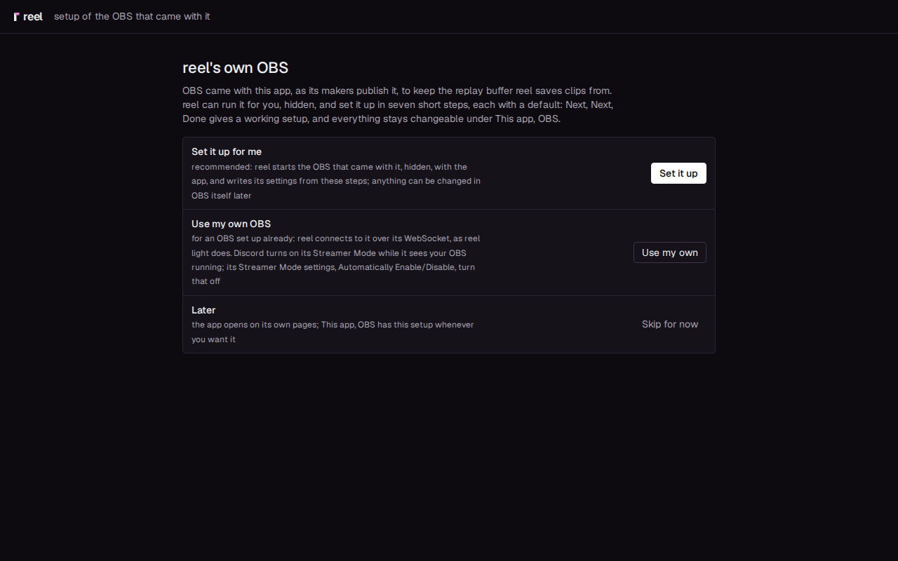

The first page offers three ways:

- **Set it up for me** (recommended): press **Set it up**. Eight short steps follow (seven with a
  server), each with a sensible default, so pressing **Next** through them gives a working setup. Everything stays
  changeable later under Settings, **OBS**.
- **Use my own OBS**: for an OBS you have set up already. The setup goes on with the five steps
  for your own OBS instead, the ones of [Your own OBS](own-obs.md#2-the-setup).
- **Later**: press **Skip for now**, and the app opens on its own pages. Settings, **OBS** has the
  setup whenever you want it.

If OBS is slow to answer, or something is wrong with it, a line at the top of the step says what,
with **Show the log**. If OBS does not answer at all, reel shows OBS's own window, where OBS's
error appears.

1. **Clip length**: how much of the past a clip keeps when you save it. The default is 1 min;
   30 s, 2, 3, 5 and 10 min are one click away, or type a number of seconds.
2. **Quality**: **Smooth: 1080p60** suits most games; **Light: 1080p30**, at 30 frames a second,
   asks about half as much of the PC, and fast motion looks less fluid; **Sharp: 1440p60** keeps
   small text readable; **Native: your screen** records the screen as it is. On a PC with 4
   logical processors or fewer, a first setup starts at Light and says why; a quality already
   chosen stays. "What that comes to" shows what OBS records at and how much memory the replay
   buffer takes.

    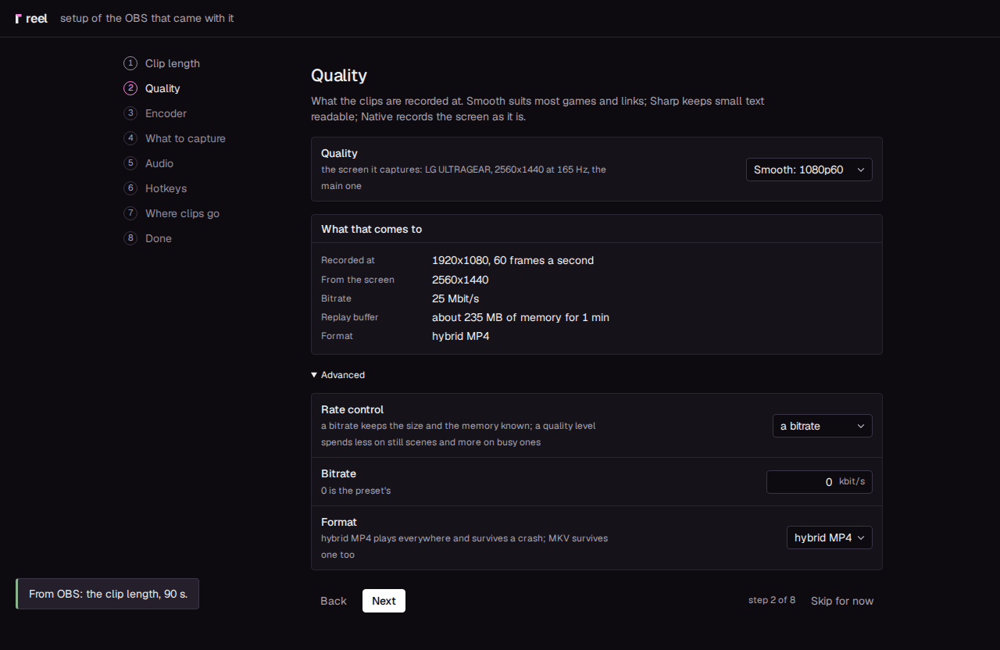

3. **Encoder**: reel tests each encoder this PC has with a short encode, the graphics card's first,
   then tries each one that passed in OBS itself, and picks the first OBS records with. NVIDIA
   NVENC, AMD AMF and Intel Quick Sync leave the game more room than the CPU. Each row shows where
   its test is (waiting, testing, trying in OBS, works, not here) as the test goes. **not here**
   says why in plain words, such as "no NVIDIA graphics card here", with ffmpeg's own lines under
   **details**; a driver that does not answer within 10 seconds is stopped and its row says so.
   For the try in OBS, OBS starts again with the encoder, a few seconds each, and its replay
   buffer has to run with it. **OBS cannot use it** means OBS does not have that encoder or could
   not start it, with OBS's own lines under **details**. Only an encoder that works in both can
   be picked, here and later under Settings, OBS, where the others are listed with the reason.
   **Test again** runs the test once more.

    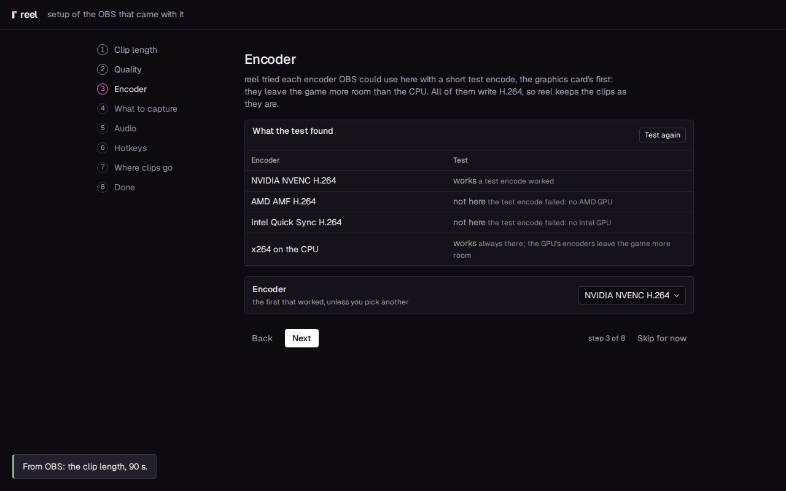

4. **What to capture**: **The game in front** (on) captures any fullscreen game, with the screen
   behind it when no game runs. **Screen** picks the monitor. Leave **Capture games that run as
   administrator** off unless a game of yours needs it
   ([Games that run as administrator](#games-that-run-as-administrator)).
5. **Audio**: what should a clip hear?

    - **Desktop audio** (everything the PC plays on the output you pick, the game and Discord
      included) and the **Microphone** are on, each with its device. Turn either off.
    - **The game alone** (the game in front, or a program you pick from the ones open) and
      **Discord alone** can be added.
    - Each source you choose shows a level with its meter (the meters move a few seconds after
      OBS starts) and a line saying where it goes. Track 1, the full mix a clip plays, holds desktop
      audio and the microphone. With desktop audio on, the game and Discord are in it already, so
      they go on tracks of their own and never into the full mix twice. With desktop audio off,
      they make the full mix with the microphone.
    - **Each source on a track of its own** turns on by itself with more than one source, so the
      editor can turn each one up or down later.
    - **Noise suppression** for the microphone: **Strong (RNNoise)** by default, which also takes
      out keyboard clicks and noise between words; **Light (Speex)** for steady hiss and hum, at
      very little CPU; **NVIDIA noise removal** when OBS offers it (an RTX card with NVIDIA's audio
      effects installed); or **Off**. If your own OBS has filters on its microphone, **Use these
      filters** copies them as they are. **Noise gate** is under **Advanced**.

    Anything beyond these choices (more filters, a source's own properties) you set in OBS itself,
    after the setup: see **Open OBS** under [Afterwards](#afterwards).

    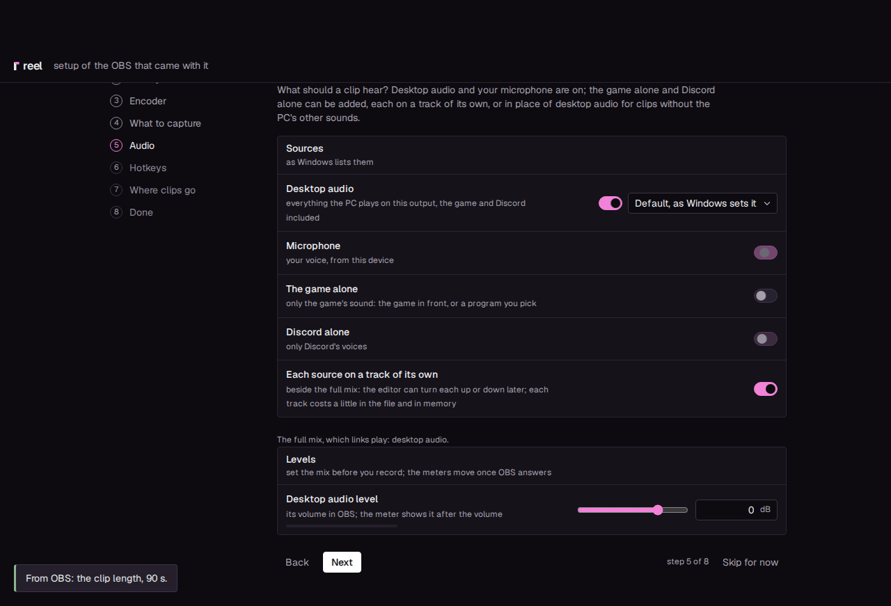

6. **Hotkeys**: **Save a clip** is Alt+F10. To change it, click the field and press the keys.
   With a server (the next step), **Save and share** shows here too, Ctrl+Alt+Shift+S by default.
7. **Where clips go**: **This PC only** is chosen already. reel keeps the library in the app, on
   this PC, and nothing goes anywhere ([Standalone](standalone.md)). **Clips folder** is where OBS
   writes the clips; reel takes each one into the library. For a server, see
   [Add a server for links](#add-a-server-for-links).

    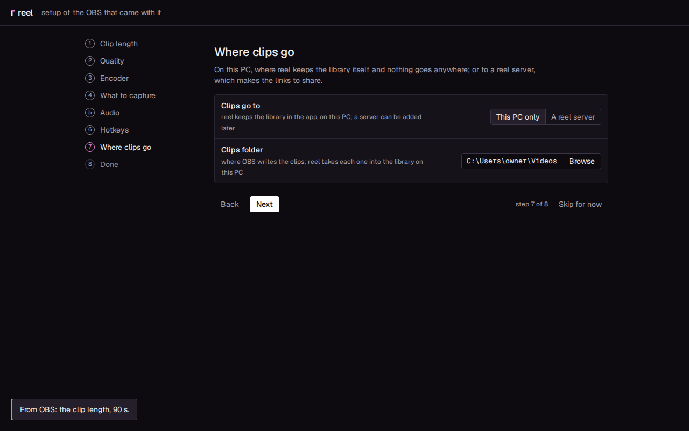

8. **New versions**: **Look for new versions on GitHub** is on. The app then asks GitHub for
   reel's newest release, with reel's version and nothing else, a minute after the start and
   then every six hours, and asks you before it installs one; switched off, only **Check now**
   asks ([What leaves your PC](../privacy.md#what-leaves-your-pc)). With a server this step is
   not there: the server brings the app's updates.

    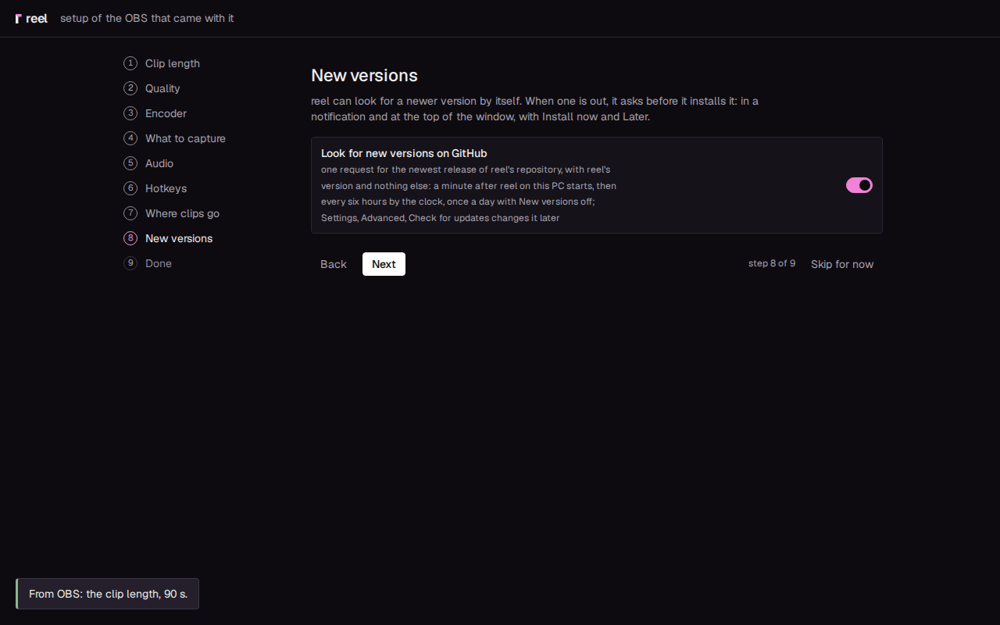

9. **Done** shows a summary. Press **Finish**.

    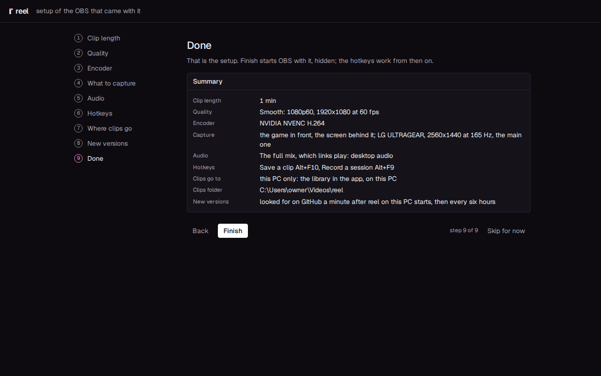

When it worked, OBS starts with your setup, hidden (no window, no second tray icon), and the window
opens on your library. From now on OBS starts and stops with the app. If one part could not be
done (Windows refused the task for games that run as administrator, say), Finish still saves
everything else and says which part failed and why. You can try that part again under Settings,
**OBS**.

## 4. The first clip

1. Start a game and play a little.
2. Press **Alt+F10** (Save a clip). The "clip captured" sound plays.
3. A moment later the notification "Clip in the library" appears. Click **Open** to see the clip.
4. To send it, open **Send** on the clip's page, download the original or a copy under your chat's
   upload limit, and drag the file into the chat ([Standalone](standalone.md) has the details).

When something does not happen, click the status chip at the top of the window: it says what the
app and OBS are doing. Settings, **Status** has more.

## Add a server for links

With a server of your own ([The server](server.md)), every clip goes up as you save it, and
**Save and share** puts its link on your clipboard.

1. On the server, open Settings, Devices and press **Pair a device**. A code appears, good for ten
   minutes and one use.

    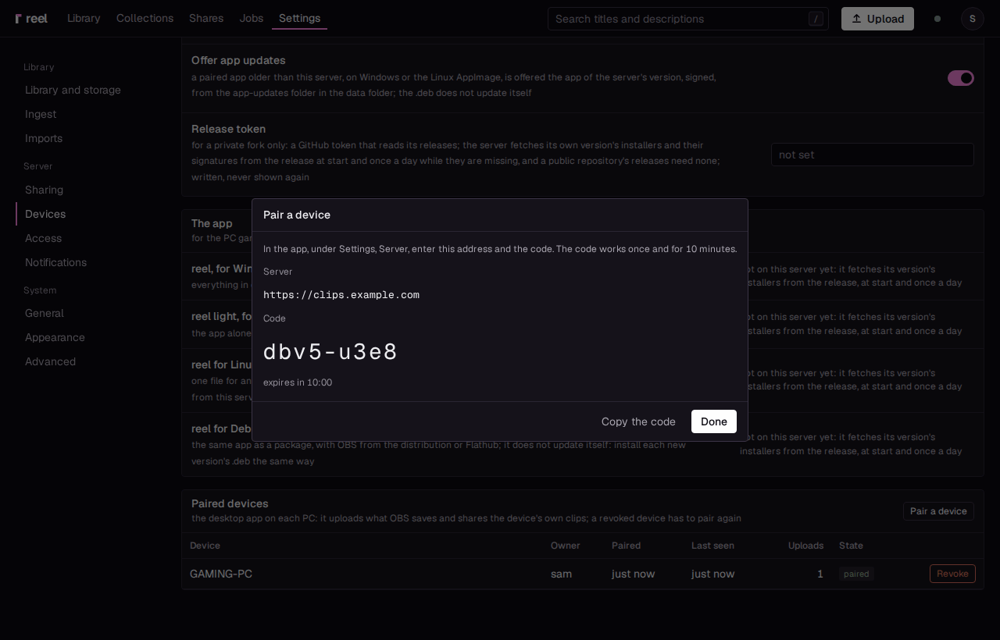

2. In the setup's **Where clips go**, pick **A reel server**. (Finished the setup already? Follow
   [Add a server later](standalone.md#add-a-server-later) instead.)
3. Enter the **Server URL** (`https://clips.example.com`) and the **Pairing code**, then press
   **Pair**. When it worked, the setup moves on to **Done**, and its summary names your server
   under "Clips go to".
4. Press **Finish**. The window opens on the server's library. With reel's own accounts it asks
   you to sign in the first time, inside the window, as in the browser; the app remembers it.

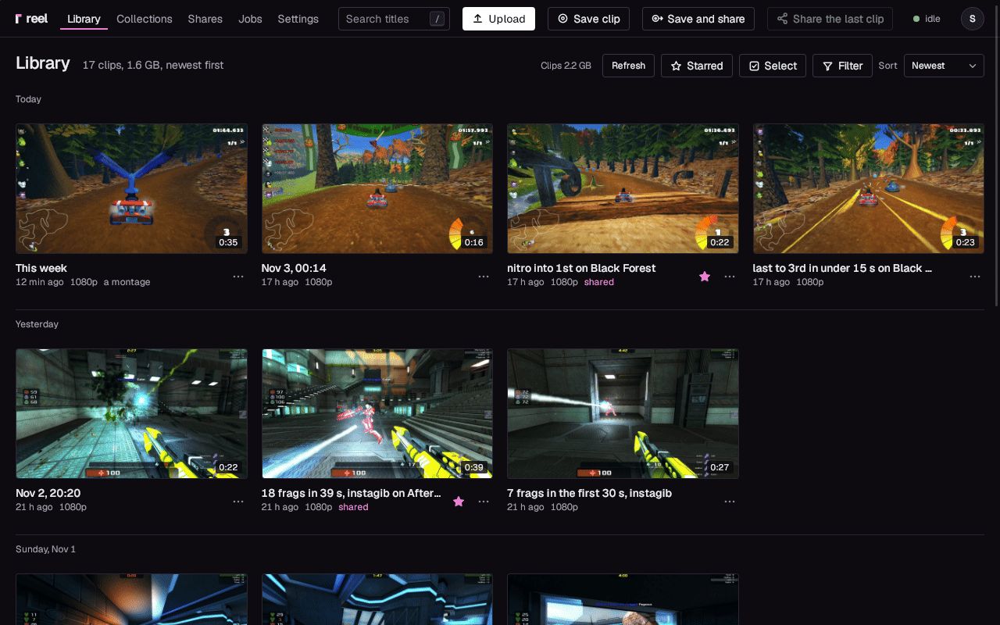

Then make your first link:

1. In a game, press **Ctrl+Alt+Shift+S** (Save and share).
2. The "clip captured" sound plays, the tray shows the upload, and a few seconds later the "link
   copied" sound plays.
3. Paste the link into a chat (Ctrl+V). In Discord, and in other apps that show a link's video, it
   plays right there; anywhere else the link opens the clip's page.

With a server, **Alt+F10** (Save a clip) uploads without making a link: the clip waits in your
library. **Ctrl+Alt+S** (Share the last clip) copies a link to the newest one. The tray menu lists
the last clips, each with **Open** and **Copy link**, and has **Save clip** and **Save and share**
as well.

## Afterwards

- **Change the setup**: Settings, **OBS** has every choice of the setup, the sources a
  clip hears among them, and **Run the setup again**. Its values are OBS's own: reel reads them
  from OBS, so a change you make in OBS shows there too. A change made here goes into OBS, that
  setting alone. When it starts, reel writes nothing into OBS; it only makes sure the WebSocket and
  the replay buffer are on.
- **Open OBS**, at the top of Settings, OBS, opens OBS's own window, for anything reel's choices
  do not name. Change what you like there; reel keeps working as long as the WebSocket and the
  replay buffer stay on. While OBS's window is up, a bar at the top of every page says where reel's
  settings are in OBS (Settings, Output, Replay Buffer for the clip length, and so on). Press
  **Hide OBS** to hide it again; what you changed shows under Settings, OBS.
- **Your own OBS at the same time**: while it is open, reel's OBS waits ("your own OBS is running
  ...; reel's OBS starts once it is closed"), so two captures never run at once.
- **If OBS crashes**, also when its crash dialog keeps it open, or stops answering for 20
  seconds, the app ends it and starts it again, a little later each time, with the replay buffer
  as it was: running, or stopped while recording is paused. An OBS that stops again right after
  it starts (twice in a row, or once right after the encoder changed) with an encoder no replay
  was saved with yet counts against that encoder: reel changes it back, as the next point says,
  and says OBS stopped right after it started with it. With the encoder of the last replay it is
  not the encoder's: after five stops in a row reel stops trying and says why; **Start OBS
  again**, in the tray or at the top of Settings, OBS, tries once more. An OBS with the highest
  rights that its task does not bring up is waited for instead: reel says so and takes it over
  once it runs.
- **If another encoder does not record**: after the encoder changes (in the setup, under Settings,
  OBS, or in OBS itself), reel watches OBS's next start. If the replay buffer does not run with
  it, or a save fails before any replay was saved with it, reel goes back to the encoder the last
  replay was saved with (x264 on the CPU if none was) and says so in its status, the tray's tooltip
  and a notification. That encoder is not offered again until **Run the setup again** tests it.
  OBS's own lines about it go into reel's log (Settings, Log), as they do when a save fails.
- **Its name**: reel runs the OBS that comes with it as `reel-capture.exe`, so Discord does not
  switch to Streamer Mode while it records in the background. The files are OBS's own, unchanged,
  and their source ships with every release. The OBS for games that run as administrator, when an
  earlier reel put it in place, keeps OBS's name (`obs64.exe`) until you press **Update the copy**
  under Settings, OBS.
- **Updates** keep the package: reel stays reel, with its OBS. Press **Install** and reel
  closes, a small window shows the installer's progress, and reel opens again by itself about a
  minute later ([Updates](../desktop-app.md#updates)).
- **A newer installer of your own**: you can run one while reel is open. Its page says
  **Update reel** and names the version on this PC. While it works it says "Closing
  reel" until reel has stopped its OBS and quit, and only then are the files replaced. If
  something still holds one of OBS's files, the installer names it: close it, then press
  **Retry**.
- **OBS's own updates**: the OBS that came with reel never updates itself and never asks. A newer
  OBS comes with a newer reel: once OBS publishes a version, reel's project tests it and ships it
  in its next release. An update that brings a newer OBS replaces OBS's files and keeps OBS's
  settings (`obs\config`); one that brings the same OBS leaves its files alone, which makes it
  quicker.
- **reel light over reel** removes the OBS that came with reel, its settings and its copy for
  games that run as administrator. The installer's page, **Switch to reel light**, says so, and
  **Install** waits until you tick **Remove the OBS that came with reel, and its settings**. To
  keep OBS, cancel and run `reel_<version>_x64-setup.exe` instead. Run silently (`/S`), it stops
  without touching anything unless it is also given `/WITHOUTOBS`. reel over reel light says
  **Switch to reel** and brings the OBS back.
- **Uninstall** (Windows Settings, Apps, **reel**, or in the app Settings, Startup, About,
  **Uninstall reel...**) removes the app, the OBS that came with it and OBS's settings. reel's own
  settings, the pairing and your clips folder go only when you tick them on its page
  ([Uninstalling](../desktop-app.md#uninstalling)).

## Games that run as administrator

A few games run with administrator rights, and OBS can only capture them when it runs with those
rights too. Turn on **Capture games that run as administrator**, in the setup's step 4 or under
Settings, **OBS**:

- **Windows asks once**, when you press **Finish** or flip the switch, to run `reel-elevate.exe`,
  reel's own small helper, as administrator. It puts a copy of OBS, its settings included, in
  `C:\Program Files\reel\obs`, where only an administrator can change it, checks that copy's rights,
  and creates two scheduled tasks. "reel OBS (games that run as administrator)" starts the copy,
  never reel, with the highest rights at logon, hidden and loading no plugin but OBS's own. "reel
  OBS window (games that run as administrator)" shows, hides and closes it when reel asks. There is
  no prompt at every start. If it fails, the switch stays off and says why.
- **A change of the setup** under Settings, OBS (the clip length, the quality, the encoder ...)
  is written into the copy while the switch is on, and Windows asks once for each, as the page
  says. The levels and the microphone's filters change without asking.
- **When an update of reel brings another OBS**, reel updates the copy itself at its first start
  after the update, once no game or other fullscreen app is in front. Windows asks once, and on
  **Yes** OBS starts again from the updated copy. Settings, OBS says so in its first line while it
  waits and while Windows asks. If you say **No**, or it fails, the copy keeps the OBS it had:
  Settings, OBS names its version, a notification says so each time reel starts, and **Update the
  copy** does it whenever you like. reel asks by itself again only after its next update, never at
  every start.
- **If the copy or its task is gone** while the switch is on (reel light was installed over reel,
  or reel was uninstalled and installed again with its settings kept), OBS runs without
  the highest rights: your other games are captured as before, games that run as administrator
  are not. Settings, OBS and a notification say so, with **Put it in place**, or **Update the
  copy** when only the task is missing. Windows asks once.
- **Open OBS** and **Hide OBS** work as without the switch, through the second task: Windows does
  not let reel itself show or hide a program with more rights. A copy an earlier reel put in place
  starts OBS in its own tray icon until Settings, OBS, **Update the copy** (Windows asks once).
- **The Save a clip key** is taken by OBS itself, since Windows does not pass keys pressed in such
  a game to reel. Save and share and Share the last clip work again once the game is not in front.
- **Turning the switch off** removes the task and the copy. Windows asks once more for that, and
  once when you uninstall reel with the switch on.
- **One change of the copy runs at a time.** While Windows asks, or while the copy is being set
  up, the switch and the buttons that change the copy wait, and the line under the switch says
  what runs. Changes made meanwhile count together, the newest last: Windows asks once for where
  they end, or not at all when the switch is back where it was. If you say **No**, the switch goes
  back to what is there and says so.
- **A copy or task left in Program Files** with the switch off (a step that stopped halfway, for
  example) shows on Settings, OBS, with **Remove it**. Windows asks once.
