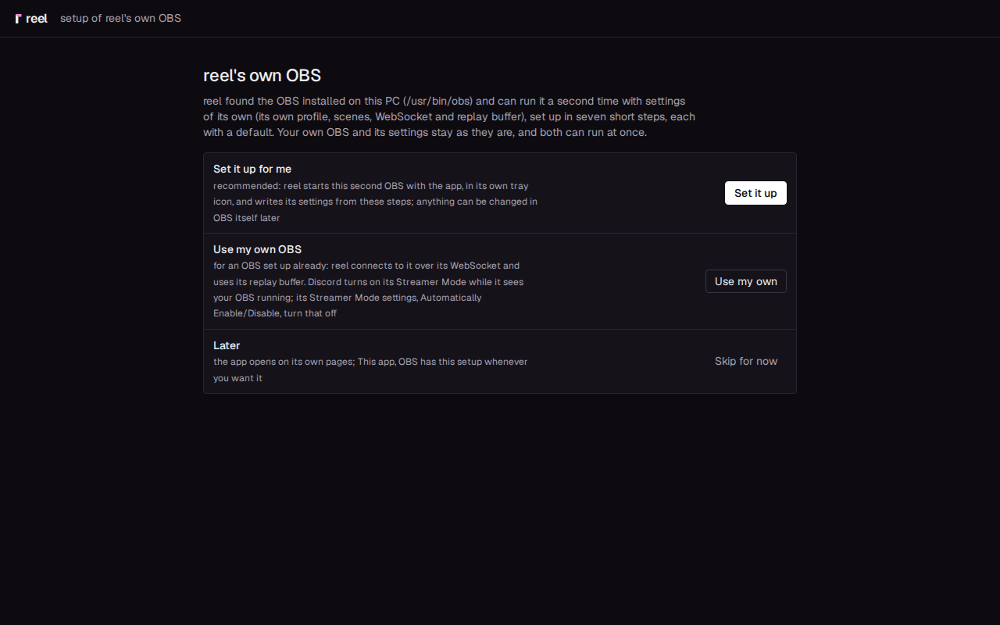
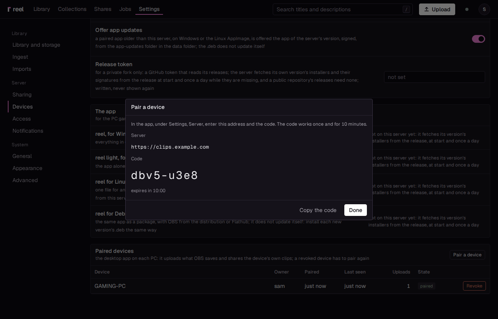

# Linux

The desktop app works on a Linux gaming PC as on Windows: every replay OBS saves goes into your
library on this PC, and with a server of your own, one key puts its share link on your clipboard.
It comes as an AppImage for any distribution and as a `.deb` for Debian and Ubuntu, both simply
reel: the Windows packages reel and reel light differ by the OBS inside, and on Linux there is
none inside, only the OBS you install.

You pick one of two ways with OBS:

- **Set it up for me**: reel runs the OBS installed on this PC a second time, with settings of its
  own (its own profile, scenes, WebSocket and replay buffer), and sets it up in seven steps. Your
  own OBS and its settings stay exactly as they are, and both can run at once: stream or record
  with yours while reel's keeps the replay buffer.
- **Use my own OBS**: reel connects to your OBS over its WebSocket and uses its replay buffer.

What you need:

- A 64 bit PC with glibc 2.36 or later: Arch, Fedora, Debian 12, Ubuntu 24.04 and later, and their
  relatives. Ubuntu 22.04 is too old.
- OBS Studio 28 or later, from your distribution or from Flathub. reel finds it by itself: `obs` on
  the PATH, else OBS from Flathub (`com.obsproject.Studio`). Installed OBS after reel? Quit reel
  from its tray and start it again.
- Nothing else to start with. A reel server is optional: it adds share links
  ([Add a server for links](#add-a-server-for-links)).

## 1. Download

Download one of the two from [reel's releases](https://github.com/Locko2901/reel/releases), each
with its `.sha256` beside it:

- `reel_<version>_amd64.AppImage`: one file that runs on any distribution. Take this one unless
  you want a package.
- `reel_<version>_amd64.deb`: the same app as a package for Debian and Ubuntu, installed with apt.

A reel server you run offers both under Settings, Devices: **reel for Linux, the AppImage** and
**reel for Debian and Ubuntu, the .deb**.

## 2. Install

=== "The AppImage"

    1. Put it where it can stay, such as `~/Applications`, and make it executable:

        ```
        chmod +x ~/Applications/reel_*_amd64.AppImage
        ```

    2. Run it, from a terminal or by double-clicking it in the file manager. Its updates replace
       this file in place, so keep it in a folder you can write to.
    3. If it says FUSE is missing, install your distribution's FUSE (`sudo pacman -S fuse2` on
       Arch, `sudo apt install fuse3` on Debian and Ubuntu, `sudo dnf install fuse` on Fedora), or
       start it with `--appimage-extract-and-run`.

=== "The .deb"

    ```
    sudo apt install ./reel_<version>_amd64.deb
    ```

    apt brings along WebKitGTK, the tray's library and GStreamer's plugins for the clips' video
    (`gstreamer1.0-plugins-good`, `gstreamer1.0-libav`, and `gstreamer1.0-gl`, which shows the
    video without a copy). reel is then in the menu, and `reel-desktop` starts it from a terminal.

When it worked, reel's icon is in the tray and the window opens: on **reel's own OBS** when OBS is
installed (the setup, step 3), else on Settings, **OBS**. On a desktop without a tray
(GNOME without the AppIndicator extension) the app runs all the same and says so under Settings,
**Status**; starting it again opens its window.

## 3. The setup

At its first start with OBS installed, the app opens on **reel's own OBS**, with three choices:
**Set it up for me**, **Use my own OBS**, or **Skip for now**. The page names the OBS it found, for
example "the OBS installed on this PC (/usr/bin/obs)" or "OBS from Flathub".



### Set it up for me

The same seven steps as on Windows, each with a default, so pressing **Next** through them gives a
working setup; [All in one](all-in-one.md) walks through them with pictures. The last step,
**Where clips go**, has **This PC only** chosen: the library on this PC
([Standalone](standalone.md)). What differs on Linux:

- **What to capture**: the screen. On X11, reel's OBS takes it directly. On Wayland it takes it
  through PipeWire: the first time OBS starts, the desktop asks which screen to share. Pick it, and
  allow it to be remembered; OBS keeps the answer in reel's settings, so it asks once. On Hyprland,
  tick **Allow a restore token** in its screen picker, or it asks at every start of reel's OBS.
- **A game**, captured straight from it rather than from the screen, needs the obs-vkcapture
  plugin for OBS (Vulkan and OpenGL games). The step says whether this OBS has it. With it, start
  each game through `obs-gamecapture`: on Steam, set `obs-gamecapture %command%` as the game's
  launch option. Without it, the screen holds the game.
- **Audio**: desktop audio and the microphone as PulseAudio and PipeWire list them. **The game
  alone** and **Discord alone** need the PipeWire audio capture plugin for OBS
  (obs-pipewire-audio-capture); the step says whether this OBS has it. The game alone is picked by
  name from the programs playing sound, so start the game before this step.
- **Encoder**: NVIDIA NVENC, VAAPI (AMD and Intel) or x264 on the CPU, each tested with a short
  encode first.
- **Its window**: reel's OBS keeps itself in its own tray icon, beside reel's, and its window opens
  from there, since on Wayland no app may show or hide another's window. Without a tray, OBS's
  window stays minimised.

From then on reel's OBS starts with the app, starts again after a crash, and stops when you quit
reel. Its settings live in reel's folder: `~/.local/share/reel/obs` for an installed OBS, and
`~/.var/app/com.obsproject.Studio/reel` for OBS from Flathub, the one place its sandbox may write.
Plugins you installed for your own OBS (under `~/.config/obs-studio/plugins`) work in reel's as
well.

!!! note "One game capture at a time"
    obs-vkcapture serves one OBS at a time. If your own OBS is open and captures games through it
    too, give reel's OBS the screen alone (turn **The game in front** off under Settings, OBS).

### Use my own OBS

reel connects to your OBS as in the next step; nothing of reel's runs inside OBS.

## 4. Your own OBS

With **Use my own OBS**, start OBS once, then look at the panel **What reel needs from OBS** at the
top of Settings, **OBS**. It checks two things for as long as the app runs, and says in words what
to do about each:

1. **OBS's WebSocket**: in OBS, open **Tools**, **WebSocket Server Settings**, tick **Enable
   WebSocket server**, leave the port at 4455, and press **Show Connect Info** for the **Server
   Password**. Paste it into **Password** in the app. When it worked, the line says "on" with OBS's
   version.
2. **The replay buffer**: with **Start the replay buffer** on (the default), reel turns OBS's
   replay buffer on and starts it by itself. When it worked, the line says "running, it keeps the
   last 60 s" (or your length).

The recording format and the encoder are OBS's: any H.264 encoder (VAAPI, NVENC or x264) with AAC
audio keeps clips as they are, never encoded again. [Your own OBS](own-obs.md), steps 2 and 3, has
the same settings with OBS's pictures; they are the same on Linux.

OBS from Flathub works the same way: its WebSocket is reachable on 127.0.0.1 from outside the
sandbox.

## 5. Hotkeys

Global hotkeys on Linux depend on your desktop: they may not work, or may need to be set up in the
desktop's own keyboard settings. There you can bind a key to `reel-desktop --save` (Save a clip),
or with a server `--save-and-share` and `--share-last`. With the AppImage, the command is the
AppImage's path, which Settings, **Hotkeys** shows.

## 6. The first clip

1. Play a game and press **Save a clip**: Alt+F10 after **Set it up for me** or **Use my own OBS**;
   otherwise set a key under Settings, **Hotkeys**. The "clip captured" sound plays.
2. A moment later the notification "Clip in the library" appears. Click **Open** to see the clip.
3. To send it, open **Send** on the clip's page, download the original or a copy under your chat's
   upload limit, and drag the file into the chat ([Standalone](standalone.md) has the details).

## Add a server for links

With a server of your own ([The server](server.md)), every clip goes up as you save it, and
**Save and share** puts its link on your clipboard.

1. On the server, open Settings, Devices and press **Pair a device**. A code appears, good for ten
   minutes and one use.

    

2. In the app, during **Set it up for me**: pick **A reel server** in **Where clips go**, enter the
   **Server URL** (`https://clips.example.com`) and the **Pairing code**, and press **Pair**. The
   setup moves on to **Done**, and the library opens once you finish it.
3. Otherwise, follow [Add a server later](standalone.md#add-a-server-later): pair under Settings,
   **Server**, then set **Mode** to **connected**.

The device's token is kept in `~/.config/reel/token`, readable by your user alone. **Revoke** under
Settings, Devices on the server signs the PC out.

Then make your first link:

1. Play a game and press **Ctrl+Alt+Shift+S** (Save and share), or your shortcut.
2. The "clip captured" sound plays, then the "link copied" sound.
3. Paste the link into a chat. In Discord, and in other apps that show a link's video, it plays
   right there.

## Good to know

- **Start at logon**: Settings, **Startup**. For the AppImage the entry points at the AppImage's
  own path, so after moving the file, turn it off and on again.
- **NVIDIA**: with NVIDIA's driver, WebKitGTK's DMA-BUF renderer leaves windows blank, and on
  Wayland NVIDIA's explicit sync breaks them. reel turns both off for itself unless you set
  `WEBKIT_DISABLE_DMABUF_RENDERER` or `__NV_DISABLE_EXPLICIT_SYNC` yourself.
- **Video in the window**: the AppImage carries what the window plays the clips' video and sound
  with (GStreamer and its plugins), so it needs nothing of your system's for that; the `.deb` uses
  your system's. If a plugin a clip needs is missing, or the page stops answering while it plays,
  the app loads the page again without video and sound rather than let the window freeze, and its
  log says why. Links and the pages in a browser play as always.
- **reel's OBS or yours**: Settings, OBS switches between them at any time (**Run a second OBS of
  reel's**); off, reel connects to your own. Its line there says which OBS reel runs.
- **Its name**: reel runs its second OBS as `reel-capture`, so Discord does not switch to Streamer
  Mode while it records in the background. It is a copy of the OBS you installed, OBS's own program
  unchanged, in `~/.local/share/reel/obs`, copied again when OBS updates. With OBS from Flathub, or
  your own OBS, Discord still switches: in Discord, **User Settings**, **Streamer Mode** (in newer
  versions under **Appearance**), turn off **Automatically Enable/Disable**. Discord from Flathub
  never turns it on by itself.
- **Updates**: the AppImage installs a new version from Settings, Startup, **Install** (from its
  server when paired, from the release in standalone), replaces itself and starts again. The
  `.deb` does not update itself: install the next `.deb` the same way as the first. See
  [Updates](../desktop-app.md#updates).
- **reel's OBS keeps its own settings** in `~/.local/share/reel/obs` (its log in
  `obs-studio/logs` there; for OBS from Flathub in `~/.var/app/com.obsproject.Studio/reel`), beside
  the program it runs as, `reel-capture` in `program/bin`, with links to OBS's helpers and to the
  folders OBS finds its plugins in.
- **Uninstall**: delete the AppImage, or run `sudo apt remove reel`. The settings stay in
  `~/.config/reel`, and the logs, reel's OBS and the library on this PC in `~/.local/share/reel`,
  until you delete those folders. So does the hidden desktop entry the shortcuts portal knows reel
  by, in `~/.local/share/applications`.
