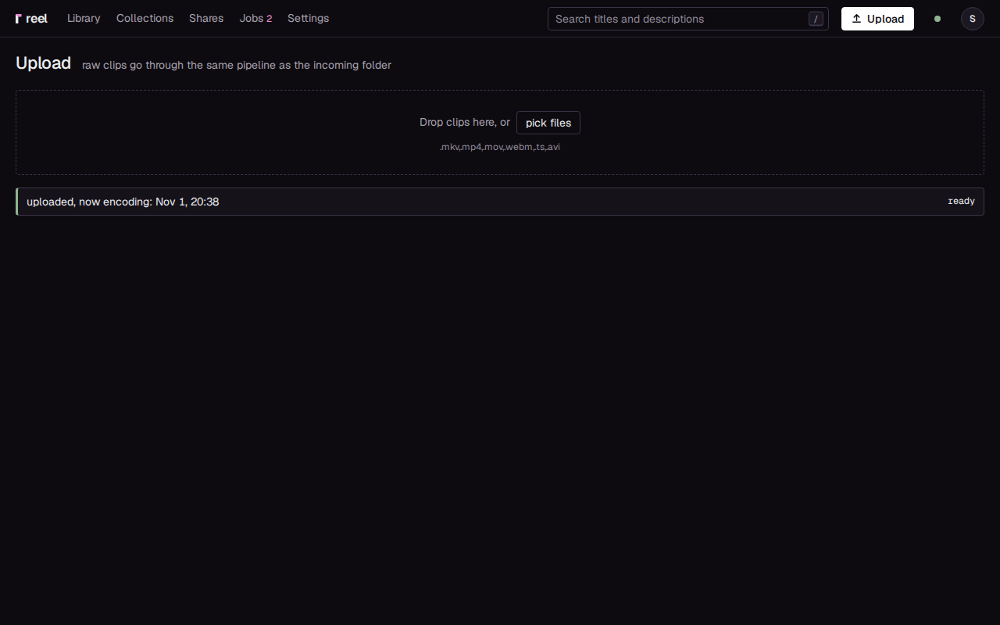

# No app: a watched folder, the browser, ShareX

You can get clips onto your reel server without installing anything on
the gaming PC. Let OBS save straight into the server's incoming folder,
upload in the browser from any computer or phone, or send files from
ShareX. Each way needs a server ([The server](server.md)).

| Way | What you get |
|---|---|
| [OBS into the incoming folder](#1-obs-into-the-incoming-folder) | every replay you save shows up in the library by itself |
| [The browser](#2-upload-in-the-browser) | a clip now and then, from any computer or phone, nothing to set up |
| [ShareX](#3-sharex) | uploads from ShareX, with limits you should know first |

Without the app there is no key that copies a link. You make links on the
clip's page: **New link**, then **Create and copy**.

## 1. OBS into the incoming folder

The server watches its incoming folder (`./incoming` in the compose file,
`/incoming` inside the container) and takes in every video that lands
there. Point OBS at that folder and every replay you save reaches the
library with no further step.

### Make the folder reachable from your PC

Pick one:

- **A network share.** Share the folder the compose file mounts as
  `/incoming` over SMB: with Samba on the server, or as a share on a NAS
  that the server mounts as its incoming folder. On the PC it is a path
  such as `\\nas\reel-incoming`. You can map it to a drive letter in
  Explorer (This PC, **Map network drive**).
- **A sync tool** such as Syncthing. Sync a folder on the PC, such as
  `D:\Clips\reel`, to the server's incoming folder, sending one way.

### Point OBS at it

1. In OBS, open **Settings**, **Output** and set the **Recording Path** to
   the share (`\\nas\reel-incoming`) or to the synced folder.
2. Turn the replay buffer on and give OBS's **Save Replay** a hotkey, as
   in [Your own OBS](own-obs.md).
3. Play a game and press the hotkey.

When it worked, the clip is in the library a few seconds after the file
has finished arriving, and the Jobs page shows the work on it. The file
then leaves the incoming folder: reel keeps its own copy, and the raw
file of a re-encoded clip under **Keep originals**.

### What reel takes, and when

- Files directly in the folder, not in subfolders, whose name ends in one
  of the **Extensions** (Settings, **Ingest**; `mkv mp4 mov webm ts avi`
  by default).
- Names that start with a dot or end in `.part`, `.tmp`, `.crdownload` or
  `.txt` are left alone. Copies and sync tools use such names while they
  write, so reel waits for the final name.
- reel takes a file once its size has stayed the same for two reads of
  the folder, five seconds apart, and it can be opened (Settings,
  **Ingest**, **Poll every** and **Stable polls**). If a slow connection
  pauses for longer than that, raise **Stable polls**.
- A file that drops out of sight before reel took it (a share gone for a
  moment, a file moved out and back) is counted again from its return.
- A file ffmpeg cannot read moves to `failed/` inside the incoming
  folder, with a note beside it that says why.
- The same video twice is one clip: reel compares the files' contents.

## 2. Upload in the browser

1. Sign in to your server and press **Upload** at the top right.
2. Drop videos on the page, or press **pick files**.
3. Each file shows its progress. When it worked, its row says "uploaded,
   now encoding:" with a link to the clip, then "ready".

You can also drop videos anywhere on the library page. A video that is in
the library already says so, with a link to it.

What limits an upload:

- reel's own **Upload size limit**, 8 GB by default (Settings,
  **Imports**).
- Your reverse proxy's request size
  ([The server](server.md#2-put-a-reverse-proxy-in-front)).
- Not Cloudflare's 100 MB limit: each file goes up in pieces of at most
  90 MiB.

If the connection drops, or you close the page half way, pick the same
file again and the upload goes on where it stopped. An upload nobody
touches for 24 hours is removed and starts again from the beginning.

The same page works on a phone, and on Android you can share videos to
reel from the gallery ([The phone](phone.md)).

## 3. ShareX

ShareX can send each file to your reel server with a custom uploader.
It works today with a copy of your browser's sign-in, and it has limits
you should know before you rely on it.

### Set it up

1. Sign in to reel in your browser. In the browser's developer tools,
   find the site's cookies and copy the value of `reel_session`.
2. In ShareX, make a custom uploader:
    - method `POST`, request URL `https://clips.example.com/upload`;
    - body as form data (multipart/form-data), file form name `file`;
    - a header `Cookie` with the value `reel_session=` followed by the
      value you copied.
3. Choose it as ShareX's file uploader, and upload a video.

When it worked, the clip shows up in the library, and reel answers ShareX
with JSON naming the clip:
`{"clips":[{"id":"...","title":"...",...}]}`.

### Its limits

- **The cookie is your whole sign-in.** Anyone who sees your ShareX
  settings is signed in as you. It stops working when that session ends:
  after 30 days unused ([Idle timeout](../configuration.md#idle-timeout)),
  after 90 days however active
  ([Session lifetime](../configuration.md#session-lifetime)), or when you
  press **Sign out everywhere**.
- **No way past a sign-in proxy.** With a sign-in in front of reel
  (Authentik and the like, in proxy mode), ShareX does not get through.
- **One request per file.** ShareX cannot split a file into pieces, so
  your proxy has to allow the whole file, and behind Cloudflare a file
  over 100 MB fails.
- **No share link back.** What comes back names the clip, whose page is
  private. Make the link on the clip's page.

For clips from a gaming PC, the desktop app, the incoming folder and the
browser serve you better. A ShareX uploader of reel's own is planned: a
token just for ShareX, made on the server like a device's, and an answer
with a share link whose preview plays where you paste it.
