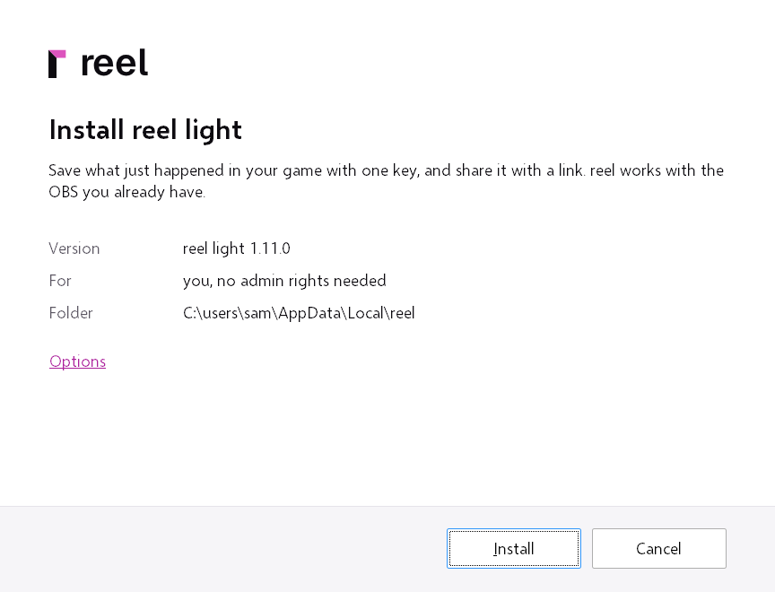
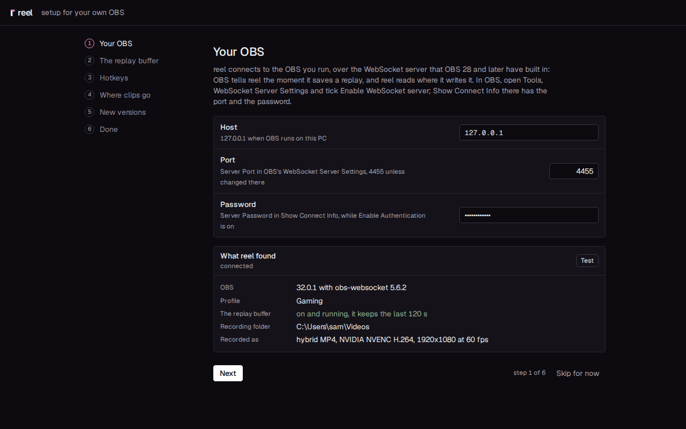
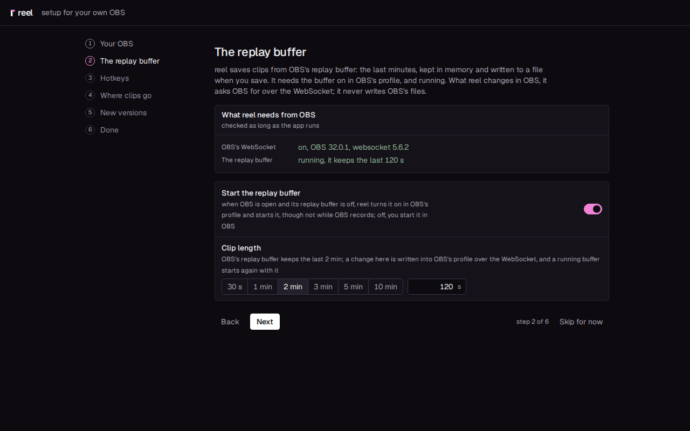
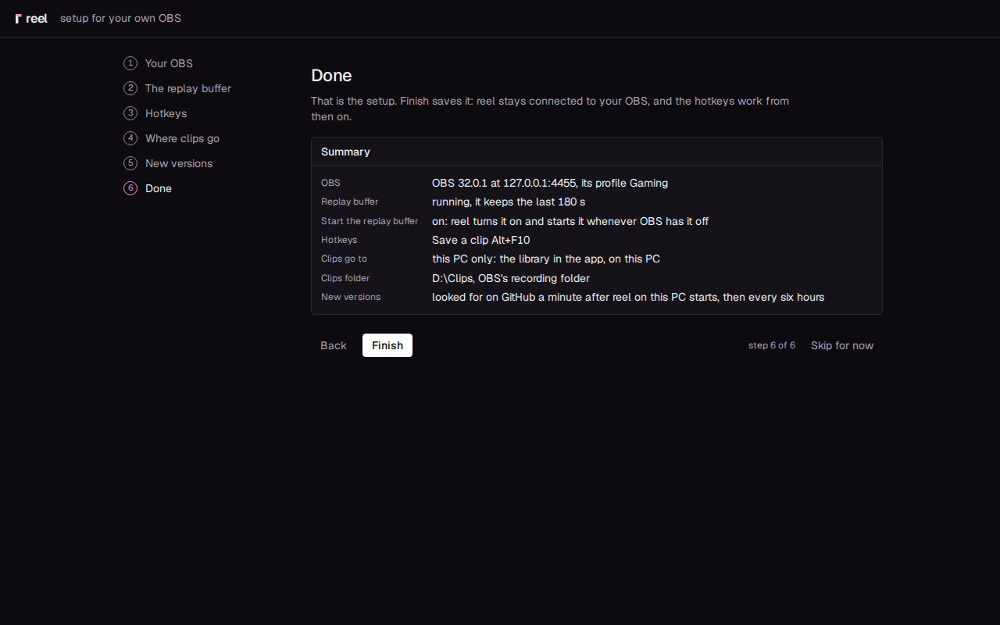
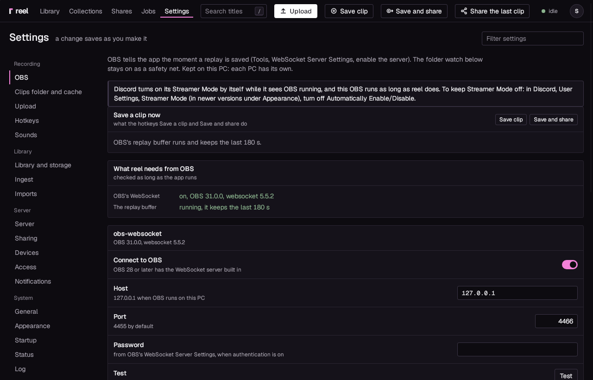
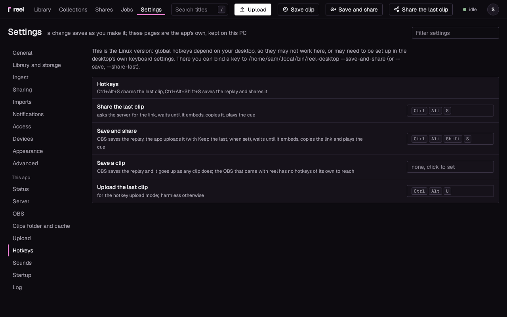
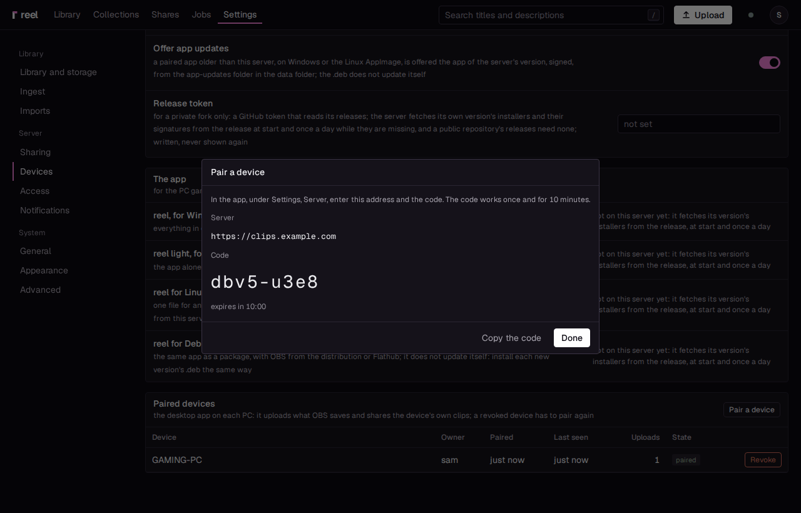
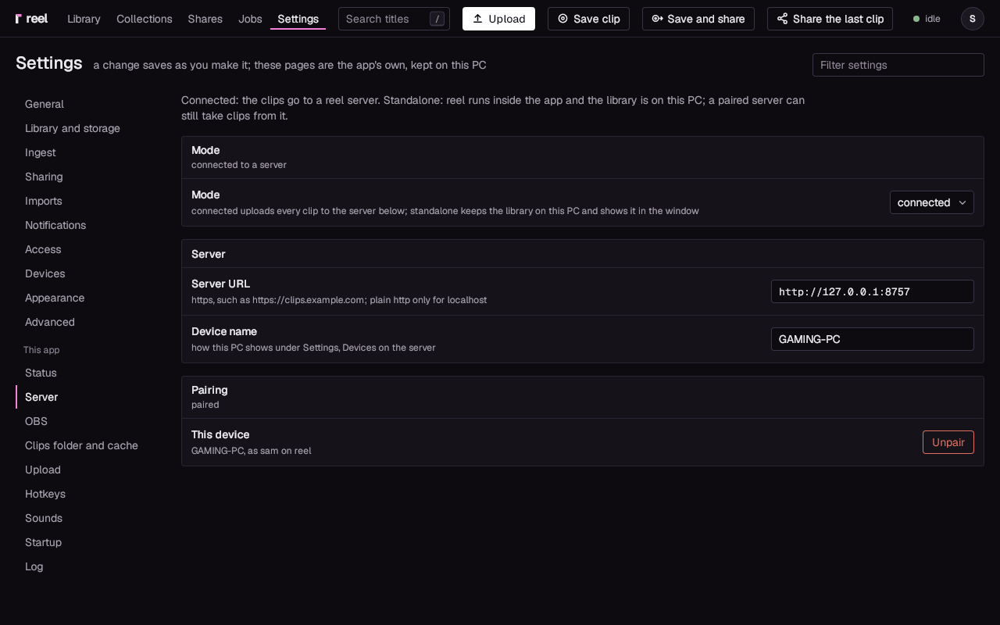

# Your own OBS: reel light

For a Windows PC with OBS set up already, your scenes and all. **reel light** is reel without an
OBS of its own: it connects to yours, OBS keeps recording the way you set it up, and every replay
you save lands in your library a moment later. On Linux, see [Linux](linux.md).

What you need:

- Windows 10 or 11, 64 bit.
- OBS Studio 28 or later, which has the WebSocket server built in.
- Nothing else to start with. A reel server is optional: it adds share links
  ([Add a server for links](#add-a-server-for-links)).

## 1. Download and install

!!! note "Windows protected your PC"
    The installer is not code signed yet, so Windows SmartScreen warns about it. Click
    **More info**, then **Run anyway**.
    [Troubleshooting](../troubleshooting.md#windows-protected-your-pc) has the details.

1. Download reel light, `reel-light_<version>_x64-setup.exe` (about 70 MB), from
   [reel's releases](https://github.com/Locko2901/reel/releases), with its `.sha256` if you want to
   check the file. A reel server you run offers it under Settings, Devices, **reel light, for
   Windows**.
2. Run it. Its one page, **Install reel light**, says what it installs, that it is for you alone with no admin rights
   needed, and the folder, `%LOCALAPPDATA%\reel`. **Options** has **Add a shortcut to the
   desktop**, on unless you untick it. Press **Install**. Without Microsoft's WebView2 runtime,
   which Windows 10 and 11 usually have, the installer brings it along.

    

3. At the end, press **Open reel**. The app, called reel in the Start menu and in Apps like the
   one with OBS, starts in the tray (the corner by the clock) and opens
   its window on its setup. **Close** leaves it for later: reel is in the Start
   menu.

## 2. The setup

Five short steps (four with a server), each with a default, so pressing **Next** through them
gives a working setup once OBS answers. reel reads what it needs from OBS over OBS's WebSocket,
and what it changes in OBS it asks OBS for the same way; it never writes OBS's files. Start OBS
before you begin.

1. **Your OBS**: where reel finds OBS's WebSocket. In OBS, open **Tools**, **WebSocket Server
   Settings**, tick **Enable WebSocket server**, leave **Server Port** at 4455 and **Enable
   Authentication** on, press **Show Connect Info** and copy the **Server Password**. In the
   setup, leave **Host** `127.0.0.1` and **Port** `4455`, and paste the **Password**. The setup
   tests at once and after each change (**Test** tries again). When it worked, **What reel found**
   lists OBS's version, the profile in use, the replay buffer (on or off, running or not, how
   much it keeps), the recording folder and what a replay is recorded as. When it did not, it
   says what to turn on in OBS, or that OBS wants the password. **Next** saves the connection,
   and the app connects.

    

2. **The replay buffer**: reel saves clips from OBS's replay buffer, the last minutes kept in
   memory and written to a file when you save. **What reel needs from OBS** checks the WebSocket
   and the replay buffer for as long as the app runs, and says in words what to do about either.
   **Start the replay buffer** is on: when OBS is open and its replay buffer is off, reel turns it
   on in OBS's profile and starts it (not while OBS records); off, you start it in OBS. **Clip
   length** shows how much OBS's replay buffer keeps; a length picked here is set in OBS's
   profile, and a running replay buffer starts again with it.

    

3. **Hotkeys**: **Save a clip** is Alt+F10. To change it, click the field and press the keys.
   OBS's own **Save Replay** key (in OBS, **Settings**, **Hotkeys**) saves a clip as well: OBS
   saves, and the app takes the clip in. Pick a key here that OBS does not use. With a server (the
   next step), **Save and share** shows here too. **Record a session**, Alt+F9, starts and stops
   a [session recording](../desktop-app.md#recording-a-whole-session).
4. **Games**: the same step as in [All in one](all-in-one.md#3-the-setup): **Add my Steam
   games to the list** is on, and Settings, **Games and apps** changes it later.
5. **Where clips go**: **This PC only** is chosen already: the library on this PC
   ([Standalone](standalone.md)). For a server, see [Add a server for links](#add-a-server-for-links).
   **Clips folder** is OBS's recording folder, as OBS says; a folder picked here is set in OBS.
6. **New versions**: the same step as in [All in one](all-in-one.md#3-the-setup): **Look for new
   versions on GitHub** is on, and switched off only **Check now** asks. With a server this step
   is not there.
7. **Done** shows a summary. Press **Finish**, and the window opens on your library.

    

**Skip for now**, on every step, leaves the setup for later: the app opens on Settings, **OBS**,
and **Run the setup**, in its **obs-websocket** panel, opens it again. An app that was set up
before an update opens as it did, without the setup.

## 3. OBS's settings, later

Settings, **OBS** has what the setup set and more: the **obs-websocket** panel (the connection
and **Start the replay buffer**), **What OBS is set to**, and **Change in OBS**, which sets the
recording folder, the replay length, the format and the bitrate in OBS for you.

For the recording format, pick **Hybrid MP4** or **MKV** in OBS: both survive a crash of OBS. For
the encoder, any **H.264** one works (NVENC, AMF, Quick Sync or x264). Clips in H.264 up to 1440p
and 50 Mbit/s, with AAC audio (OBS's default), go into the library as they are, never encoded
again.

reel never starts or ends your OBS. While it is closed, or after it crashed, the OBS line under
Settings, **Status** says what reel waits for ("waiting for OBS at 127.0.0.1:4455: it is not
running, or its WebSocket server is off"), and reel connects again within a few seconds of OBS
being back, with the replay buffer started again when **Start the replay buffer** is on.

The clips folder follows OBS's recording folder unless you turn **Follow OBS** off under Settings,
**Clips folder** (**Clips folder and cache** when connected). The app watches that folder as a
safety net too, so a clip saved while OBS and the app were not talking is still found.

!!! tip "Discord's Streamer Mode"
    Discord turns on its Streamer Mode by itself while it sees OBS running, and with reel your OBS
    runs whenever you play. To keep Streamer Mode off: in Discord, **User Settings**, **Streamer
    Mode** (in newer versions under **Appearance**), turn off **Automatically Enable/Disable**.

The app's keys are under Settings, **Hotkeys** later: click a field and press the keys. A
combination another program holds is refused with a reason, and the field keeps what it had. With
a server, the page has three more keys: **Save and share**, **Share the last clip** and **Upload
the last clip** ([Hotkeys](../desktop-app.md#hotkeys)).

## 4. The first clip

1. Play a game and press **Alt+F10** (Save a clip), or OBS's **Save Replay**. The "clip captured"
   sound plays.
2. A moment later the notification "Clip in the library" appears. Click **Open** to see the clip.
3. To send it, open **Send** on the clip's page, download the original or a copy under your chat's
   upload limit, and drag the file into the chat ([Standalone](standalone.md) has the details).

To open the window later, double-click the tray icon.

## Add a server for links

With a server of your own ([The server](server.md)), every clip goes up as you save it, and
**Save and share** puts its link on your clipboard.

1. On the server, open Settings, Devices and press **Pair a device**. A code appears, good for ten
   minutes and one use.

    

2. In the setup, on **Where clips go**, pick **A reel server**, enter the **Server URL**
   (`https://clips.example.com`) and the **Pairing code**, and press **Pair**. The setup moves on
   to **Done**, whose summary names your server; press **Finish**.
3. Set up already? In the app, open Settings, **Server**. Under **A server, later**, enter the
   **Server URL** and a **Device name** for this PC (how it shows on the server). Under
   **Pairing**, enter the **Pairing code** and press **Pair**. When it worked, **Pairing** says
   "paired", and **This device** names this PC, your user and your server.

    

4. With the app set up already, set **Mode** to **connected**, so new clips go to the server.
   Clips already in the library on this PC can go up from Settings, **Status**, each with
   **Upload to the server**.

The window now shows your server's library; with reel's own accounts it asks you to sign in once,
inside the window. The device's token is kept in the Windows Credential Manager, never in a file.
Settings, Devices on the server lists the PC, and **Revoke** there signs it out.

Then make your first link:

1. In a game, press **Ctrl+Alt+Shift+S** (Save and share). The "clip captured" sound plays.
2. The app uploads the clip and waits until its link preview is ready, so the link plays where you
   paste it. Then the "link copied" sound plays.
3. Paste the link into a chat. In Discord, and in other apps that show a link's video, it plays
   right there.

## Games that run as administrator

Windows does not pass keys pressed in a game that runs as administrator to a program without
those rights, and that includes the app. For such a game, run OBS as administrator yourself (its
shortcut's Properties, Compatibility, **Run this program as an administrator**, or a scheduled task
at logon) and use OBS's own **Save Replay** key. OBS saves, and the app still takes the clip. The
app's own keys work again once that game is not in front.

Would you rather have reel run and set up its own OBS, with this handled for you? Install
[reel](all-in-one.md), the package with OBS, over this one: its page says **Switch to reel**, and
your settings, your library and the pairing stay.
