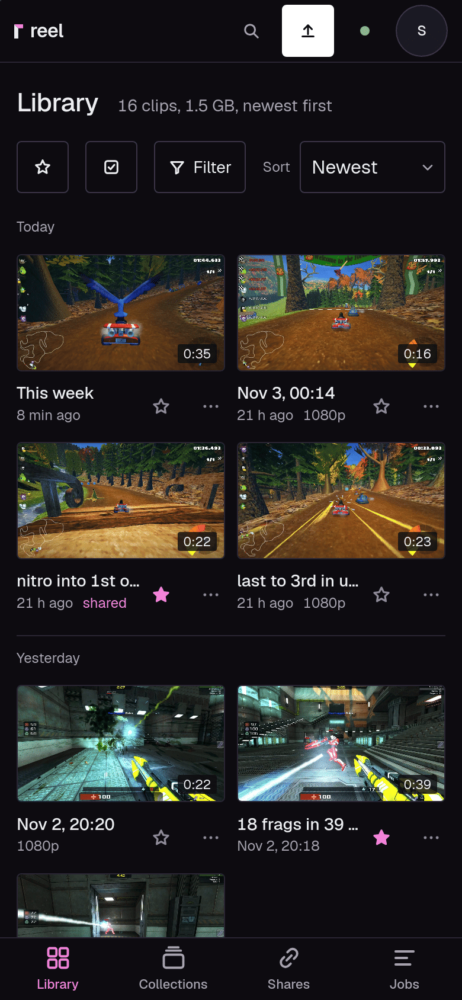
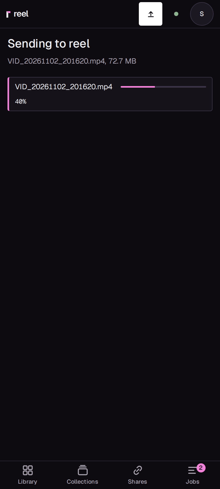
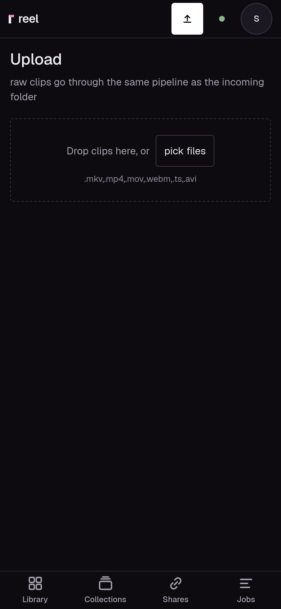

# The phone

Put reel on your phone's home screen and it opens like an app: full
screen, without the browser's bars, with your library a tap away. On
Android you can also share a video to reel straight from the gallery.

You need a reel server you can sign in to, at its HTTPS address
([The server](server.md)).

## 1. Install it to the home screen

**Android (Chrome):**

1. Open `https://clips.example.com` in Chrome and sign in.
2. Tap the menu (the three dots, top right), then **Install app** (on
   some phones **Add to Home screen**), then **Install**.
3. Open reel from its new icon on the home screen.

**iPhone and iPad (Safari):**

1. Open `https://clips.example.com` in Safari and sign in.
2. Tap the Share button (the square with the arrow), scroll down, tap
   **Add to Home Screen**, then **Add**.
3. Open reel from its icon on the home screen, and sign in once more. The
   home screen app keeps its own sign-in, apart from Safari's.

When it worked, reel opens without an address bar, with **Library**,
**Collections**, **Shares** and **Jobs** at the bottom. Jobs shows a count
while something is being worked on. Status, and Settings for an admin,
are under the round button with your initial, top right.

## 2. Share a video to reel (Android)

1. In the gallery, Google Photos or the Files app, open a video and tap
   **Share**.
2. Pick **reel** in the list. It is there once reel is installed as in
   step 1.
3. reel opens on **Sending to reel** and shows the upload's progress.

When it worked, the clip's page opens once the video is in and shows its
processing. A minute later the clip is in the library like any other.

Several videos in one share go up side by side, and the library opens
when they are all in. A file over the server's upload limit is refused
before anything is sent, with the reason.

## 3. Upload from an iPhone

Safari does not let a web app appear in the share sheet, so on an iPhone
you upload from reel itself:

1. Open reel and tap the upload button at the top (the arrow).
2. Tap **pick files**, then choose **Photo Library** or Files, and pick
   your videos.

The progress shows on the page. When a video is in, it is processed like
any other clip.

## Share from your phone

- **A link:** open a clip, tap **New link** under Share, then **Create
  and copy**, and paste it anywhere. Or, under Send, tap **Send to an
  app**: it hands the clip's newest link to a chat or a messenger through
  the phone's share sheet, and makes a link first if the clip has none.
- **The file itself:** under Send, pick the original or a size and tap
  **Send the file**. It goes to the app you pick through the share sheet.
  A copy under that size that does not exist yet is made first: tap again
  once it is ready. [Sharing and links](../sharing.md) has more.

## Good to know

- **Big videos** go up in pieces, so a long one passes behind Cloudflare
  too. The limit is the server's own, 8 GB by default. If the connection
  drops, share or pick the same video again and it goes on where it
  stopped.
- **Always current:** the installed app keeps only reel's stylesheet,
  scripts and icons for itself, never your clips or pages, so it always
  shows the server's current library.
