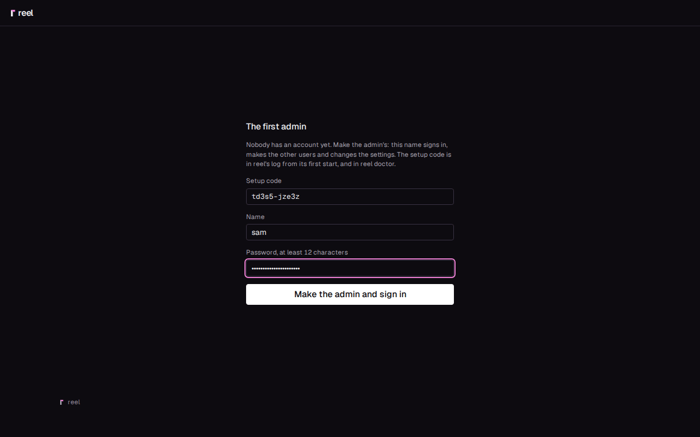
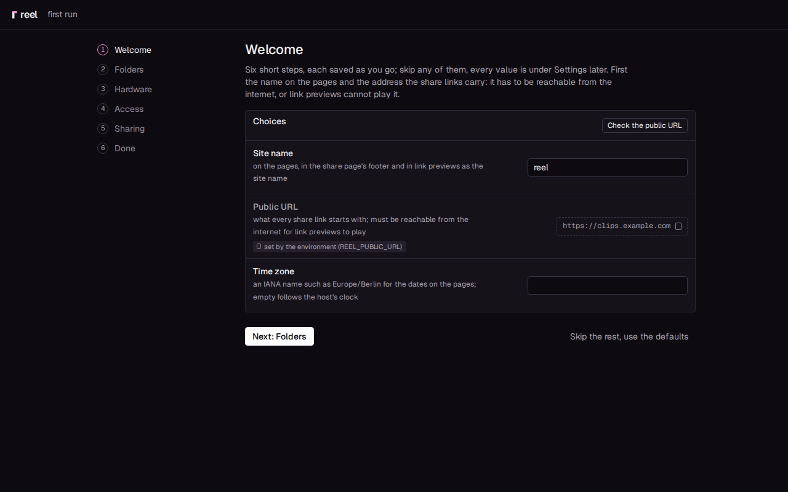
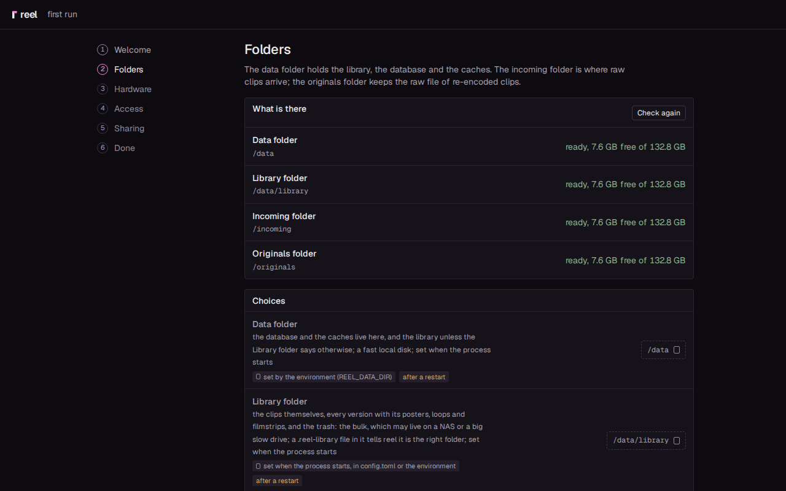
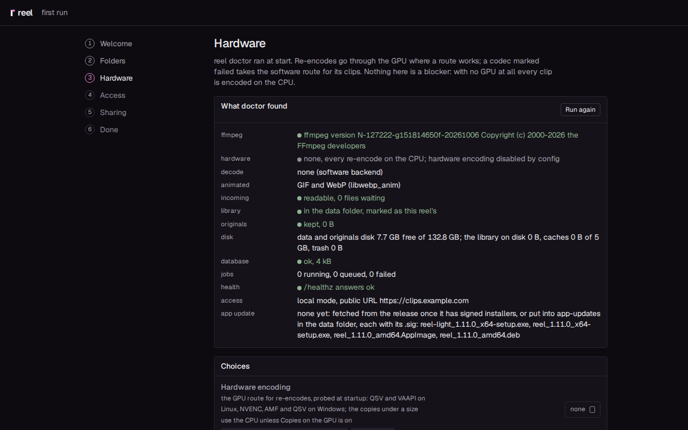
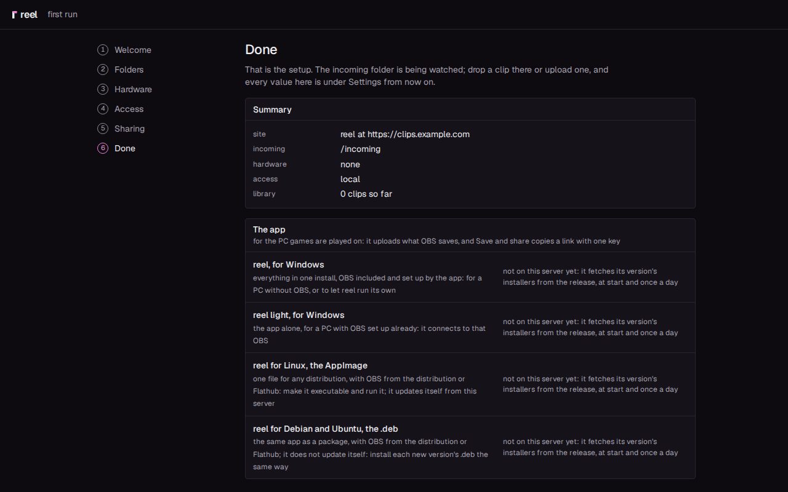
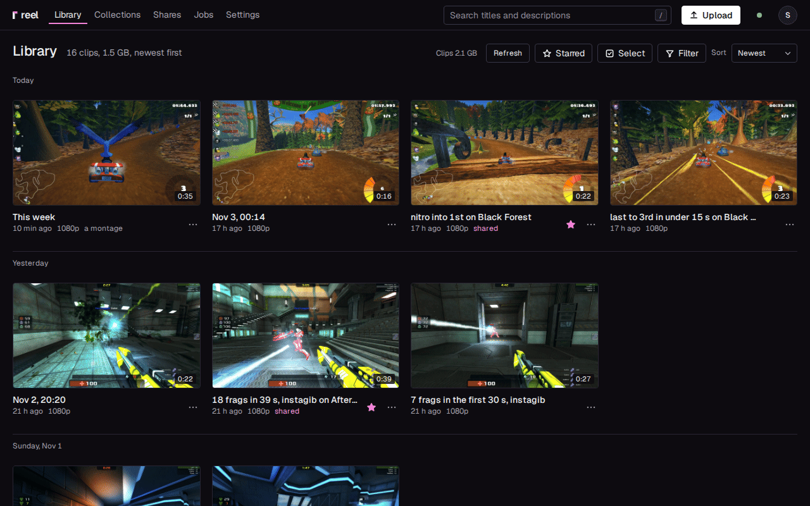
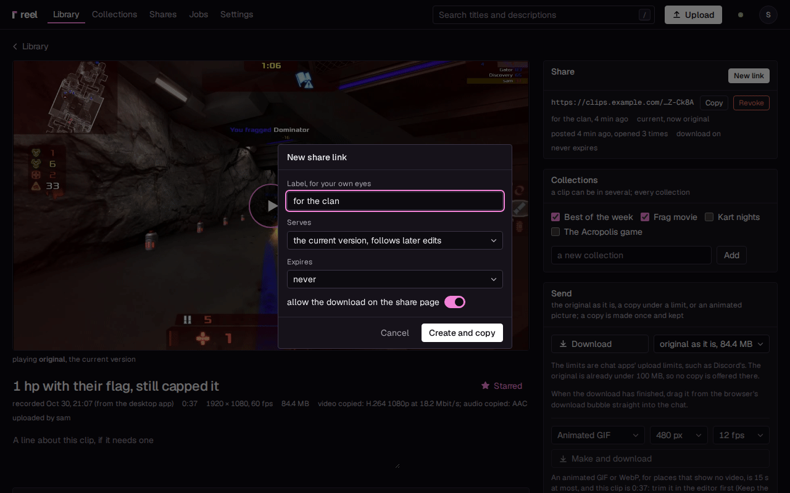
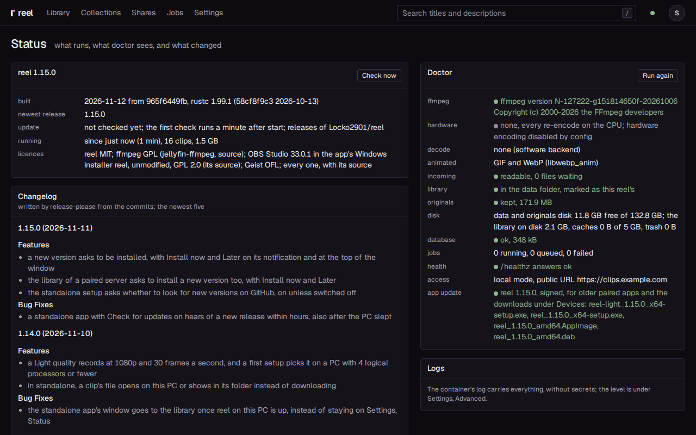

# The server

The server gives your clips share links. Paste one in Discord or any chat
that shows link previews, and the video plays right in the message, for
anyone, with no account. The server is one container: it keeps the
library, makes the links and serves their pages.

You do not need a server to start. The desktop app keeps a library on
your gaming PC by itself ([Standalone](standalone.md)). Add the server
when you want links, then pair the app with it (step 6).

This guide takes you from nothing to a first link that plays where you
paste it, on a Linux machine with Docker, behind a reverse proxy with
HTTPS. Plan about half an hour.

## What you need

- **A Linux machine that stays on**, with Docker and Docker Compose. A
  small one is enough: reel idles at about 15 to 25 MiB of memory and
  well under a tenth of a percent of one core. While ffmpeg encodes a cut
  it takes up to about 1 GB ([How light it is](../light.md)).
- **Room for your clips.** A minute of 1080p at 60 frames and 25 Mbit/s
  takes about 210 MB in the library.
- **A domain name and a reverse proxy with a certificate for it**, such as
  nginx, Nginx Proxy Manager, Caddy or Traefik. Share links have to be
  reachable from the internet, for the people you send them to and for
  the chat apps that build their previews.
- **Optional: an Intel or AMD graphics chip** for faster re-encodes.
  Without one, everything runs on the CPU.

The image (`ghcr.io/locko2901/reel`) and the desktop app's installers come
from the public GitHub repository
[`Locko2901/reel`](https://github.com/Locko2901/reel) and its releases. You
need no account for either.

## 1. Start the container

1. Make a folder for reel, such as `/srv/reel`, and save this in it as
   `docker-compose.yml`:

    ```yaml
    --8<-- "deploy/docker-compose.yml"
    ```

2. Change three things in it:

    - `REEL_PUBLIC_URL`: the address your share links carry, such as
      `https://clips.example.com`, with no slash at the end.
    - `TZ`: your time zone, such as `Europe/Berlin`.
    - Without an Intel or AMD GPU, delete the two `devices` lines at the
      end.

    The three folders on the left of the `volumes` lines can live
    anywhere. `./data` holds the database, the caches and the library,
    `./incoming` is where clips can be dropped, and `./originals` keeps the
    raw files. Keep `./data` on a local disk. To put the clips themselves
    on a NAS or a big slow drive, see
    [Fast and bulk storage](../bulk-storage.md).

3. Start it and read its log:

    ```
    docker compose up -d
    docker compose logs reel
    ```

    When it worked, the log ends with a line like this one, with a code of
    its own:

    ```
    WARN reel_server: no user yet: the first admin needs this setup code at /signin code=7kq2m-x9tfd
    ```

    Keep the code for step 3. reel now answers on port 8746 of this
    machine: `curl http://127.0.0.1:8746/healthz` answers with a line of
    JSON that holds `"ok":true`.

## 2. Put a reverse proxy in front

reel speaks plain HTTP. The proxy adds HTTPS and is what the internet
talks to: point your domain at it and forward everything to reel's port
(8746 in the compose file). Three settings matter.

- **Uploads come in pieces.** The desktop app and the browser send a clip
  in pieces of 32 MiB by default (**Chunk size** under Settings,
  **Devices**; at most 90 MiB). Your proxy has to accept requests of at
  least 100 MB, and nginx
  accepts 1 MB unless told otherwise. Allow up to reel's own **Upload size
  limit** (8 GB, under Settings, **Imports**) if you also upload whole
  files in one request, as ShareX does ([No app](no-app.md#3-sharex)).
  Turn request buffering off, so a piece streams through instead of
  filling the proxy's disk first.
- **Slow uploads.** A read timeout of five minutes keeps a slow piece from
  being cut off.
- **The visitor's real address.** Pass `X-Forwarded-For`, and put the
  proxy's address in `REEL_TRUSTED_PROXIES` in the compose file, written
  as the exact address (`10.0.0.2/32`), never a whole network. Then reel's
  limit on sign-in attempts counts each visitor, not the proxy.

### nginx

This is the whole server block. Use your own name and certificate paths:

```nginx
server {
    listen 443 ssl;
    server_name clips.example.com;
    ssl_certificate     /etc/letsencrypt/live/clips.example.com/fullchain.pem;
    ssl_certificate_key /etc/letsencrypt/live/clips.example.com/privkey.pem;

    client_max_body_size 8g;
    proxy_request_buffering off;
    proxy_read_timeout 300s;

    location / {
        proxy_pass http://127.0.0.1:8746;
        proxy_set_header Host $host;
        proxy_set_header X-Forwarded-For $proxy_add_x_forwarded_for;
        proxy_set_header X-Forwarded-Proto $scheme;
    }
}
```

The live updates (a new clip turning up in an open library, a job's
progress) need nothing here: reel tells nginx not to buffer them.

### Nginx Proxy Manager

Make a proxy host for your domain that forwards to the machine's address
and port 8746, with an SSL certificate. Then paste these three lines into
the proxy host's **Advanced** tab:

```nginx
client_max_body_size 8g;
proxy_request_buffering off;
proxy_read_timeout 300s;
```

### Caddy

Caddy needs nothing extra. It gets the certificate by itself, streams
uploads and has no size limit by default:

```
clips.example.com {
    reverse_proxy 127.0.0.1:8746
}
```

### Check it

Open `https://clips.example.com/healthz` from anywhere, your phone on
mobile data included. When it worked, it answers the same JSON with
`"ok":true`.

### Behind Cloudflare

With Cloudflare's proxy on (the orange cloud), Cloudflare refuses any
single request over 100 MB on its free and Pro plans. The desktop app and
the browser upload in pieces of at most 90 MiB, so neither is affected.

## 3. Choose how people sign in

reel has its own accounts, or it can leave the sign-in to something you
already run. You pick one mode in the compose file (`REEL_AUTH_MODE`); it
takes effect when the container starts. Share links never need a sign-in,
whatever the mode.

| Mode | Who signs people in | Pick it when |
|---|---|---|
| `local` (the default) | reel, with its own accounts | you want nothing else to run |
| `proxy` | a sign-in in front of reel, such as Authentik, Authelia or oauth2-proxy | your reverse proxy already asks for a sign-in (forward auth) |
| `oidc` | an identity provider over OpenID Connect, such as Authentik or Keycloak | you have a provider and want reel to send people to it |
| `single` | nobody: everyone who reaches reel is one user | you try reel on one machine; it only runs on a loopback address |

### reel's own accounts (the default)

There is nothing to configure.

1. Open `https://clips.example.com`. The page says **The first admin**.
2. Enter the setup code from the log, a name and a password of at least
   12 characters.
3. Press **Make the admin and sign in**.



When it worked, the first run opens (step 4). Later, you add other people
under Settings, **Access**, **Add user**. A member sees the whole library
and edits and shares what they uploaded. An admin does everything.

**Lost the code?** `docker exec reel reel doctor` prints it again while
nobody has an account.

**Locked out later?** This sets a new password for a user and signs them
out everywhere:

```
docker exec -e REEL_PASSWORD='a new long password' reel reel passwd --make-admin admin
```

Put your user's name in place of `admin`. With `--make-admin`, a name that
does not exist yet becomes a new admin.

### A sign-in in front (Authentik, Authelia, oauth2-proxy)

If your proxy already asks for a sign-in (forward auth), reel can trust
it and not ask again.

1. In the compose file, set `REEL_AUTH_MODE: proxy`, and set
   `REEL_TRUSTED_PROXIES` to the proxy's exact address. Without it, reel
   refuses to start in this mode and the log says why.
2. Make the proxy send the signed-in user's name in the header
   `X-authentik-username`. Authentik does this by itself. For Authelia or
   oauth2-proxy, map their user header to that name.
3. Put the admins' names in `REEL_ADMINS`, separated by commas, exactly
   as the proxy sends them, case included. The first user reel ever sees
   is an admin too.
4. Let five paths through without the sign-in.

!!! warning "Leave these paths open, or links and the app stop working"
    | Path | Why |
    |---|---|
    | `/s/` | the share pages and their video, which your friends and the chat apps open without an account |
    | `/c/` | shared collections, the same way |
    | `/assets/` | the stylesheet, fonts and icons those pages load, and the phone app's files |
    | `/healthz` (exactly) | the health check, and the first run's check of your public URL |
    | `/api/device/` | the desktop app, which signs in with its own device token that reel checks |

In nginx, add these beside the `location /` that has the forward auth:

```nginx
location /s/ { proxy_pass http://127.0.0.1:8746; }
location /c/ { proxy_pass http://127.0.0.1:8746; }
location /assets/ { proxy_pass http://127.0.0.1:8746; }
location = /healthz { proxy_pass http://127.0.0.1:8746; }
location /api/device/ {
    proxy_pass http://127.0.0.1:8746;
    proxy_request_buffering off;
    client_max_body_size 96m;
    proxy_read_timeout 300s;
}
```

When it worked, opening `https://clips.example.com` signs you in through
your proxy and lands on the first run. A request that does not come
through the trusted proxy gets a 401 page, never the library. If your own
requests get that page too, look in reel's log for the line
`request without a proxy identity`: it names the address reel saw, and
that is the one `REEL_TRUSTED_PROXIES` needs.

### An identity provider (OpenID Connect)

reel can send people to Authentik, Keycloak or any other OpenID Connect
provider to sign in, with no proxy asking first.

1. At the provider, make an application (a client) for reel of the
   confidential kind, with the redirect URI
   `https://clips.example.com/oidc/callback`.
2. In the compose file, add:

    ```yaml
    REEL_AUTH_MODE: oidc
    REEL_OIDC_ISSUER: https://auth.example.com/application/o/reel/
    REEL_OIDC_CLIENT_ID: reel
    REEL_OIDC_CLIENT_SECRET_FILE: /run/secrets/reel_oidc
    ```

    Copy the issuer exactly as the provider shows it, with its last slash
    if it has one: reel compares it character for character. The client
    secret goes in `REEL_OIDC_CLIENT_SECRET`, or in a file that
    `REEL_OIDC_CLIENT_SECRET_FILE` names. It is never stored in the
    database.

3. Optional: set a [Role claim](../configuration.md#role-claim) such as
   `groups`, and the [Admin value](../configuration.md#admin-value) in it
   that makes an admin. reel follows it at every sign-in. Or list the
   admins in `REEL_ADMINS` by the subject the provider sends for them,
   exactly, not by a name: Authentik's subject is the username unless the
   client says otherwise.
4. Optional: name the provider on the sign-in button with
   `REEL_OIDC_NAME: Authentik` ([Provider name](../configuration.md#provider-name)).

When it worked, the sign-in page has a button **Sign in with** followed
by that name, or by your provider's address without one. A user who
comes back from it listed in Admins, or with the admin value, is an
admin. Anyone else who comes first finds a page that asks for the setup
code: reel's log has it from the start (`docker logs reel`), and so has
`docker exec reel reel doctor`. Type it there and you are the admin; the
code then works no more. reel binds each user to the provider's issuer
and subject, never to a name, so a renamed account stays the same user.

### No sign-in (single)

`REEL_AUTH_MODE: single` lets everyone who reaches reel in as one user.
reel refuses to start with it unless it listens on a loopback address
such as `127.0.0.1`, so it is for trying reel on one machine, never for a
server others reach.

Every mode and every other setting is on
[Configuration](../configuration.md). To change the mode of a server that
has users, see [Switching the sign-in method](../switching-sign-in.md)
first: it says who keeps their user and what to do.

## 4. The first run

After your first sign-in as an admin, reel walks you through six short
steps. Each one saves as you change it, you can skip any of them, and
every value stays under Settings later. **Skip the rest, use the
defaults** takes you straight to the library.

1. **Welcome**: the **Site name** (on the pages and in a link preview),
   the **Public URL** and the **Time zone**. Press **Check the public
   URL**. When it worked, it says the public URL answers, so the chat apps
   reach your share pages. If it does not, look at the proxy and the path
   `/healthz`.

    

2. **Folders**: the data, library, incoming and originals folders, with
   their free space. Each should say "ready, ... free of ...". **Create
   it** makes a missing incoming or originals folder.

    

3. **Hardware**: what reel's self-test (reel doctor) found, the GPU route
   and a line per codec, with **Hardware encoding** and **Workers** to
   change. Without a GPU it says so and everything runs on the CPU. That
   is not an error.

    

4. **Access**: who is an admin and, with reel's own accounts, how long a
   session lasts.
5. **Sharing**: what a new link starts with (whether its page offers the
   download, when it expires), the size the copies under a size aim for,
   and which raw files reel keeps.
6. **Done**: a summary and the desktop app's installers, two for Windows
   and two for Linux. Press **Open the library**.

    

The installers' rows say "not on this server yet" until the server has
them. It fetches its own version's installers, with their signatures,
from the repository's public release at start and once a day while one
is missing. It needs no token for that. The apps you pair with this
server then get their updates from it.

A private fork's releases need a GitHub token that can read them: set it
under Settings, **Devices**, **Release token**
([`REEL_UPDATES_TOKEN`](../configuration.md#release-token)). You can also
put the installers into the data folder's `app-updates` folder by hand,
each with its `.sig` file.

## 5. Your first share link

1. Drop a video into the incoming folder (`./incoming`), or press
   **Upload** at the top right and pick one.
2. It shows up in the library within seconds, with a poster. The Jobs
   page shows the work on it.

    

3. Open the clip, press **New link** under Share, then **Create and
   copy**. When it worked, reel says "Link made and copied. Go paste it."

    

4. Paste the link in a private browser window: the page plays without a
   sign-in.
5. Paste it into a chat that shows link previews with video, such as
   Discord. After a moment, the video plays right in the chat.

If the chat shows only the link, open the link in a browser on mobile
data. If that fails too, the certificate or one of the public paths is
wrong.

[Sharing and links](../sharing.md) has the rest: which version a link
plays, links that expire, collections, and copies under a size for chat
apps with an upload limit.

## 6. Pair the desktop app

The desktop app records on your gaming PC. Paired with your server, it
uploads every clip, and **Save and share** puts a link on your clipboard
with one key.

1. If the app is not installed yet, take its installer from the first
   run's last step, or follow [All in one](all-in-one.md),
   [Your own OBS](own-obs.md) or [Linux](linux.md).
2. On the server, open Settings, **Devices** and press **Pair a device**.
   You get a code that works once, for ten minutes.
3. In the app, open Settings, **Server**. Under **A server, later**, enter
   the **Server URL** and the **Pairing code**, then press **Pair**. When
   it worked, the device shows under Settings, **Devices** on the server.
4. Optional: send clips already in the app's own library, one by one,
   with **Upload to the server** on Settings, Status.
5. Set **Mode** to **connected**, so every new clip goes to the server.

## 7. Check on it

The Status page (in the menu under your initial, top right) shows the
version, the GPU route, the folders and their space, the jobs, and when a
newer release is out.



From a shell, the same check:

```
docker exec reel reel doctor
```

## 8. Folders and backups

| Folder | What lives there | Back it up |
|---|---|---|
| `./data` | `reel.db` (every clip, version, link, user and setting); `library/` (the clips with every version and poster, `.trash/` and `.reel-library`; it can live elsewhere with the [Library folder](../configuration.md#library-folder)); `cache/`; `uploads/`; `app-updates/` | `reel.db` and `library/`. The rest comes back by itself: `cache/` holds copies that are made again when asked for, `uploads/` holds uploads in flight, and `app-updates/` is fetched again. `library/.trash/` holds deleted clips waiting out their days. The files next to each version (`*.loop.mp4`, `*.strip.jpg`, `*.tint`, `*.kf.json`) can be made again: Settings, **Library and storage**, **Rebuild posters, loops and filmstrips**. |
| `./incoming` | raw clips dropped by a recorder or a sync tool. reel takes each in and removes it; `failed/` takes what ffmpeg cannot read, with a note | nothing, it is a drop folder |
| `./originals` | the raw file of every re-encoded clip, named by the clip's id | yes, if you want the raw files back |

The database is SQLite. Copy it with reel stopped, or while it runs with
the `sqlite3` tool on the host:

```
sqlite3 ./data/reel.db "VACUUM INTO './data/backup.db'"
```

## 9. Updates

```
docker compose pull && docker compose up -d
```

The database updates itself at start. A
newer reel always opens an older database, but not the other way round,
so keep your backup from before an update until the new version has run
for a while. The Status page tells you when a newer release is out.

Next: get clips in from the gaming PC with the
[all in one app](all-in-one.md) or [your own OBS](own-obs.md), or
[without the app](no-app.md). Your phone can install reel too
([The phone](phone.md)).
