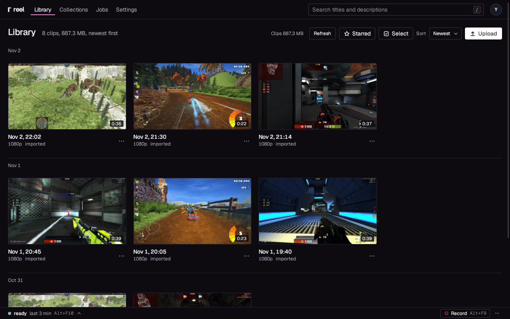

# Standalone: the library on your PC

A new install of the app is reel by itself. It keeps your library on the gaming PC and shows it in
its window, with the same pages a server has: the editor, montages, collections, favourites, and
copies under a size for chats with an upload limit. Nothing leaves the PC, and there is no server
to run and no account to make.

To send a clip, you download it and drag the file into the chat. Share links need a server, which
you can [add at any time](#add-a-server-later).

## 1. Install the app

Follow the guide for your PC: [All in one](all-in-one.md) or [Your own OBS](own-obs.md) on
Windows, [Linux](linux.md) for the AppImage or the `.deb`. Every installer carries what standalone
needs, ffmpeg included.

## 2. Check that it is standalone

A new install starts standalone, so there is usually nothing to do:

- **reel** on Windows, and **Set it up for me** on Linux: the setup's last step, **Where clips
  go**, has **This PC only** chosen already. Press **Next**, then **Finish**.
- **reel light**, or your own OBS on Linux: the window opens on Settings, This app, **OBS**. Connect your OBS as
  in [Your own OBS](own-obs.md), steps 2 to 4 (on Linux, [Linux](linux.md), step 4).
- An app that was paired with a server keeps that through an update. To switch it, open Settings,
  This app, **Server** and set **Mode** to **standalone**.

When it worked, **Mode** says "reel runs on this PC", and the window shows the library.

The library lives in `%LOCALAPPDATA%\reel\library` on Windows and `~/.local/share/reel/library` on
Linux. The status chip at the top of the window has a **Library** row: on this PC, where it lives,
and whether reel on this PC runs.

## 3. The first clip

1. Play a game and press **Save a clip**: Alt+F10 after the setup of reel's own OBS. With your own
   OBS, set a key under This app, **Hotkeys**, or use OBS's own **Save Replay** hotkey. The "clip
   captured" sound plays.
2. A second or two later the notification "Clip in the library" appears. Click **Open**.
3. On the clip's page, under **Send**, pick the original or a size under your chat's upload limit,
   then press **Download**.
4. A note at the bottom of the page says where the file went. Press **Show in folder** and drag the
   file into the chat.

A clip OBS saves in H.264 with AAC sound, up to 1440p and 50 Mbit/s, goes into the library as it
is, never encoded again.

In standalone, the tray and the window offer **Save clip**, and the hotkeys **Save a clip**, alone.
Save and share, Share the last clip and Copy link make links, and links need a server.

## How it treats the PC while you play

- **Low priority.** Every ffmpeg runs at the lowest priority: Windows' idle class, `nice 10` on
  Linux.
- **Heavy work waits for the game.** On Windows, a re-encode, the hover loop and the filmstrip,
  and the copies under a size wait while a game is fullscreen, and run when it ends (This app,
  New clips, **Wait while a game is fullscreen**).
- **The graphics card where it can.** When it starts, reel tests the encoders with a short encode
  and takes the first that works: on Windows NVIDIA NVENC, AMD AMF, then Intel Quick Sync; on
  Linux Intel Quick Sync, then VAAPI; else the CPU. This app, **Status** shows which one, and the
  ffmpeg that came with the app with its licence. This app, Server, **GPU encoder** picks another.
- **A cap on its size.** **Library cap** (This app, Server, 100 GB to start with) moves the oldest
  clips to the trash when the library grows past it, as on a server
  ([The library cap](../sharing.md#the-library-cap)). A starred clip or one in a collection never
  goes, and neither does a clip that is on no server, unless you turn **The cap spares unsent
  clips** off. The line under the cap says what it would move at the size you type.

## New versions

Nothing asks by itself. Under Settings, This app, **Startup**, **Updates**, **Check now** asks
GitHub for the newest release; Settings, **Advanced**, **Check for updates** asks once a day
instead, when you turn it on. When a newer reel is out, **Install reel** and the release's notes
appear there and in the tray menu. The app takes the installer of its own package from the
release (reel, reel light or the AppImage), checks its signature, and puts it in place; your
settings and your library stay. On Windows, reel closes, its installer shows its progress in a
small window, and reel opens again by itself ([Updates](../desktop-app.md#updates) has every
step).

A standalone app of 1.11 or earlier cannot install an update itself: install the new version by
hand once, from the releases page (**Open the releases** opens it), the same way as the first.
The `.deb` never updates itself.

## Add a server later

A server of your own adds share links that play in the chat
([The server](server.md) sets one up).

1. On the server, open Settings, Devices and press **Pair a device**. A code appears, good for ten
   minutes and one use.
2. In the app, open Settings, This app, **Server**. Under **A server, later**, enter the **Server
   URL** (`https://clips.example.com`).
3. Under **Pairing**, enter the **Pairing code** and press **Pair**. When it worked, **Pairing**
   says "paired".
4. To send clips you already have, open This app, **Status**: each of the last clips has
   **Upload to the server**. An older one you can download here and upload on the server's
   **Upload** page.
5. To have new clips go to the server, set **Mode** to **connected**. The window now shows the
   server's library, and **Save and share** puts a link on your clipboard.

Clips you did not send stay in the library on this PC. Set **Mode** back to **standalone** to see
them again.
