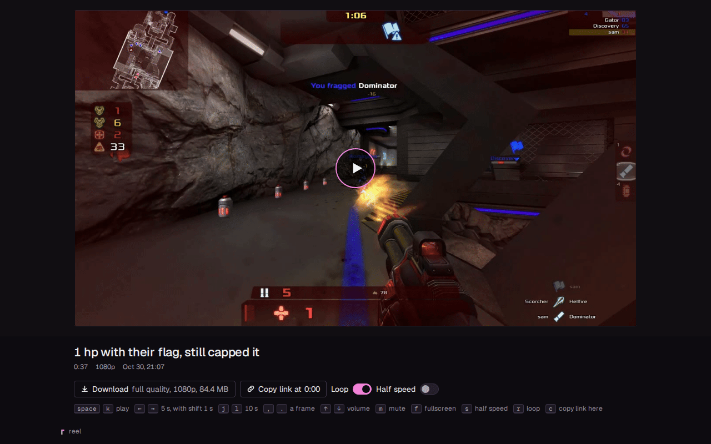
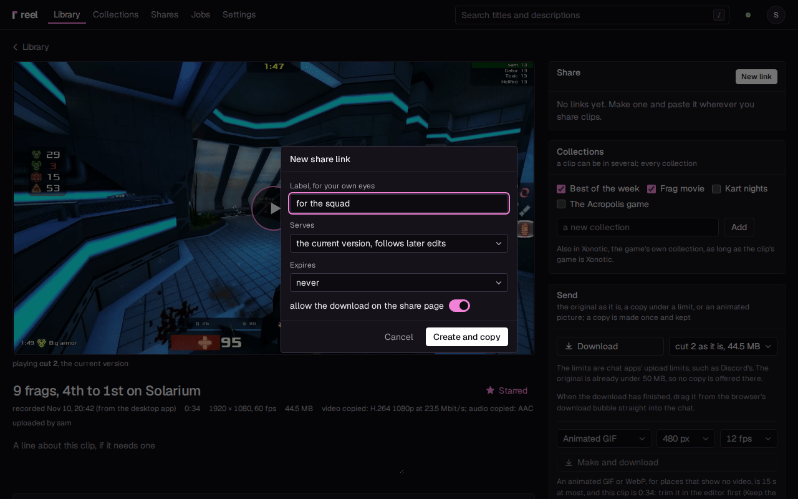
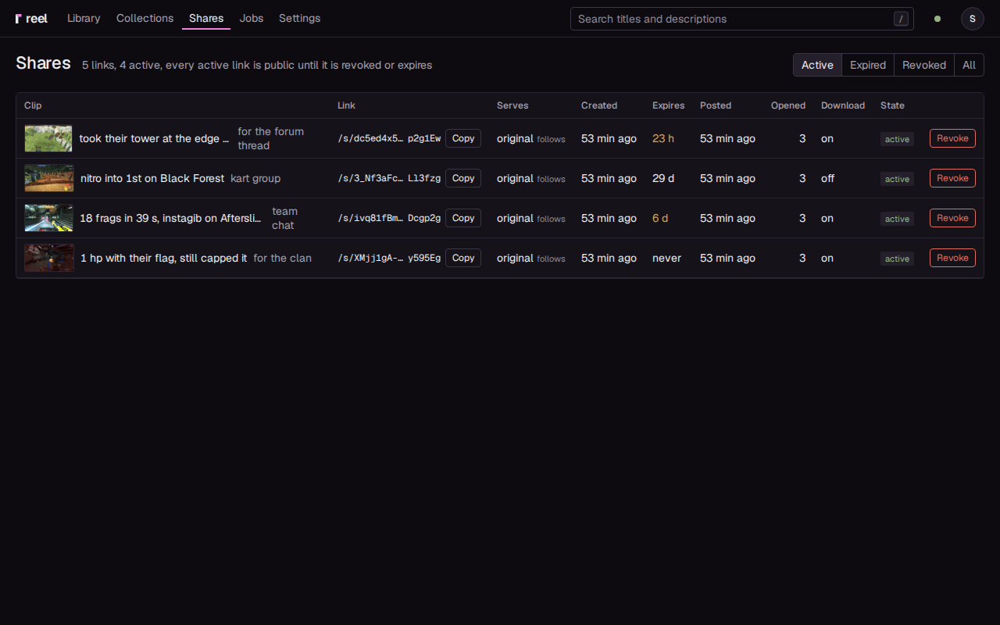
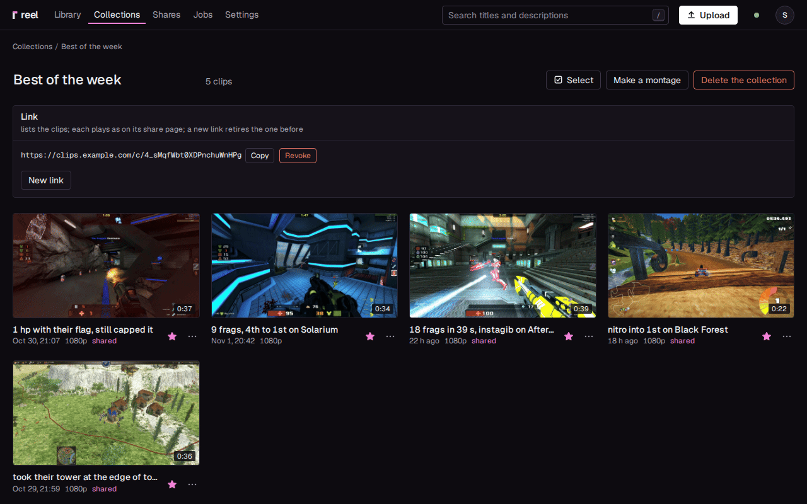
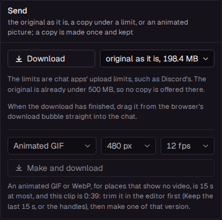
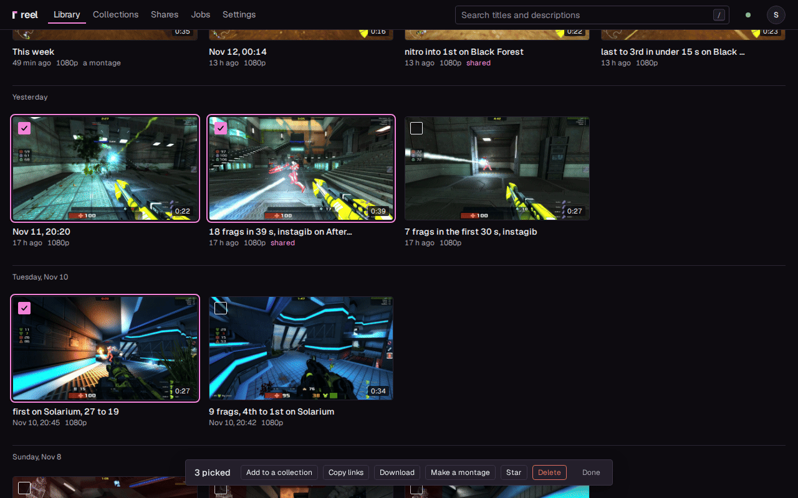

# Sharing and links

Send a clip as a link that plays right in the chat, or as a file that fits the chat's upload
limit. This page also covers what keeps a growing library in order: stars, collections, acting
on many clips at once, the Stats page and the trash.

!!! note "Links come from your server"
    Share links, collection links and the Shares page need a [server of your own](setup/server.md).
    The desktop app on its own ([standalone](setup/standalone.md)) has the files and the library
    tools: copies under a size, animated pictures, the zip of picked clips, stars, collections,
    Stats, the trash and the library cap.

## What a link gives you {#what-a-link-is}

Paste a link into a chat and the clip plays right there, in the chat's preview. Discord does
this, and so does any app that reads a page's `og:video` tag. The preview carries the clip's
title, its description (or its length, height and date when it has none), its poster and the
video.

Opened in a browser, the link is a page of its own: the clip in a large player, its title, one
line with its length, its height and its date, and nothing else. No sign-in, no menu, no other
clips, and search engines are asked to leave it out.

A link looks like `https://clips.example.com/s/8xQvT1n4wKpR9sLm2cHd7A`: your server's
[Public URL](configuration.md#public-url), then `/s/` and 22 random letters and digits. Nobody
can guess it. Anyone who has it can watch the clip and pass the link on, until you revoke it or
it expires.

## Make a link

A clip can have as many links as you like, each with its own rules: which version it plays,
when it expires, and whether it offers the download.

<video src="../img/share.mp4" poster="../img/share.png" autoplay muted loop playsinline width="1280" height="800" aria-label="A link made for a clip, then the link's page playing it"></video>

1. Open the clip. Links come once it is ready; until then the clip page says **processing**.
2. Under **Share**, press **New link**.
3. In the **New share link** dialog, choose:
    - **Label, for your own eyes**: a note such as who the link is for. It shows on the clip
      page and the Shares page, never on the link's page.
    - **Serves**: **the current version, follows later edits** (the default), or **pinned to**
      one version, such as the original or cut 1. See
      [Follow edits or pin a version](#which-version-a-link-plays).
    - **Expires**: **never**, **after 1 day**, **after 7 days** or **after 30 days**.
    - **allow the download on the share page**: whether the page offers the full file.
4. Press **Create and copy**.

"Link made and copied. Go paste it." shows, and the link is in the **Share** panel with
**Copy** and **Revoke**. Paste it where you want it seen.

Quicker ways to a link:

- **Copy link** in a clip's menu on the library page (the three dots on its card) copies the
  clip's newest live link, or makes one with the defaults. On a phone it says **Send the link** and
  opens the share sheet.
- `c` on the clip's page copies the newest live link under **Share** (an expired one is
  skipped), or opens **New link** when there is none.
- **Copy links** in the [Select bar](#several-clips-at-once) does it for many clips at once.
- In a game, the desktop app's **Save and share** saves the replay and copies its link (see
  [The desktop app](desktop-app.md)).

Only who uploaded a clip, or an admin, makes and revokes its links.

!!! note "Paste a link once its preview is ready"
    A chat app builds a link's preview the moment you paste it, and keeps what it found, a
    failed preview too (Discord does). Right after a clip arrives or a cut is rendered, its
    preview video may still be in the making: the clip page's **Details** show it under
    **Preview video**, and the Jobs page shows the work. Until it is ready, the link's page says
    "This clip is still being prepared". Wait for it, then paste. The desktop app's **Share the
    last clip** waits for it by itself before it copies a link.

## Follow edits or pin a version {#which-version-a-link-plays}

Editing a clip makes new versions, and the original always stays (see
[The editor](editor.md)). A link you already sent keeps working through every edit. It either:

- **follows the current version**: render a cut, or press **Make current** on another version,
  and the link plays that one from then on, at the same address. The clip page says "current,
  now cut 1";
- or is **pinned** to one version, and plays it whatever becomes current. The clip page says
  "pinned to original". **Share** on a version's row under **Versions** opens the dialog already
  pinned to it.

A cut with an active link pinned to it cannot be deleted: revoke the link first.

### Show an edit in a chat

A chat keeps the preview a message was posted with, so after an edit it still shows the old
version. The clip page notices: under a link that follows the current version and was posted
before the edit, **Copy link for this version** copies the same link with `?v=2` at the end.
To the chat app that is a new address, so it builds a fresh preview. Edit the message to the
new address, or post it again. Saving the cut as a new clip, with links of its own, works too.

## Expiry, download and revoke

Each link keeps the choices it was made with:

- **Expires**: after 1, 7 or 30 days the link stops by itself. The link's page says when.
- **allow the download on the share page**: on, the page has a **Download** button for the
  full quality file of the version the link plays, with its height and size on it. Off, there
  is no **Download** button.

A new link starts on the server's defaults under Settings, Sharing:
[Allow the download](configuration.md#allow-the-download) (on) and
[Expire](configuration.md#expire) (never). A link's choices are fixed once it is made: to
change them, make a new link and revoke the old one. A clip can have any number of links, each
with its own choices, such as one for a friend that expires tomorrow and one that never does.

**Revoke** next to a link, on the clip page or the Shares page, ends it at once. Press it twice
(it asks "Sure?"); "Link revoked. It stopped working just now." confirms it. Whoever opens the
link afterwards sees "This link has been retired. Ask whoever sent it for a fresh one." The
same page shows for an expired link and for a clip in the trash. A revoked link never works
again; make a new one if you need it back.

## The link's page

Whoever opens the link gets a player made for watching a moment again and again: it loops,
steps frame by frame, slows to half speed and links to the exact second. Under the player:

- **Download** gives the full quality file, when the link allows it.
- **Copy link at 0:04** copies the link with the moment the player is at (`?t=4` at the end),
  so the clip starts there for whoever opens it.
- **Loop** and **Half speed** switch those on and off.

A faint line under the buttons lists the keys:

| Key | Does |
|---|---|
| space or k | play and pause |
| left and right arrows | 5 s back or on (1 s with shift) |
| j and l | 10 s back or on |
| `,` and `.` | pause, then one frame back or on |
| up and down arrows | louder and quieter |
| m | mute |
| f | fullscreen |
| s | half speed |
| r | loop on or off |
| c | copy a link to this moment |

The keys work wherever the focus is (the video, its timeline, a button you clicked), but not in
a text field, and a button you reached with Tab keeps space for itself. The player on the clip
page has the same keys, from space to f.

## What the chat and the page play {#what-plays-where}

A clip in your library can be bigger than a chat's previewer or a home upload likes, so a link
serves files made for it. reel makes them by itself; this is what they are:

- **The preview video** is what a chat's preview plays (the page's `og:video` tag). A version
  that is H.264 with AAC audio and under
  [Preview video size from the server](configuration.md#preview-video-size-from-the-server)
  (20 MB by default) is sent as it is; any other gets a smaller copy for it, at most 1080p.
  Previewers give up on a file that takes more than a few seconds to arrive, which is what the
  size is for. The copy is made right after a clip arrives and after every cut. With
  [Link previews from external storage](storage.md) on, the preview comes from your storage's
  CDN instead: larger, and on time whatever your upload is doing.
- **The web copy** is what the link's page plays in a browser: the version at its own height,
  up to [Web copy height](configuration.md#web-copy-height) (1440p by default), at
  [Web copy bitrate](configuration.md#web-copy-bitrate) (10 Mbit/s by default), so two or three
  people can watch at once over a home upload. It is made when a link to the version is made,
  or when its page is first opened without one. Until it is ready, the page plays the preview
  video and moves over by itself, still playing; the line under the title says what plays
  ("720p preview", then "1440p"). A version already H.264 with AAC, no taller and under that
  rate plays as it is.
- **The full file** is what **Download** on the page gives, when the link allows it.

Web copies no link plays any more (revoked, expired, its version no longer current, its clip in
the trash) are removed by the housekeeping. Settings, Library and storage, **Clear the web
copies** removes them at once; a page then plays its preview video until its copy is made again
on its next view.

## The Shares page

See every link you have sent and where each one went. **Shares** at the top lists every link on
the server:

| Column | Says |
|---|---|
| Clip | the clip, with the link's label |
| Link | the address, with **Copy** |
| Serves | the version it plays, and whether it follows edits or is pinned |
| Preview | where the preview comes from, with [link previews from external storage](storage.md) on |
| Created, Expires | when it was made, and when it stops |
| Posted | when a chat app last fetched it to build a preview: the link was pasted somewhere |
| Opened | how many times a person opened its page |
| Download | whether its page offers the full file |
| State | active, expired or revoked, with **Revoke** on an active link |

The buttons at the top show **Active**, **Expired**, **Revoked** or **All** links. reel tells a
chat app's previewer from a person by the name each one gives; search engines and other robots
count as neither. The clip page sums the same up under each link ("posted 3 h ago, opened 5
times").

## Collections {#collections}

Group clips under a name: a weekend's best plays, a tournament, one friend's highlights. Each
collection has a page in the library and, on a server, one link for all of its clips.

- **Your own**: on the **Collections** page, **New collection** asks for a name. On a clip's
  page, the **Collections** panel ticks the collections the clip is in; type a name and press
  **Add** to make a new one with the clip in it. A clip's menu in the library has
  **Collections** too, and the Select bar's **Add to a collection** puts many clips in at once.
  A clip can be in several collections. Yours lists its clips in the order they were put in.
- **A game's**: every game with clips is a collection by itself, marked **automatic**, holding
  every clip of that game, the newest first. Nothing is put in or taken out by hand: changing a
  clip's game moves it.

Everyone signed in sees every collection. Who made a collection, or an admin, renames it,
deletes it (**Delete the collection**, press it twice; the clips stay), puts clips in and makes
its link. A game's collection is linked by an admin.

### A collection's link

Send one link, and your friends get every clip of the collection on one page.

1. Open the collection.
2. Under **Link**, press **Make a link**.
3. Press **Copy**, and paste it.

The link, `https://clips.example.com/c/...`, opens a public page with the collection's name,
how many clips it holds and a tile for each. Pasted in a chat, it previews with the name, the
count and the first clip's poster. Each tile opens that clip on a page like a share link's,
playing its current version; that clip's own address previews in a chat as a share link does.
Whether those pages offer the download follows
[Allow the download](configuration.md#allow-the-download) when the link is made.

- A collection has one link at a time: **New link** makes another and retires the one before
  ("Link made. The one before stopped working."). **Revoke** (press it twice) ends it.
- A clip taken out of the collection, or deleted, leaves the link at once.
- A link serves the clips its maker may share: their own, and every clip when an admin made it.
  A clip of someone else's in your collection stays off your link, and the collection's page
  says how many are left out; its uploader or an admin can share it.
- A montage, or a cut saved as its own clip, that holds another user's footage gets a link
  from an admin only, on its own or through a collection.
- A game's link shows the game's clips as they are when it is opened, later ones included.
- Deleting a collection takes its link with it, never its clips.

On the **Collections** page, a collection with a live link says "a link is out".

## Send the file itself

Some chats do not preview links, and some friends want to keep the clip. The **Send** panel on
a clip's page gives you the current version as a file, or as a copy that fits a chat's upload
limit.

1. Pick a size in the list next to **Download**: the version as it is ("original as it is,
   84 MB"), then a copy under each upload limit the version does not fit under. The limits are
   500, 100, 50, 20 and 10 MB by default ([Limit list](configuration.md#limit-list)), the upload
   limits chat apps set: Discord takes 20 MB without Nitro, 50 MB with Nitro Basic and 500 MB
   with Nitro, and some apps still stop at 10 MB.
2. Press **Download**. A copy that does not exist yet is made first, with its progress on the
   button, and the download starts when it is done, even when the connection to the server
   dropped meanwhile.
3. Drag the finished download from the browser's download bubble into the chat.

In the desktop app on its own ([standalone](setup/standalone.md#the-files-are-on-this-pc)), the
file is on the PC already: **Send** has **Open** and **Show in folder** for the version as it is
instead of **Download**, and a copy under a size downloads as above.

A copy is made once per version and limit, and kept: the next time it is ready at once, and the
list says so with its size ("Under 20 MB, ready, 19.2 MB"). Each copy gets the sharpest picture
that fits: the version's own height first, then lower ones, then 30 fps, and only then lower
audio, which the panel says. A clip too long to fit a limit even at 480p, 30 fps and 128 kbit/s
audio gets no copy under it, and the page says why.

The copies are encoded with two-pass x264 on the CPU by default
([Copies on the GPU](configuration.md#copies-on-the-gpu) makes them faster, a little larger),
the audio kept as it is when it is AAC. They take up to
[Copies under a size](configuration.md#copies-under-a-size) on disk (5 GB by default), the
oldest going first.

**Download** on a row under **Versions** gives that version's file as it is. When the server
kept the raw file a re-encoded clip came from ([Keep originals](configuration.md#keep-originals)),
**Details** has **Download the original** for it. In standalone, both are **Open** and **Show in
folder**.

### An animated GIF or WebP

For places that show pictures but no video (a forum post, a README, an old chat), the **Send**
panel makes an animated picture of the current version, without sound.

1. Pick **Animated GIF** or **Animated WebP**, a width (**480 px** or **720 px**) and a frame
   rate (**12 fps** or **24 fps**; a GIF starts on 12, a WebP on 24). The line under it says
   about how big it will be: a GIF is large, from a couple of MB for a calm clip to several
   times that for a busy one; a WebP is far smaller, but not every app shows one.
2. Press **Make and download**. It is made as a job, with its progress on the button and under
   **Jobs**, where you can cancel it, then it downloads, even when the connection to the server
   dropped meanwhile. One that failed or was cancelled says why.

An animated picture is 15 seconds at most. For a longer clip, keep its last 15 s or trim it in
the [editor](editor.md) first, then make one of that version. WebP is offered only where the
ffmpeg can write it: the Status page's **animated** line says so, and the ffmpeg that comes with
the desktop app can.

Under **Make and download**, **Made** lists the animated pictures made of the clip, the newest
first, each with what it is and which version it shows ("GIF 720 px, 24 fps, 3.2 MB, of cut 2,
current"). **Download** gives one again; **Delete** (press it twice), there for whoever may
edit the clip, removes it. The pictures are kept with the copies under a size, under the same
limit, the oldest going first, so download one you want to keep.

### On a phone

On a phone or a tablet whose browser can hand things to other apps (reel over HTTPS, in Chrome
on Android or Safari on an iPhone), **Send** has two more buttons. They never show on a PC,
however narrow the window, nor in the desktop app.

- **Send to an app** hands the clip's newest live link to an app you pick, such as a messenger,
  through the phone's share sheet. Nothing is encoded. Without one, a link is made with the
  defaults first; the button says what it waits for ("Making the link: preview going up, 40%"),
  and a second tap makes no second link.
- **Send the file** hands over the file at the size picked above. When that copy does not exist
  yet, the first tap makes it, with the progress on the button; tap again once it is ready.

See [The phone](setup/phone.md) for reel on the home screen.

## Star your favourites {#stars}

Star the clips you want to find again. A starred clip is also safe from the
[library cap](#the-library-cap).

- Press the star on a clip's card in the library, **Star** next to the title on its page, or
  **Star** in its menu (the three dots). Press it again to unstar. `s` does it on the clip's
  page.
- **Starred** at the top of the library shows only the clips you starred, together with the
  search and what you picked in **Filter**. The library's address keeps it, so a bookmark opens
  the same view.

Stars are your own: each person signed in has theirs, and nobody else sees them.

## Work on many clips at once {#several-clips-at-once}

Tidy up after a session in a few clicks: star, collect, link, download or delete a whole pick.

1. Press **Select** on the library page or on a collection's page. A click on a card now picks
   it instead of opening it; a second click puts it back.
2. **Shift**+click picks every card between the last one and this one, and **Ctrl+A** (Cmd+A on
   a Mac) picks every card shown (with a search or a filter, the ones it shows). On a phone,
   press and hold a card to start, then tap the others.
3. Act on them with the bar at the bottom, which counts the picked clips. **Esc** or **Done**
   stops.

| Button | Does |
|---|---|
| **Add to a collection** | puts them in one of your collections, or in a new one named there |
| **Copy links** | copies each clip's newest link, one a line, ready to paste; a clip of yours without one gets a new link with the defaults |
| **Download** | one zip of them all (below) |
| **Make a montage** | opens the montage editor with them, two or more, in the order you picked them (see [The editor](editor.md#a-montage)) |
| **Star** | stars them all for you; it says **Unstar** when every picked clip is starred already |
| **Delete** | press it twice: they all go to the trash, and one **Undo** brings them all back |

**Delete** leaves out a clip someone else uploaded (only who uploaded a clip, or an admin,
deletes it), and **Copy links** one that has no link and is not yours. Those stay picked, and
the bar says how many were skipped and why.

### Download them as one zip

**Download** in the bar asks which files, and says how many files and how big each choice is:

- **The current version of each**: what their links play.
- **The original of each**.
- **Every version**.

Press the dialog's **Download**, which carries the size. The zip downloads at once and shows its
size and progress like any download (in the desktop app it goes to your Downloads folder). In
it, `README.txt` says what the zip holds and when it was made, and each clip has a folder named
by its title (a number added where two are alike) with its video files (`original.mp4`,
`cut 2.mp4`) and `clip.json`: its title, game, description, when it was recorded and added, who
uploaded it, its versions (which one is current) and its live links.

Anyone signed in may download any clip in the library, so the zip takes every picked clip that
is ready; a clip in the trash, or still being made, is left out. One download is 50 GB at most:
the dialog refuses a bigger choice and shows its size.

## The Stats page {#stats}

See which games fill your library and how often you clip. **Stats** is in the library's
**Filter** (**Stats per game**) and in the popover of the line at the top of the library ("9
clips, 77 MB"). It counts the library as the library shows it:

- **Games**: each game's clips, how long they run together and the room they take on disk
  (their versions and preview videos). A game opens the library on its clips.
- **Clips per month**: by when they were recorded, the newest first.
- **Most watched links** (on a server): the ten links whose pages were opened most, with when
  each was last watched. A link that no longer works says "(stopped)".

## Delete and restore {#deleting-a-clip}

A deleted clip waits in the trash before it goes for good, so a slip costs nothing.

**Delete clip** at the bottom of the clip's page, or **Delete** in a clip's menu on the library
page, moves the clip with every version to the trash; press either twice. Its links stop at
once. **Undo** in the message that appears brings back the clip and the links the delete
stopped. Otherwise the clip stays in the trash for [Trash](configuration.md#trash) days (7 by
default), then it is deleted for good.

The words of that message, "In the trash for 7 days.", open the trash. It lists every deleted
clip with when and by whom it was deleted, its size on disk and how long it has left, the
soonest first.

- **Restore** brings a clip back, with its links.
- **Delete now** deletes it for good at once, once you confirm.
- Both work on several clips picked with their boxes: Shift+click picks a range, Ctrl+A all of
  them, Esc none.
- **Empty the trash** (admins) deletes them all for good.

The trash is also under Settings, Library and storage, **The trash**, with its size: **Open**
shows it, **Purge now** empties it.

## The library cap

Set a size, and reel keeps the library under it by itself, so old clips never fill the disk.
Settings, Library and storage, [Library cap](configuration.md#library-cap) is off (0) until you
set it. Housekeeping runs every 10 minutes and moves clips to the trash until the library is
under the cap:

- It counts each clip's versions (the original and its cuts) and its preview video: what the
  library holds. The copies under a size, the web copies and the kept originals have their own
  limits and are not counted.
- The oldest go first, by when they were recorded (as the library's **Oldest** sort orders
  them), but a clip with a live link goes only after every clip without one.
- Never moved, whatever its age: a clip someone starred, and a clip in a collection someone made
  (a game's collection does not count).
- A clip it moves is like a deleted one: its links stop at once, and **Restore** in the trash
  brings it back with them. The trash is not counted against the cap and keeps the clips its
  usual days; the disk has their room back when they go for good.

Under the setting, a line says what the library holds now and, as you type a size, what the cap
would move at its next run: how many clips, how much, recorded when, and what it spares. When a
run moves clips, **Notifications** can tell you (the event "the library cap moved clips"), once a
run, with the count and the size.

In the desktop app on its own, the cap is under Settings, Library folder, and by default it never
moves a clip that is on no server yet; see [Standalone](setup/standalone.md).

A server updated from a version before 1.7 that already has clips keeps the cap waiting, since
before then it never moved a server's clips, and a cap set long ago could empty much of the
library at once. Nothing moves until you save the cap under Settings (or change it), or until
it would move nothing anyway. While it waits, the line under the setting says so, and one
notification goes, whichever events are ticked.

## The settings that matter

| Setting | Where | What it does |
|---|---|---|
| [Public URL](configuration.md#public-url) | General | every link starts with it; link previews must reach it from the internet |
| [Allow the download](configuration.md#allow-the-download), [Expire](configuration.md#expire) | Sharing | what a new link starts with |
| [Preview video size from the server](configuration.md#preview-video-size-from-the-server) | Sharing | the size of the file chat previews play |
| [Web copy bitrate](configuration.md#web-copy-bitrate), [Web copy height](configuration.md#web-copy-height) | Sharing | what a link's page plays |
| [Limit list](configuration.md#limit-list) | Sharing | the copies under a size the clip page offers |
| [Copies under a size](configuration.md#copies-under-a-size) | Library and storage | how much disk those copies and the animated pictures may take |
| [Trash](configuration.md#trash) | Library and storage | how long a deleted clip waits |
| [Library cap](configuration.md#library-cap) | Library and storage | the size the library is kept under |

If a chat shows only the link and no video, open the link in a browser on mobile data. When
that fails too, the server is not reachable from the internet at its Public URL (see
[Troubleshooting](troubleshooting.md#a-link-shows-no-video-in-a-chat)).
