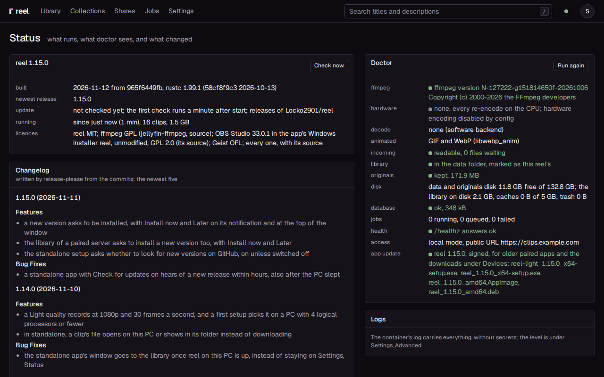
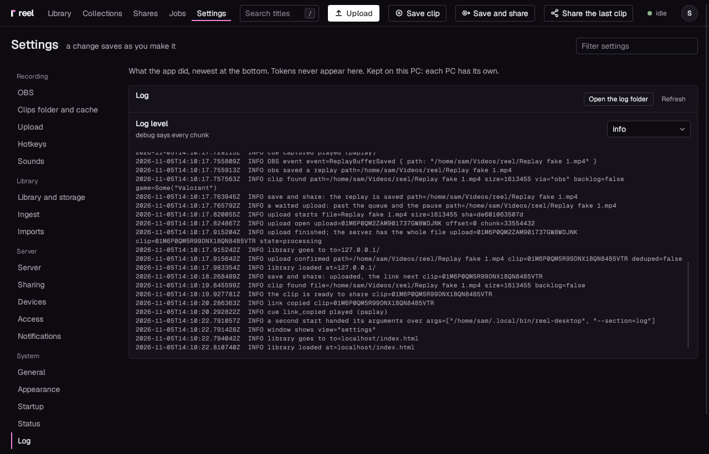

# Troubleshooting

When something does not happen, reel tells you why in plain words. Start
with the places below, then find your problem further down: each section
says what the message means and what to do.

## Where to look first

- **The status chip** at the top of the app's window: a dot and a word
  for the app (**idle**, **uploading**, **paused**, **not paired**,
  **cannot reach the server**, **error**). Click it for a line each about
  the app, OBS and the server.
- **The app's Status** (Settings, **Status**): the connections,
  one row each for the server, OBS, the clips folder and the hotkeys,
  with a line saying what is wrong; and the queue, with **Retry** on a
  clip that failed.
- **The server's Status page** (the menu under your name, **Status**):
  the version, and the **Doctor** panel with its checks (ffmpeg, the
  hardware route and the decoders, the folders, the disk, the database,
  the jobs, the sign-in, the app's installers), with **Run again**.



## SmartScreen: "Windows protected your PC" { #windows-protected-your-pc }

The installers are not code signed yet, so Windows SmartScreen may stop
the first run of one with "Windows protected your PC".

1. Click **More info**.
2. Click **Run anyway**. The installer starts.

To be sure you have the file the release published, check it first
against the `.sha256` beside it on the release. In PowerShell,
`Get-FileHash .\reel_<version>_x64-setup.exe` prints the file's
SHA256, which must match the one in the `.sha256` file.

## The logs

### The app

Settings, **Log** shows what the app did, newest at the
bottom. Tokens never appear in it. **Open the log folder** opens the
folder with the files, one per day (`reel-desktop.log.` followed by the
date). For a problem that is hard to catch, set **Log level** to **debug,
everything**, make it happen again, then set it back.



=== "Windows"

    The app's log: `%LOCALAPPDATA%\reel\logs`. The settings are in
    `%APPDATA%\reel`. With reel, the package with OBS, OBS's own logs are in
    `%LOCALAPPDATA%\reel\obs\config\obs-studio\logs`, one file per run.
    The installer writes each step of its last install, with its time,
    to `installer.log` in the same logs folder, and the first start after
    an update copies those steps into the app's log ("the update's
    installer: ...").

=== "Linux"

    The app's log: `~/.local/share/reel/logs`. The settings are in
    `~/.config/reel`. Started from a terminal, the app also prints what
    WebKitGTK says there.

Settings, Startup, **About** lists the app's version and both folders.
With your own OBS, OBS's logs are under its **Help**, **Log Files**.

### The server

```
docker compose logs reel
```

prints the container's log: everything the server did, without secrets.
In the site, Settings, **Advanced**, **Logs** shows the last 200 lines
and has **Download the last hour**; **Log level** is set there too.

```
docker exec reel reel doctor
```

prints ffmpeg's version, the hardware route with its test encode and a
line per codec, the folders and whether they can be read, the library
size, the jobs, the sign-in mode, and, while nobody has an account yet,
the setup code. The Status page's **Doctor** panel shows the same. When
no admin can sign in under the sign-in mode in force, `reel doctor` also
says what to run.

## When the app or the PC crashed: Reliability Monitor

Windows keeps a record of every program that stopped working, and of the
PC's own crashes, in its Reliability Monitor.

1. Press Win+R, type `perfmon /rel` and press Enter. (Or: Control Panel,
   **Security and Maintenance**, **Maintenance**, **View reliability
   history**.)
2. The chart has a column per day. A red circle with a cross in the
   **Critical events** row marks a crash: click that day.
3. Below the chart, look for a line with the source
   **reel-desktop.exe** (the app) or **reel-capture.exe** (the OBS that
   came with reel; your own OBS is **obs64.exe**), with the summary
   **Stopped working**, or **Windows was not properly shut down** for the
   PC itself.
4. Double-click the line (or **View technical details**). The details
   name the faulting module and an exception code, with the time.
5. **Copy to clipboard** at the bottom copies all of it. Send that, the
   time it happened and the app's log of that day with your report.

The app starts its own OBS again by itself after a crash, a little later
each time; an OBS that stops answering for 20 seconds is ended first.
After five stops in a row it stops trying and tells you in a
notification: "The OBS that came with reel stopped 5 times in a row, so
reel stopped starting it. Start OBS again is in the tray; Settings, Log
has what OBS said." The app's log then holds the end of OBS's own log and
the start of its crash report, so the log you send names the cause.

## Pairing

**"that code is wrong, used already or past its ten minutes; make a new
one under Settings, Devices"**: a pairing code works once, for ten
minutes. Make a new one on the server (Settings, Devices, **Pair a
device**) and enter it straight away.

**"that is not a pairing code; make one under Settings, Devices"**: the
code has the wrong length. Copy it exactly as the server shows it.

**"http only for localhost; a server on the network needs https"**: the
app talks to a server over HTTPS only, except one on the same PC
(`http://127.0.0.1:...` or `http://localhost:...`). Put the server behind
its reverse proxy and enter the `https://` address, such as
`https://clips.example.com`, with no path after it.

**"the server does not know this device any more; pair again"**: the PC
was revoked on the server (Settings, Devices, **Revoke**). Make a new
code and pair again under Settings, **Server**.

## The app cannot reach the server

The window shows the app's own page with the reason, and the chip says
**cannot reach the server**. The app keeps trying by itself.

| The page says | What it means |
|---|---|
| **No answer from the server** | nothing came back in six seconds: the server or its proxy is down, or this network does not reach it |
| **The server's name is unknown** | the name does not resolve: a typo in the URL, or no DNS on this network |
| **The connection is not trusted** | the certificate is for another name, has expired, or something in between answers with its own |
| **Nothing listens at the server** | the connection was refused: reel is not running there, or the port is wrong |
| **The server is up but not serving** | an answer in the 500s: a proxy with no reel behind it, or reel restarting |

Open the same address in a browser on that PC: what the browser says is
usually the quickest pointer. On the server, `docker compose logs reel`
says whether reel is running.

## A link shows no video in a chat

A chat app that shows link previews (Discord is one; any app that reads
a page's `og:video` tag can be) plays the video only when it can fetch
the share page and its video from the internet, without a sign-in.

1. Open the link in a private browser window, or on a phone on mobile
   data. If it asks for a sign-in, or does not load at all, the proxy
   does not let the share pages through: with a sign-in in front of
   reel, the paths `/s/`, `/c/`, `/assets/` and `/healthz` must pass
   without it ([The server](setup/server.md), step 3).
2. In reel, Settings, **General**, **Public URL** must be the address
   people reach, starting with `https://`. The first run's **Check the
   public URL** says "the public URL answers; the apps that show link
   previews will reach the share pages" when it is right; when it is
   not, "the public URL answered 404 Not Found; check the proxy" (with
   whatever came back) or "the public URL did not answer from here".
3. An expired or broken certificate stops the previews as well: the
   browser on mobile data shows it.

A chat app keeps what it fetched about a link for a while (Discord
does): after a fix, make a new link to see the change at once.

## Uploads fail behind a proxy

- **The proxy refuses big requests.** The app and the browser both send a
  clip in pieces of at most 90 MiB, so the proxy must allow a request of
  about 96 MB on reel's paths (nginx: `client_max_body_size`; see
  [The server](setup/server.md), step 2). That is also why Cloudflare's
  limit of 100 MB a request is no problem.
- **Slow uploads are cut off.** A read timeout of five minutes on the
  proxy keeps a slow piece from being dropped.
- **reel's own limit.** A file over the **Upload size limit** (8 GB by
  default, Settings, **Imports**) is refused, with the reason.

A dropped upload goes on where it stopped: the app resumes by itself; in
the browser, pick the same file again.

## The same clip sent twice

A replay whose file the library has already is not sent again. When the
clip is yours (sent before from another of your PCs, or before this app
was paired again), the app takes that clip and its link as for a new
one. When it is another user's, the upload stops with **"the library has
this file already, as another user's clip"**: reel keeps one clip per
file, and only its owner or an admin shares it. Everyone signed in still
sees it in the library.

## OBS

With your own OBS, Settings, **OBS** has **What reel needs from OBS**,
checked as long as the app runs. Each line says what to do:

- **"nothing answers at 127.0.0.1:4455: start OBS; in OBS, Tools,
  WebSocket Server Settings, tick Enable WebSocket server and check that
  its port is 4455"**: OBS is not running, or its WebSocket server is off,
  or on another port.
- **"OBS refused the password"** or **"OBS asks for a password"**: in
  OBS, Tools, **WebSocket Server Settings**, **Show Connect Info** has the
  password. Copy it into **Password** in the app and press **Test**.
- **The replay buffer, "off in OBS"**: in OBS, Settings, **Output**,
  **Replay Buffer**, tick **Enable Replay Buffer**, then press **Start
  Replay Buffer**; or turn on **Start the replay buffer** in the app and
  reel does both. reel does not change it while OBS records.

With reel's own OBS, the app runs OBS itself. If OBS does not answer,
the setup's steps say so at the top, with **Show the log**, and This
app, **OBS** says so in its first line.

- **"running, hidden, without the highest rights, so games that run as
  administrator are not captured"**: **Capture games that run as
  administrator** is on, but its copy of OBS in Program Files, or the task
  that starts it, is gone (reel light was installed over reel, or reel
  was installed again). Press **Put it in place**, or **Update the
  copy**, under Settings, **OBS**; Windows asks once. reel 1.4.1 and
  earlier did not start OBS at all then: the app's log said "OBS did not
  start: the task for games that run as administrator is missing" again
  and again. On those versions, turn the switch off and on again under
  Settings, **OBS**.
- **"the copy is OBS 32.2.2, and this version of reel brought OBS
  33.0.0"**: an update of reel replaced its own OBS and left the copy for
  games that run as administrator as it was. reel updates the copy itself
  at the first start after an update. If you answered No to Windows'
  question then, or the step failed (the line says why), press **Update
  the copy** under Settings, **OBS**; Windows asks once.

Each time OBS starts, the app's log (`%LOCALAPPDATA%\reel\logs`) has a
line "the bundled OBS started" with `from_copy` and `version`, then
"obs connected" once OBS answers. On Windows, while your own OBS is open,
reel's OBS waits until you close it, so two captures never run at once;
on Linux the two run side by side, each with settings of its own.

## "No replay saved"

When OBS takes a save but writes no file within 20 seconds, the app says
so at once: a notification, and the tray's first line ("no replay saved:
OBS took the save but wrote no replay within 20 s; its log in ... says
why"), until the next replay is saved. OBS's own log says why; for
reel's own OBS the message names its folder (on Linux
`~/.local/share/reel/obs/obs-studio/logs`). A save OBS refused shows
OBS's own words instead.

## Laggy clips

A clip that stutters in every player (the server's page, the app, a
phone), though it is 60 fps, was recorded that way: the game kept the
graphics card at 100 %, so OBS missed frames and repeated the last one
(OBS calls it rendering lag). In one Counter-Strike 2 clip on an
RTX 4090, 42 % of the frames were repeats, down to 12 to 21 new frames a
second. The fixes, the first one first:

1. Limit the game's frame rate below what the card manages, so it is not
   at 100 %: the game's own limit (`fps_max` in Counter-Strike 2) or the
   graphics driver's.
2. On Windows, turn on **Capture games that run as administrator** (This
   app, **OBS**): OBS then runs as administrator, which lets it raise its
   priority on the graphics card ([Games that run as
   administrator](#games-that-run-as-administrator)). With your own OBS,
   run it as administrator.

## Discord turns on its Streamer Mode

Discord turns its Streamer Mode on by itself while it sees OBS running,
by the program's name (`obs64.exe` on Windows, `obs` on Linux), and
reel's OBS runs as long as reel does. That is why the OBS that comes
with reel runs under a name of reel's own, `reel-capture.exe` on Windows
and `reel-capture` on Linux: Discord does not take it for OBS.

Discord still sees your own OBS, OBS from Flathub, and on Linux an `obs`
that is a script rather than the program itself; Settings, **OBS** says
so then. To keep Streamer Mode off, in Discord: **User Settings**,
**Streamer Mode** (in newer versions under **Appearance**), turn off
**Automatically Enable/Disable**. Discord from Flathub never turns it on
by itself: it cannot see other programs.

## A hotkey is refused

**"Ctrl+Alt+S is held by Windows or another app; ..."** (on Linux,
"held by the desktop or another app"): another program, or the system,
has that combination. Pick another one; the field keeps what it had
until then. A program that grabs many keys (a game overlay, a recorder)
is the usual holder.

## Games that run as administrator

Windows does not pass keys pressed in a game that runs as administrator
to a program without those rights, so reel's hotkeys do nothing while
such a game is in front.

- **reel**, with its own OBS: turn on **Capture games that run as administrator**
  (Settings, **OBS**). OBS then runs with those rights and takes the
  **Save a clip** key itself
  ([All in one](setup/all-in-one.md#games-that-run-as-administrator)).
- **reel light**, with your own OBS: run OBS as administrator and use OBS's own **Save
  Replay** key in those games; the app still uploads what OBS saves
  ([Your own OBS](setup/own-obs.md#games-that-run-as-administrator)).

## An update does not install

When an update of the app stops on the way, the reel you had starts
again and says why in a notification ("reel 1.10.1 did not install:
..."), with its window open where it was. **Install** under Settings,
Startup, **Updates** tries again.

- **A file is in use**: another program holds one of reel's files, for
  example a program that has a file of reel's OBS open, and the
  installer cannot replace it. Close that program and press **Install**
  again.
- **You pressed Cancel** at reel's question "reel could not stop what
  runs from its folder": the update stops before it touches anything.
- **The steps and their times** are in `installer.log` in reel's logs
  folder ([The logs](#the-logs)); the line that starts with `stopped:`
  names what stopped it.

## Linux

**Hotkeys do nothing on Linux.** Global hotkeys depend on your desktop,
so they may not work, or may need setting up in the desktop's own
keyboard settings. There you can bind a key to `reel-desktop
--save-and-share` (or `--save`, `--share-last`); the Hotkeys page shows
the exact command for the AppImage
([The desktop app](desktop-app.md#hotkeys)).

**No tray icon.** GNOME shows no tray icons without the AppIndicator
extension. Settings, Status says "this desktop shows no tray icons (on
GNOME the AppIndicator extension adds them); reel runs all the same:
start it again to open its window". Install the extension, or open the
window by starting reel again.

**A blank window, or "Error 71 (Protocol error)" with an NVIDIA card.**
WebKitGTK's DMA-BUF renderer does not work with NVIDIA's driver. The app
turns it off by itself when the NVIDIA driver is loaded
(`WEBKIT_DISABLE_DMABUF_RENDERER=1`, and on Wayland
`__NV_DISABLE_EXPLICIT_SYNC=1`). If the window is still blank, start the
app from a terminal with `WEBKIT_DISABLE_DMABUF_RENDERER=1` set yourself
and see what it prints.

**Videos do not play in the window.** The AppImage carries what the
window plays video and sound with (GStreamer and its plugins); the .deb
uses your system's, `gstreamer1.0-plugins-good`, `gstreamer1.0-libav` and
`gstreamer1.0-gl` among them. When a plugin a clip needs is missing, or
the page stops answering while it plays, the app loads the page again
without video and sound rather than let the window freeze, and its log
says why ("video and sound in the window are off", or "the page stopped
answering"). Links and the clips' pages in a browser play as always.
Install what was missing, then start the app again. The warning "WebKit
wasn't able to find the GL video sink dependencies" means the GL plugin
is missing: the video still plays, with a copy of each frame on the way.
The AppImage carries it; for the .deb it is `gstreamer1.0-gl`. A warning
about WebVTT is about subtitles, and reel's clips have none.

**reel's own OBS keeps stopping.** Settings, **OBS** shows its line
("OBS stopped (exit code 1); starting it again in ..."), and after the
fifth stop in a row the app stops starting it and a notification says
so; **Start OBS again** in the tray tries once more. The app's log has
the end of OBS's own log for each stop. OBS's own log is in reel's
copy of its settings: `~/.local/share/reel/obs/obs-studio/logs`, or for
OBS from Flathub `~/.var/app/com.obsproject.Studio/reel/obs-studio/logs`.
Start your own OBS once to see whether it starts at all. To leave reel's
OBS off, turn off **Run a second OBS of reel's** under Settings,
**OBS**.

**On Wayland the screen stays black in reel's clips.** The desktop asks
which screen to share the first time reel's OBS starts. If that was
refused or never seen (the question can open behind other windows), quit
reel from its tray and start it again: OBS asks again. Allow it to be
remembered, so it does not ask at every start.

**The game alone, Discord alone or the game capture are not offered.**
They need plugins for OBS: the PipeWire audio capture
(obs-pipewire-audio-capture) for a program's sound, obs-vkcapture for a
game's picture. Installed for your user, under
`~/.config/obs-studio/plugins`, or from your distribution or Flathub,
they work in reel's OBS too. Quit reel and start it again after
installing one, and the setup's steps offer them.

**The AppImage does not start.** Make it executable first (its
Properties, or `chmod +x reel_<version>_amd64.AppImage`). On a
distribution older than glibc 2.36 (Ubuntu 22.04, for one) it cannot
run.

## A clip is in the incoming folder's failed folder

A file ffmpeg cannot read moves to `failed/` inside the incoming folder,
with a note beside it (the file's name with `.txt` added) saying why.
Usually the file was cut short (a copy that stopped, a recorder that
crashed). The Jobs page lists the failed job with **Retry**; a file that
is broken stays broken.

## "The library folder is not usable"

The library page shows **library away**, Status turns red, `/healthz`
answers 503 and uploads are refused: the Library folder has no
`.reel-library` file while the database holds clips. The usual reason
is a NAS that is off or a share that is not mounted, which leaves an
empty folder (the line says "is empty, as a disk or a share that is not
mounted leaves it") or none ("is not there"). Mount it again: reel
notices within ten seconds and goes on by itself, the files waiting in
the incoming folder included. Nothing was written to the empty folder
meanwhile. [Fast and bulk
storage](bulk-storage.md#when-the-library-is-not-there) says how to give
reel a folder that really is new.

## "Is not there: is its drive plugged in?"

In standalone, with the library moved to another drive (Settings, This
app, **Server**, **Library folder**), reel on this PC waits for that
drive: it is unplugged, off, or has another letter now. **Save clip**
still saves, and the clips wait in the clips folder. Plug the drive in:
within ten seconds reel on this PC starts by itself, and the waiting
clips go in. If Windows gave the drive another letter, press **Move**
and pick the library's folder at its new place; reel takes it up as it
is.

## The server does not start

The log says why in a sentence. The most common:

- **"auth.mode is proxy but auth.trusted_proxies is empty: name the
  proxy's address (REEL_TRUSTED_PROXIES), nothing is trusted by
  default"**: in proxy mode, set `REEL_TRUSTED_PROXIES` to the proxy's
  exact address, such as `10.0.0.2/32`.
- **"auth.mode is single (no sign-in) but reel listens on 0.0.0.0:8080:
  ..."**: single mode, with no sign-in, works only on a loopback address.
  Use `local` (reel's own accounts) or `proxy` for a server others reach.
- **"open database"**, followed by **"migration ... was previously
  applied but is missing in the resolved migrations"**: a newer reel
  moved the database forward, and an older one runs now. Start the newer
  image again, or restore the backup from before the update
  ([Updating](updating.md#going-back-to-an-older-version)).

In proxy mode, a browser that reaches reel's port directly, past the
proxy, gets a 401 page ("This port is not the front door. Come in through
the proxy."): open the site through the proxy's address instead.

In single mode, reel answers only at its own address: `127.0.0.1`,
`localhost` or `[::1]` with the port it listens on, or the public URL.
Any other name, such as the other end of an SSH tunnel on another port,
gets a 421 page ("That is not reel's address."). Open reel at one of
those, or set the public URL to the address you open it at.

## The setup code is lost

While nobody has an account, the code is in the log of every start, and

```
docker exec reel reel doctor
```

prints it again. Locked out later, with accounts there:

```
docker exec -e REEL_PASSWORD='a new long password' reel reel passwd --make-admin admin
```

sets that user's password (twelve characters at least) and signs them
out everywhere. With `--make-admin`, a user of that name that does not
exist yet is made, as an admin.

## Someone is a new, empty user after a change of the sign-in mode

Under a new sign-in mode, reel finds people another way (by the proxy's
name, or by their account at the identity provider), and someone it
cannot match gets a new user. Their clips are still with their old one.
[Switching the sign-in method](switching-sign-in.md) has what to do for
each mode, and how to undo a user made by mistake.

## Asking for help

Include the app's version (Settings, Startup, **About**) and the
server's (the Status page), what you did and what you saw, the app's log
of that day, and for a crash on Windows the Reliability Monitor's
details. Logs never hold tokens or passwords, but they do hold your
clips' titles and your server's address: look them over before you post
them anywhere public.

Updating, backing up and removing reel each have a page of their own:
[Updating](updating.md), [Backing up](backup.md) and
[Uninstalling](uninstalling.md).
