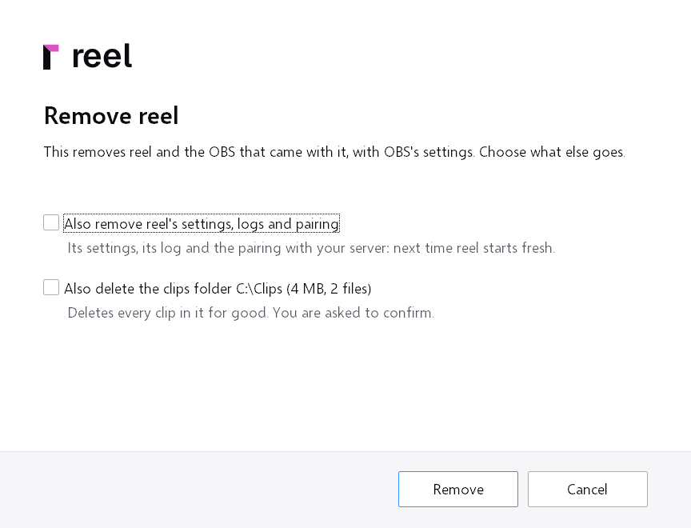
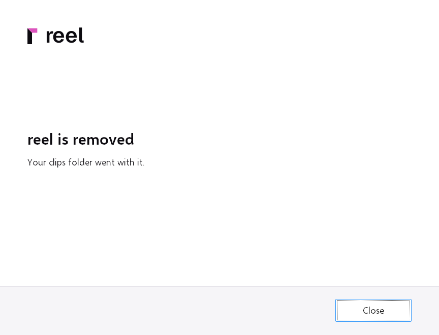

# Uninstalling

Removing reel takes a minute, and your clips stay where they are unless
you choose otherwise. This page covers the app on Windows and on Linux,
and the server.

!!! tip "Keep your clips first"
    To take clips with you, pick them in the library (**Select**, then
    **Ctrl+A** for every clip shown) and press **Download** in the bar:
    one zip, with a folder per clip named by its title
    ([Several clips at once](sharing.md#several-clips-at-once)). Or back
    up the whole library ([Backing up](backup.md)).

## Windows

1. Start the uninstaller, either way:
    - Windows Settings, **Apps**, find **reel**, then **Uninstall**.
    - In the app, Settings, **Startup**, **About**, **Uninstall reel...**.
      It starts the same uninstaller and quits the app.
2. The page **Remove reel** says what goes in any case: reel, and with
   reel (the package with OBS) the OBS that came with it, OBS's settings
   included. reel light has no OBS of its own to remove. The
   shortcuts and the start at logon go with them.

    

3. Choose what else goes. Both boxes start off:
    - **Also remove reel's settings, logs and pairing**: the app's
      settings (`%APPDATA%\reel`), its logs, the list of clips it sent,
      the pairing token in the Windows Credential Manager and the
      window's web data. Leave it off and a later install starts paired
      and set up as before.
    - **Also delete the clips folder**, with the folder's path and size
      on the box: the folder where OBS saved your replays, and every clip
      in it, for good. reel asks once more when you tick it. Clips
      already on your server stay there.
4. Press **Remove**. Windows asks for administrator rights for what only
   an administrator may remove: the firewall rule that reel added for
   its OBS, and, if **Capture games that run as
   administrator** was on, the copy of OBS in Program Files and its
   task.
5. The last page says **reel is removed**, and that your clips are still
   where they were, or that your clips folder went with it. Press
   **Close**.

    

The clips folder is never offered for deletion when it is a whole drive,
a folder on the network, a link, one of the folders of Windows or of your
profile (Windows, Program Files, your user folder, Videos, Documents,
Desktop and the like), or a folder that holds one of them or reel
itself. The page then says the folder is kept, and why.

A standalone library stays in any case, in
`%LOCALAPPDATA%\reel\library` or in the folder you moved it to (This
app, **Server**, **Library folder** says which). To remove it too,
delete `%LOCALAPPDATA%\reel` after the uninstall, and that folder.

An uninstall without its page (`uninstall.exe /S`) keeps your settings
and the clips folder.

## Linux

=== "The AppImage"

    1. Turn off **Start at logon** (Settings, **Startup**), so nothing
       tries to start reel at your next login.
    2. Quit reel from its tray icon.
    3. Delete the AppImage file.

=== "The .deb"

    1. Turn off **Start at logon** (Settings, **Startup**).
    2. Quit reel from its tray icon.
    3. Remove the package:

        ```
        sudo apt remove reel
        ```

Your folders stay, for a later install:

| Folder | What is in it |
|---|---|
| `~/.config/reel` | the settings and the pairing token |
| `~/.local/share/reel` | the logs, the list of clips sent, the settings of reel's own OBS, and a standalone library |
| `~/.var/app/com.obsproject.Studio/reel` | the settings of reel's own OBS, with OBS from Flathub |
| `~/.local/share/applications/dev.lockoo.reel.desktop` | a hidden desktop entry the desktop's shortcuts know reel by |

Delete them for nothing to be left. Your clips folder stays either way.

## The server

1. In the folder with your `docker-compose.yml`, stop and remove the
   container:

    ```
    docker compose down
    ```

    reel stops at once, and every share link stops working with it.
2. Remove its image:

    ```
    docker image rm ghcr.io/locko2901/reel:latest
    ```

    With another tag in your compose file, name that one.
3. The folders stay until you delete them: `./data` (the database and,
   by default, the library), `./originals` and `./incoming`, and a
   Library folder elsewhere if you set one. reel writes them as user
   1000, so delete them with `sudo`:

    ```
    sudo rm -r ./data ./originals ./incoming
    ```

4. Take away what you put in front of reel: its site in your reverse
   proxy, and its DNS name if nothing else uses it. With
   [Link previews from external storage](storage.md) on, delete the
   previews under `reel/` in your bucket, or the bucket itself: reel
   leaves them there.

Each paired app then says **cannot reach the server**. Uninstall it as
above, or switch it to standalone, so new clips go into a library on its
PC: Settings, **Server**, **Mode**: **standalone**.
