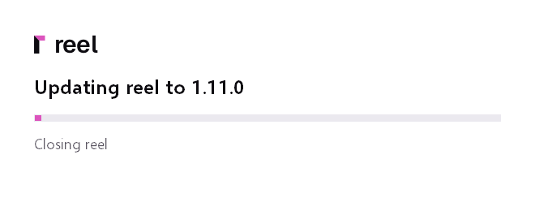

# Updating

A new reel is one pull on the server, and the apps paired with it are
offered the same version by themselves. A standalone app installs the
newest release when you ask it to. This page covers updating the
server, choosing which versions it follows, going back, and the desktop
app.

## Update the server

1. Take a backup first ([Backing up](backup.md)). An update can move the
   database forward, and the backup is your way back.
2. In the folder with your `docker-compose.yml`, pull the new image and
   start reel again from it:

    ```
    docker compose pull
    docker compose up -d
    ```

    Your folders, your settings and your links stay as they are.
3. reel brings its database up to date by itself at start. There is
   nothing to run.
4. Open the Status page (the menu under your name, **Status**). Its top
   panel names the version that runs, such as **reel 1.9.1**, and its
   **update** line says "you run the newest, 1.9.1".

## Know when a release is out

The server asks GitHub for the newest release a minute after it starts,
then once a day. When one is out, the Status page says so on its
**update** line ("1.9.2 is out since 2026-11-10; you run 1.9.1") with a
link to the release notes, and **Check now** asks again at once (an
admin's button, there while **Check for updates** is on under Settings,
**Advanced**; switched off, reel asks GitHub nothing).

- To be told without looking, set up ntfy or a webhook under Settings,
  **Notifications** and turn on the event **an update is available**
  there.
- To stop the daily check, turn off **Check for updates** under
  Settings, **Advanced**. The check asks GitHub for the repository's
  newest release, nothing else.

## Choose which versions you follow

The image's tag in `docker-compose.yml` decides what
`docker compose pull` brings. Every release is published under four
tags:

| Tag | What it follows |
|---|---|
| `latest` | every release (the example compose file uses it) |
| `1` | every release of reel 1, never a 2 |
| `1.9` | the fixes of reel 1.9 only |
| `1.9.1` | exactly that release, nothing else |

For example, to stay on reel 1.9 and take its fixes:

```yaml
    image: ghcr.io/locko2901/reel:1.9
```

The tag `dev` is every change on the main branch as it lands, before a
release: it is for trying what is next, not for a server you rely on.

## Going back to an older version

Each update can move the database forward, and an older reel refuses a
database moved past it: it does not start, and its log says "migration
... was previously applied but is missing in the resolved migrations".
To go back:

1. Stop reel: `docker compose down`.
2. Restore the database from the backup you took before the update
   ([Restore a server](backup.md#restore-a-server)).
3. Set `image:` to the older version, such as
   `ghcr.io/locko2901/reel:1.9.0`.
4. Start it: `docker compose up -d`.

Clips, links and settings made since that backup are not in it, so keep
the backup from before an update until the new version has run a while.

## The desktop app

### Paired with a server

The server offers each paired app the app of its own version, so
updating the server is what updates the apps. The app asks its server
45 seconds after it starts and then every six hours, and **Check now**
under Settings, Startup, **Updates** asks at once. Every installer is
signed with reel's release key, and the app checks the signature before
it installs anything. The signature also names the installer's version,
and the app installs it only as that version and only when it is newer
than its own, so no server can pass an older installer off as a newer
one.

By default the app asks first: a notification says "reel 1.10.1 is
ready to install" with **Install now** and **Later**, and while the
window is open the same question sits at the top of its pages (the app's
own, and standalone also the library). **Later** asks again a day later,
or at the next start; **Check now** asks at once. **Install reel
1.10.1** also appears in the tray menu and under Settings, Startup,
**Updates**, which says what Install does before you press it. The app
never opens or raises its window to ask. On Windows, reel closes, a small window shows the installer's
progress, and reel opens again by itself about a minute later (half a
minute for reel light), back on the page it showed and with a
line of what is new. The AppImage takes a few seconds. **New versions**
in the same panel can instead install it when you quit the app, or
leave it to **Check now**.



If an update does not install, the reel you had starts again and says
why, and **Install** tries again. [The desktop app](desktop-app.md#updates)
has every step.

The `.deb` never updates itself, since installing a package needs root.
Download the next one from your server (Settings, **Devices**) and
install it the same way as the first:

```
sudo apt install ./reel_<version>_amd64.deb
```

On the server, Settings, **Devices**, **Offer app updates** (on by
default) decides whether paired apps are offered updates at all.

### Standalone

With no server, the app takes its updates from reel's releases on
GitHub, and it asks only when you ask:

- **Check now** under Settings, Startup, **Updates** asks for the newest
  release when you press it.
- Settings, **Advanced**, **Check for updates** (off in standalone until
  you turn it on) asks a minute after the start, then once a day. While
  **New versions** is not off, the app asks again whenever the last
  answer is six hours old by the clock, so a new version reaches it
  within hours, also on a PC that sleeps at night.

When a newer reel is out, the update goes as it does for a paired app:
the app takes the installer of its own package from the release (reel
for reel, reel light for reel light, the AppImage for the AppImage),
checks its signature against the key built into it, and **Install**
puts it in place. **New versions** in the same panel decides what a
newer release found by **Check for updates** does; **Check now** offers one
either way. Until the release job has put the installers on a new
release, the panel says the release has none for this app yet.

A standalone app of 1.11 or earlier cannot install an update by itself:
its Updates panel says the new version is out and points at the
releases page. Install that release by hand once, the same way as the
first; from then on the app installs its updates itself.

- **Windows**: download the installer of the package you have from the
  [releases page](https://github.com/Locko2901/reel/releases) (**Open
  the releases** under Updates opens it), **reel** over reel, **reel
  light** over reel light (Settings, Startup, **Versions** names it),
  and run it. Its page says **Update reel** or **Update reel light** and
  names the version on this PC; press **Update**. It closes reel first,
  and your settings and your library stay.
- **AppImage**: quit reel and replace the file with the new one.

The `.deb` never updates itself: download the next one from the releases
page and install it with `sudo apt install ./reel_<version>_amd64.deb`.
